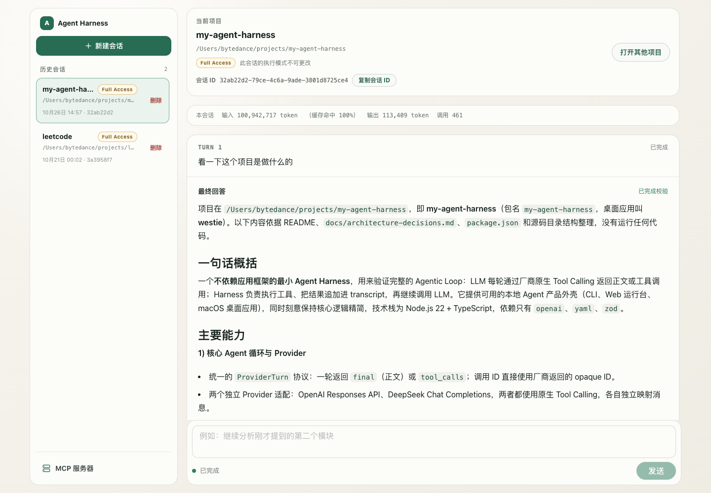

# my-agent-harness

一个不依赖应用框架的最小 Agent Harness，使用模型原生 Tool Calling 执行工具并继续对话。支持 CLI、Web 运行台和 macOS 桌面客户端。



## 环境要求

- macOS，以及用于构建进程收容 helper 的 Command Line Tools
- Node.js 22.23 或更高版本、npm 10 或更高版本
- DeepSeek 或 OpenAI API Key、Tavily API Key

## 安装

在仓库根目录执行：

```bash
npm ci
```

更新依赖时，在仓库根目录执行：

```bash
npx --yes npm@11.21.1 update
```

该命令更新根项目和 Web 的依赖及锁文件。npm 10.9.8 在解析部分依赖时会报 `edgesOut` 错误，因此更新依赖时使用 npm 11；日常按锁文件安装仍可使用 npm 10 的 `npm ci`。

## 启动

### macOS 桌面客户端

```bash
npm run desktop:dev
```

命令会构建当前代码、准备运行环境并打开窗口。首次启动时，按提示打开配置目录，在其中的 `.env` 填写模型和 API Key，重新启动应用。桌面版使用 `~/Library/Application Support/westie` 下的独立配置和数据，不读取仓库根目录的 `.env`。

打包、安装及配置说明见 [macOS 桌面版](./docs/macos-desktop.md)。

### Web 运行台

先创建并编辑仓库根目录的配置文件，填写模型和 Tavily API Key：

```bash
cp .env.example .env
npm run build
npm run start:server
```

打开 `http://127.0.0.1:3000`。前端开发时，在一个终端启动服务，在另一个终端启动 Vite：

```bash
# 终端 1
npm run build:server
npm run start:server

# 终端 2
npm run dev:web
```

Vite 会将 `/v1` 代理到本地服务。会话、HTTP 接口与诊断命令见 [Web 服务与会话](./docs/web-runtime.md)。

### CLI

CLI 使用仓库根目录的 `.env`，以启动时的当前目录作为 workspace。配置好 `.env` 后执行：

```bash
npm run build
npm start -- "上海现在几点？"
```

## 模型配置

| Provider | `LLM_PROVIDER` | 必需环境变量 |
| --- | --- | --- |
| DeepSeek | `deepseek` | `DEEPSEEK_API_KEY`、`DEEPSEEK_MODEL` |
| OpenAI | `openai` | `OPENAI_API_KEY`、`OPENAI_MODEL` |

省略 `LLM_PROVIDER` 时默认使用 OpenAI。其他配置项及示例见 [.env.example](./.env.example)，模型调用的超时与重试规则见 [运行边界](./docs/runtime-boundaries.md)。

## 开发与验证

```bash
npm run check           # 类型检查
npm run build           # 构建服务和前端
npm test                # 服务和前端测试
npm run test:e2e        # 构建并运行浏览器测试
npm run test:desktop    # 桌面进程测试
npm run desktop:pack    # 生成 arm64 .app 和 .dmg
```

浏览器测试首次运行前执行 `npx playwright install chromium`；CI 环境也需安装浏览器。测试使用临时数据库、工作目录和本地模拟模型响应；失败时截图和 trace 保存在 `test-results/`。可以用 `npm run test:e2e -- --grep "名称"` 选择用例。测试需要启动浏览器并访问本地端口；Harness 的 Workspace Sandbox 禁止本地端口监听，使用 Harness 的 Full Access 模式运行。

## 文档

- [工具与 MCP 配置](./docs/tools-and-mcp.md)：内置工具、执行模式、MCP Server 和设置面板。
- [项目记忆](./docs/project-memory.md)：同一仓库跨 worktree 共享的 Markdown 记忆、目录位置、工具和限制。
- [Stop Hook](./docs/stop-hook.md)：项目完成检查的配置、输入输出与执行规则。
- [Web 服务与会话](./docs/web-runtime.md)：HTTP 接口、持久化、会话诊断和前端开发。
- [Agent 运行机制](./docs/agent-runtime.md)：运行限制、模型协议、上下文和代码结构。
- [macOS 桌面版](./docs/macos-desktop.md)：打包、用户目录、配置和生命周期。
- [全部文档](./docs/README.md)：运行边界、SSE 协议和架构决策等。
