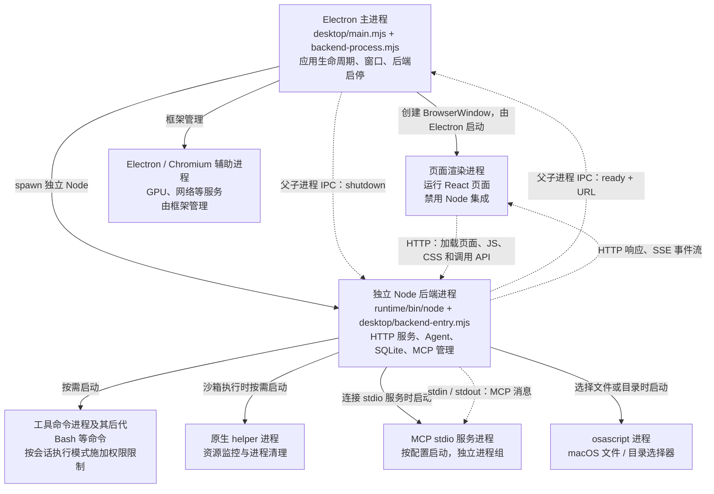

# macOS 桌面版技术方案

状态：待实施。事实基线：`edb996c`。首期交付自用 macOS 应用，保留现有 Web 运行方式。

采用 Electron 窗口和随应用分发的独立 Node 后端。窗口加载本地 HTTP 服务，继续使用现有页面、API 和 SSE。首期在 Apple Silicon 上构建并验证 arm64 安装包；Intel 构建需在对应架构验证后提供。自动更新、对外分发的 Developer ID 签名与公证、Windows/Linux 支持不进入首期。

实施预计修改 5 个现有文件、新增 7 个文件，见第 4 节；依赖锁文件由安装命令生成。本文包含建议 diff，尚未实施。数据库、Agent 业务流程及 Web 页面保持现有结构。

## 1. 当前实现

| 位置 | 当前行为 |
| --- | --- |
| `package.json` | `build` 构建后端、原生 helper 与 Web；`start:server` 使用系统 Node 和仓库 `.env` 启动 `dist/src/server-main.js`。Node 要求为 ≥22.23.0。 |
| `src/server-main.ts` | 调用 `startAgentServer()`。 |
| `src/server-bootstrap.ts` | 装配 SQLite、Provider、RunRegistry、MCP 和 HTTP 服务；使用 `process.cwd()`，静态目录为 `web/dist`；函数返回 `Promise<void>`，内部注册 SIGINT/SIGTERM。 |
| `src/server-config.ts` | 默认绑定 `127.0.0.1:3000`；数据库默认位于工作目录下 `.data/agent-harness.sqlite`，支持绝对路径；配置端口仅接受 1–65535。 |
| `src/http/static-files.ts` | 根据静态目录提供页面和资源；控制器支持 SPA 路由回退。前端和 API 可使用同一 Origin。 |
| `src/infrastructure/host-file-picker.ts` | 通过 `/usr/bin/osascript` 打开 macOS 文件和目录选择器。 |
| `scripts/build-native.mjs` | 使用 `xcrun clang` 生成 `dist/native/process-containment-helper`。 |
| `src/sandbox/darwin-process-containment.ts` | 相对于编译后的模块位置解析 `../../native/process-containment-helper`。 |
| `src/mcp/stdio-transport.ts` | 启动独立进程组；继承 PATH、HOME、LANG、TMPDIR 和 MCP 配置中的 env；关闭时有分级终止逻辑。 |

实际执行链路为：页面请求 → HTTP Controller → Conversation 服务 → Workspace Runtime → Seatbelt → 原生 helper → 工具命令。MCP stdio 由 MCP pool 单独启动，沿用当前宿主执行边界。

现有退出路径停止接收 HTTP 请求，最多等待 10 秒取消 Run，再关闭连接、数据库和 MCP。MCP 关闭目前以异步调用发起，宿主没有可等待的统一关闭结果。重启时已调用 `recoverStaleRuns()` 恢复未完成记录。

## 2. 存在的问题

以下是桌面宿主接入需要补齐的条件；当前 Web 运行方式仍按原设计使用。

1. 用户双击应用时，需要由应用创建后端进程并等待服务就绪。当前入口只打印监听日志，没有提供可供宿主使用的就绪结果。
2. 打包资源属于应用安装目录。当前默认数据库相对 cwd 解析，因此桌面启动必须传入可写目录中的绝对数据库路径。
3. 现有 `.env` 和系统 Node 来自开发环境。安装包需要携带后端运行时，配置应位于用户目录。
4. 关闭桌面应用需要等待后端清理完成。当前装配函数没有关闭句柄，Electron 无法确认业务清理结果。
5. 文件选择器、Seatbelt、helper 和 MCP 都会启动本机进程。安装包需要保持资源布局、执行权限和命令查找路径，并通过 Finder 启动验收。

## 3. 目标实现

### 3.1 一次启动与退出

最小示例：

```text
双击 westie.app
→ Electron 获取单实例锁并读取用户配置
→ 启动应用内的 Node，监听 127.0.0.1:0
→ 操作系统分配端口，例如 49152
→ 后端通过父子进程 IPC 发送 { type: "ready", url: "http://127.0.0.1:49152" }
→ Electron 窗口加载该 URL
→ 用户选择工作区并对话，继续走 HTTP/SSE
→ 关闭最后一个窗口或按 Cmd+Q
→ Electron 发送 { type: "shutdown" }
→ 后端取消运行、关闭连接和存储、等待 MCP 关闭，然后退出
→ Electron 收到后端退出事件，完成应用退出
```

主进程通过 `spawn(nodePath, [entryPath], { cwd, env, stdio: ["ignore", "pipe", "pipe", "ipc"] })` 创建后端。IPC 是 Electron 主进程与 Node 子进程之间的消息通道，仅承载就绪和退出协调。页面继续调用 HTTP API，不增加 preload 或页面 IPC API。

主进程职责为应用生命周期、窗口和错误提示；后端进程继续独立承载所有业务和 SQLite。Electron 主进程不运行 Agent，也不打开数据库。

#### 进程关系

以下以一个 westie 窗口为例。实线表示创建或管理进程，虚线表示应用通信；后端下方的进程按操作需要启动，数量随任务变化。



- `BrowserWindow` 对象由主进程管理，页面 JavaScript 在渲染进程执行。主进程通过 `loadURL()` 指定后端地址，页面向该地址请求资源和业务数据。
- Agent 循环和 SQLite 操作在 Node 后端进程内执行；SQLite 数据库保存为文件。HTTP MCP 连接已有服务，桌面应用仅为 stdio MCP 创建本地服务进程。
- 正常退出时，主进程先通过 IPC 请求后端清理 Run、工具进程、MCP 和数据库，等待后端退出后再结束应用。强制终止时的清理边界见 3.5 节。

Electron 渲染进程和辅助进程的职责参考[官方进程模型](https://www.electronjs.org/docs/latest/tutorial/process-model)及[进程沙箱说明](https://www.electronjs.org/docs/latest/tutorial/sandbox)。图中合并展示辅助进程，其实际数量由 Electron / Chromium 运行状态决定。

### 3.2 后端宿主接口

调用示例先于类型定义：

```ts
const running = await startAgentServer({ port: 0 });
// running.url === "http://127.0.0.1:49152"
await running.close();
```

建议新增接口：

```ts
interface RunningAgentServer {
  readonly url: string;
  close(): Promise<void>;
}
```

`StartAgentServerOptions` 增加可选 `port`，允许 0–65535；0 表示交由操作系统分配端口。缺省仍使用现有配置端口，`server-config.ts` 的环境变量校验规则保持不变。实际 URL 由监听成功后的 `server.address()` 生成。

`close()` 幂等，多次调用返回同一个关闭 Promise。复用现有取消 Run 的 10 秒上限、连接关闭和数据库关闭逻辑，等待 MCP pool 关闭完成后 resolve；失败向宿主返回错误。SIGINT/SIGTERM 的注册移到 `server-main.ts`。桌面入口处理 IPC shutdown、父通道断开和退出信号，统一调用 `close()`；关闭成功后断开 IPC，结束进程。

这使 Web 命令入口与桌面入口共用同一装配和关闭逻辑，分别管理自己的进程事件。

### 3.3 安装包布局

后端使用独立 Node 可执行文件。构建时固定一个通过项目测试、满足 Node ≥22.23.0 的具体版本与下载校验值，随目标架构打包；版本和校验值记录在准备脚本中。这样后端版本由项目直接控制，升级 Electron 时无需同时更换后端 Node。

```text
westie.app/Contents/Resources/
  app.asar                         Electron 主进程代码
  runtime/
    package.json                   保留 type: module
    .env.example                   不含密钥的配置模板
    bin/node                       对应目标架构的独立 Node
    desktop/backend-entry.mjs       后端桌面宿主入口
    dist/src/                      编译后的后端代码
    dist/native/process-containment-helper
    web/dist/                      构建后的页面
    node_modules/                  后端生产依赖
```

使用 electron-builder 的 `extraResources` 放置 runtime，使原生可执行文件和独立 Node 可读取的 JS 位于普通文件系统中。保持 `dist/src` 与 `dist/native` 的现有相对布局。启动命令使用 `runtime/bin/node` 的绝对路径，`cwd` 固定为 runtime 根目录，因而现有 `web/dist` 路径可以直接工作。

准备脚本在独立 staging 目录通过锁文件安装生产依赖，复制明确列出的产物。包内不包含仓库 `.env`、`.data`、测试产物、服务日志和用户工作区。Node、helper 和 Electron 的架构必须一致。用户机器运行应用不需要安装 Node 或 clang；用户工具和 MCP 自身依赖仍按其配置安装。

### 3.4 数据与配置

应用名固定为 `westie`，目录从 Electron `app.getPath('userData')` 获取。典型布局：

```text
~/Library/Application Support/westie/
  .env
  agent-harness.sqlite
  agent-harness.sqlite-wal          SQLite 按运行状态生成
  agent-harness.sqlite-shm          SQLite 按运行状态生成
  logs/backend.log
```

首次启动时复制不含真实密钥的 `.env.example` 为用户 `.env`，文件权限设为 0600，通过原生对话框提供“打开配置目录”和“退出”。用户填写 Provider、API Key、模型容量等现有字段后重新启动。后续通过应用菜单“打开配置目录”编辑，重启后生效；首期不增加配置页面或热更新。

主进程读取该文件，通过 `node:util.parseEnv` 解析，并将结果作为子进程环境。实施时固定 Electron 版本，并验证其内置 Node 提供该 API。变量优先级为：继承环境 → 用户 `.env` → 桌面宿主固定值。宿主固定 `HOST=127.0.0.1`、供现有配置校验使用的 `PORT=3000` 和绝对 `AGENT_DATABASE_PATH`，在环境合并后显式删除 `CORS_ALLOW_ORIGIN`；端口由 `startAgentServer({ port: 0 })` 指定。构造子进程环境时忽略用户配置和继承环境中的 HOST、PORT、AGENT_DATABASE_PATH、CORS_ALLOW_ORIGIN，再写入上述固定值；首次生成的桌面模板应去掉这四项。

PATH 由用户配置或继承环境中的条目，加上 `/opt/homebrew/bin:/usr/local/bin:/usr/bin:/bin:/usr/sbin:/sbin` 去重组成。保留真实 HOME、TMPDIR。应用内 Node 仅用绝对路径启动后端，不替换用户工具链的 node。通过 nvm 等安装的命令在 `.env` 配置其 bin 目录，或在 MCP 配置使用绝对命令路径；首期不执行用户 shell 初始化文件。

日志写入用户 logs 目录，记录后端 stdout/stderr；每次启动截断旧日志，单次运行最多记录 10 MiB，达到上限后停止写入但继续排空子进程输出。启动错误窗口只显示简短错误和日志路径。宿主不打印完整环境或密钥，日志沿用后端已有内容，不宣称其完全无敏感数据。

桌面版使用独立数据库，现有 Web 数据库保留。无数据库 schema 变更：表、物理列、主外键、CHECK/UNIQUE 约束和索引均保持不变；不引入数据迁移。

### 3.5 生命周期与错误处理

- 在启动后端前获取 Electron 单实例锁。重复启动聚焦已有窗口，不创建第二个后端。
- 后端入口监听父 IPC 通道，监听成功后发送唯一 ready 消息。主进程校验 URL 为 `http://127.0.0.1:<有效端口>`，仅接受所启动子进程的消息。
- 启动最多等待 30 秒。spawn 失败、配置错误、超时或就绪前退出均显示原生错误对话框并清理子进程。
- 后端运行中异常退出时关闭失效业务窗口，显示错误并结束应用；首期由用户重新启动，不自动重试正在执行的任务。
- 正常退出先发送 shutdown，最多等待 20 秒；超时强制终止后端并记录异常退出。已有 Run 恢复逻辑在下次启动生效。
- Electron 意外退出导致父 IPC 断开时，后端主动执行相同清理。后端被 SIGKILL 或失去调度能力时，无法保证 detached MCP 及外部工具都被清理；首期保留这一边界，不将强杀描述为完整清理。
- macOS 首期关闭最后一个窗口即退出应用与后端；不保留托盘或后台常驻模式。

### 3.6 页面与执行边界

窗口使用 `nodeIntegration: false`、`contextIsolation: true`、`sandbox: true`，保持 `webSecurity` 开启。只允许导航到本次后端 Origin；其他页面的窗口创建被阻止。用户点击外部 HTTP/HTTPS 链接时校验协议后交由系统浏览器打开，其他协议拒绝。

本地 HTTP 仍绑定 loopback，现有 Origin 检查和工具审批继续生效。随机端口用于避免冲突，不承担身份认证。首期保持现有本机用户信任边界，不新增账号系统或声称隔离同机恶意进程。

文件与目录选择继续使用后端 osascript。工作区来自用户选择的 canonical path，与后端启动 cwd 分开。Seatbelt 权限、Full Access、MCP 执行方式不变。

## 4. 具体改动

### 4.1 文件清单

修改 5 个现有文件：

| 文件 | 改动 |
| --- | --- |
| `src/server-bootstrap.ts` | 增加可选监听端口、返回实际 URL 和可等待的幂等 close；将进程信号归还入口管理。 |
| `src/server-main.ts` | 注册 SIGINT/SIGTERM 并等待 close，保留 Web 启动入口。 |
| `package.json` | 增加 Electron 入口、开发/打包/桌面测试脚本，以及 Electron、electron-builder 开发依赖。 |
| `package-lock.json` | 由依赖安装同步生成。 |
| `README.md` | 记录桌面构建、首次配置、目录、PATH 与平台范围。 |

新增 7 个文件：

| 文件 | 单一职责 |
| --- | --- |
| `desktop/main.mjs` | Electron 应用、窗口、单实例、配置入口和错误提示。 |
| `desktop/backend-process.mjs` | 启动后端、环境与路径准备、日志、ready/exit 和退出等待。 |
| `desktop/backend-entry.mjs` | 在独立 Node 中调用后端装配，处理父 IPC、信号与关闭。 |
| `electron-builder.yml` | 应用身份、打包文件白名单、extraResources 和 macOS arm64 产物。 |
| `scripts/prepare-desktop.mjs` | 在 staging 目录准备固定版本 Node、生产依赖和 runtime 资源。 |
| `test/server-lifecycle.test.ts` | 验证实际监听地址及重复关闭、运行中取消与资源释放。 |
| `desktop/backend-process.test.mjs` | 使用可控子进程验证 ready、早退、超时、父通道断开与退出协调。 |

桌面模块采用原生 ESM，沿用现有后端 TypeScript 编译范围；不增加第二套后端编译配置。新增脚本契约为 `desktop:dev`（构建并运行桌面）、`desktop:pack`（构建并生成当前支持架构的安装包）、`test:desktop`（运行桌面进程测试）。首次开发优先加载构建后的同源页面，保留原有 Vite 命令供 Web 开发使用。

### 4.2 关键接口 diff

以下为基于当前原文的审阅片段，展示接口边界；具体关闭实现按 3.2 节落地，片段不可单独作为完整补丁应用。

`src/server-bootstrap.ts`：为桌面宿主提供监听端口和关闭结果。

```diff
 export interface StartAgentServerOptions {
   /** 建会话时的目录来源；缺省弹 macOS 原生选择器。 */
   readonly hostDirectoryPicker?: HostDirectoryPicker;
+  readonly port?: number;
 }
+
+export interface RunningAgentServer {
+  readonly url: string;
+  close(): Promise<void>;
+}

 /** 装配并启动 HTTP 服务；进程入口与其他宿主脚本共用这一份装配。 */
 export async function startAgentServer(
   options: StartAgentServerOptions = {},
-): Promise<void> {
+): Promise<RunningAgentServer> {
```

`src/server-main.ts`：由命令入口拥有信号处理。

```diff
 import { startAgentServer } from "./server-bootstrap.js";

-await startAgentServer();
+const server = await startAgentServer();
+const shutdown = (): void => {
+  void server.close().catch((error: unknown) => {
+    console.error("Agent server shutdown failed.", error);
+    process.exitCode = 1;
+  });
+};
+process.once("SIGINT", shutdown);
+process.once("SIGTERM", shutdown);
```

关闭逻辑从 bootstrap 内的 signal 回调提取到其返回句柄；bootstrap 不再注册信号。端口缺省和 Web 配置解析维持当前行为。

### 4.3 本地启动与开发

当前仓库已提供 Web 开发命令。`desktop:dev`、`desktop:pack` 和 `test:desktop` 为本方案待新增脚本，实施前不可直接运行。

#### 环境与依赖

开发机需要 Node ≥22.23.0、npm ≥10 和 macOS Command Line Tools。首次准备依赖：

```bash
npm install
npm --prefix web install
```

Web 开发使用仓库根目录 `.env`；文件不存在时从 `.env.example` 复制，并填写模型、容量和所需工具凭据，已有配置保留。桌面开发使用第 3.4 节的 westie 用户目录配置，首次启动按提示填写；不自动复制仓库密钥。首期桌面开发与安装版使用相同的 westie 用户数据目录和应用身份，运行桌面开发前退出已安装的 westie。

#### 桌面开发

实施后，在仓库根目录执行：

```bash
npm run desktop:dev
```

脚本顺序为：构建后端和原生 helper → 构建 Web → 在 staging 目录准备 runtime → 启动 Electron。Electron 使用 staging 中的独立 Node 启动后端，等待 ready 后加载本地 URL。开发模式从 staging 解析 runtime 路径，安装版从 `process.resourcesPath` 解析；其余启动、配置和关闭流程共用。

无需先生成或安装 `.app`，也无需手动执行 `start:server`。桌面后端仍由操作系统分配端口。前端加载 `web/dist` 构建产物，首期不包含桌面内热更新；修改前端、后端或 Electron 代码后，退出桌面应用，再执行 `npm run desktop:dev` 重新构建和启动。

#### Web 页面开发

现有命令可用于日常页面开发。在两个终端分别执行：

```bash
# 终端 1：构建并启动后端
npm run build:server
npm run start:server
```

```bash
# 终端 2：启动 Vite
npm run dev:web
```

浏览器打开 Vite 在终端打印的地址。当前 `web/vite.config.ts` 将 `/v1` 代理到 `http://localhost:3000`，后端配置使用 3000 端口。前端代码由 Vite 热更新；修改后端代码后，在终端 1 停止服务，重新执行构建和启动命令。Vite 配置或环境文件的修改按需重启对应服务。

Web 开发默认使用仓库 `.data/agent-harness.sqlite`，桌面开发使用 westie 用户目录中的数据库；两种方式的会话历史分别保存。通过桌面运行验证窗口、菜单、进程启停和实际打包资源行为。

#### 桌面热更新的后续扩展

如后续加入桌面热更新，开发入口需要启动 Vite，并让 Electron 窗口加载 Vite 地址；Vite 的 `/v1` 代理目标使用本次后端 ready 消息返回的地址。该流程需要协调 Vite 与后端的就绪和退出，不可直接使用当前固定 3000 端口的代理连接随机端口后端。安装版继续加载 Node 托管的构建页面。此扩展不纳入首期文件改动清单。

## 5. 保持不变

- React 页面、路由、HTTP API、SSE 事件与重连协议。
- Agent 循环、异步子 Agent、工具审批、Provider 适配。
- SQLite schema、历史会话格式与运行恢复逻辑。
- Workspace 指令、Skills、用户级和工作区级 MCP 配置位置。
- Seatbelt、原生 helper 的职责与 MCP stdio 的宿主执行边界。
- 现有 `npm run build`、`npm run start:server`、Vite 和 CLI 使用方式。

## 6. 实施顺序与验收

所有条目为实施后的验收要求，当前状态均为待执行。

1. 后端生命周期：实际绑定端口 0 后返回可访问 URL；close 可重复调用；活跃 Run 收到取消并写入终态；SSE 连接结束、SQLite 可重新打开、MCP 退出。运行现有 server 测试和新增生命周期测试。
2. 桌面联调：主进程收到 ready 后加载页面；重复启动只出现一个后端；启动失败、30 秒超时、运行中异常退出都有明确提示；普通退出和父 IPC 断开执行清理。
3. 安装包：检查包内无密钥及用户数据；在移出仓库的应用路径、包含空格的路径下运行；验证 Node、helper 架构和执行权限；从 Finder 启动时可显示首页及静态资源。
4. 业务验收：选择工作区并对话；执行 read/Bash；触发审批并确认；连接 stdio MCP 与 HTTP MCP；文件选择器确认、取消均有效；退出后重开可以读取历史。
5. 退出验收：在流式生成、待审批、Bash 执行、MCP 运行期间分别正常退出，检查后端、MCP 进程组及这些测试创建的工具后代进程无残留。强制终止场景单独记录恢复结果和残留边界。
6. 开发流程：`desktop:dev` 无需安装应用即可打开窗口；修改代码并重启后加载新构建产物；桌面使用 westie 配置和数据目录。现有 Vite 流程可热更新页面，API 代理连接 Web 后端。
7. 回归：执行 `npm run check`、`npm test`、`npm run test:desktop`；按原命令启动 Web 版，验证页面、SSE 与默认端口行为。

自用包首先验证本机 arm64 的 `.app` 和安装载体。跨机器稳定分发另行增加 Developer ID 签名、公证和带隔离属性安装验证；当前技术方案不将其计入已支持能力。

验收通过后记录实际 macOS、Electron、Node 和 CPU 架构版本，包体积及启动时间按实测填写。

## 7. 官方依据

- [Electron app](https://www.electronjs.org/docs/latest/api/app)：userData、单实例锁和应用退出事件。
- [Electron 安全指南](https://www.electronjs.org/docs/latest/tutorial/security)：渲染进程隔离、关闭 Node 集成、导航及新窗口限制。
- [Electron utilityProcess](https://www.electronjs.org/docs/latest/api/utility-process)：Electron 也提供内置 Node 子进程能力；本方案选择独立 Node，以直接固定现有后端运行时。
