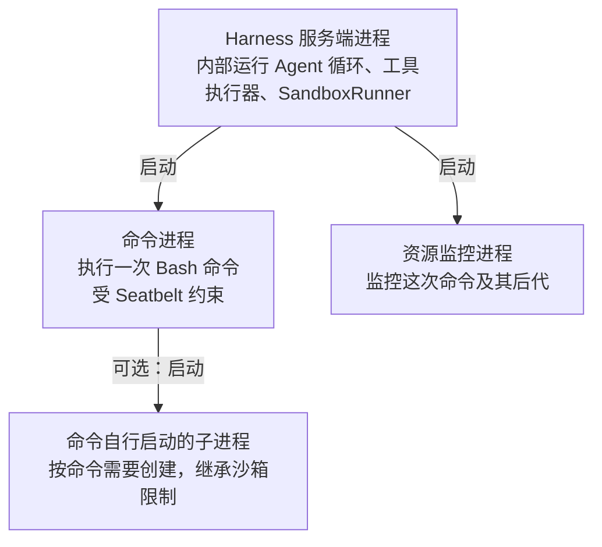
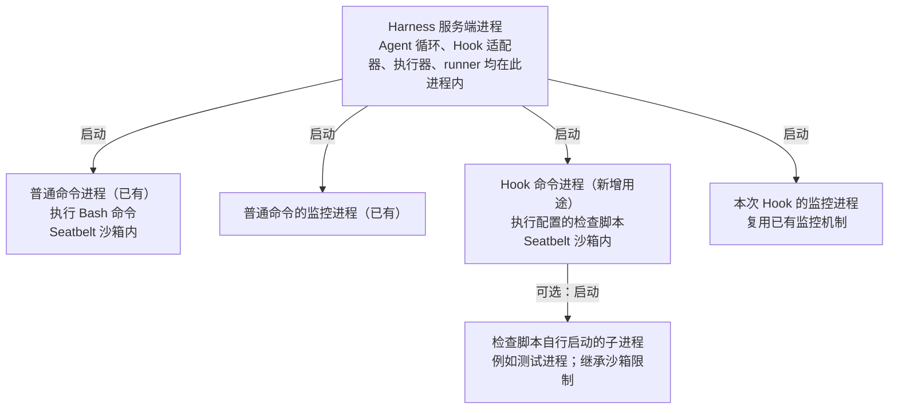

# Stop Hook 技术方案

状态：待实施。事实基线：`262ff2c4b6bf6d247d46f59609ee1c9897b10a31`。
对应[产品方案](./2026-10-23-stop-hook-product-spec.md)。本文只规划 Web／Electron 主 Run 的项目级脚本检查。

生产代码预计新增 3 个文件、修改 17 个文件；使用现有工具执行、审批、事件和持久化结构。修改范围见第 4 节。数据库物理结构、HTTP 路由和公开事件类型保持不变。本文代码差异均为建议审阅片段，尚未实施。

## 1. 当前实现

### 1.1 主 Run 的结束路径

`ConversationRunService.#runEvents()` 读取工作区指令、Skill 与 MCP 工具，构造父 Run 和子任务协调器，然后调用 `streamAgentRun()`。

`agent-loop.ts` 每步处理用户追加消息和子任务结果，再请求模型。模型返回 `final` 后，`runFinalAnswerStep()` 按顺序执行：

1. 检查仍需处理的子任务或用户追加消息。
2. 关闭子任务协调器。
3. 把 assistant 最终回答加入 transcript。
4. 发布 `step.completed(final)`、已暂存的 `answer.delta`、`answer.completed`。
5. 调用 `lifecycle.beforeCompleted`，把 transcript 和最终结果写库。
6. 发布 `run.completed`。

`beforeCompleted` 的职责是保存已接受的结果，其返回类型为 `void | Promise<void>`。当前没有拒绝最终回答并继续执行的接口。

模型正文通常边生成边发送。存在子任务等待条件时，现有 `stageAnswerDeltas` 支持暂存正文，后续根据该步类型发布或丢弃。

### 1.2 执行、权限和展示

- `runtime.ts` 按执行模式创建 `MacOsSeatbeltSandboxRunner`，将其传给 Bash 等工具；`WorkspaceRuntime` 当前只向应用层暴露工具列表。
- `SandboxCommand` 没有 stdin 字段，`runSpawnedCommand()` 的 stdin 为 `ignore`。
- `executeAgentToolCall()` 已包含参数校验、权限判断、审批等待、执行、审计及 `tool.started/tool.completed` 事件。
- `full_access` 免审批，但其进程仍使用 Seatbelt；环境保留白名单，不继承 Harness API Key。
- Web 工具轨迹可以根据工具开始／完成事件创建条目，不要求模型预先提供一条 assistant 工具调用消息。
- 现有快照恢复 Run 状态、子任务和待审批项，不保存全部工具轨迹。

### 1.3 消息和持久化

`TranscriptMessage` 支持普通 user、assistant、tool，以及 `source: "sub_agent"` 的内部 user 消息。两个 Provider 会把子任务报告包装为不可信证据。SQL 的真实用户消息查询已经使用 `source IS NULL`；上下文的用户原文保护也排除带 `source` 的消息。

`transcript_messages.message_json` 保存 canonical transcript。正常结束、失败和取消沿现有回调写入本轮消息，当前不逐条持久化运行中的所有事件。

### 1.4 当前进程架构

下面每个方框表示一个操作系统进程，箭头只表示父进程启动子进程。Agent 循环、工具执行器和 SandboxRunner 都在同一个服务端进程内。



命令进程和监控进程是服务端的两个直接子进程，互为兄弟。每次命令执行分别创建一组；监控进程由服务端直接启动，未使用该命令的 Seatbelt 包装。收尾时服务端还会短暂启动 cleanup helper 清理该组进程，随后退出。图展示命令执行期间的父子关系，省略收尾阶段的短命 helper。

依据：`MacOsSeatbeltSandboxRunner.run()` 先创建 `DarwinProcessContainment`（启动 monitor），再调用 `runSpawnedCommand()`（启动命令）；`DarwinProcessContainment.terminate()` 负责停止 monitor 并调用 cleanup helper。

## 2. 存在的问题

1. 正常 final 被直接接受，项目脚本无法否决完成。
2. 在 `beforeCompleted` 中才检查，会晚于 `answer.completed`。
3. 若检查期间继续发送候选正文，用户会看到随后被拒绝的结束声明。
4. 拒绝反馈若伪装为真实用户消息，会影响任务边界、用户消息展示和上下文保护。
5. 脚本执行需要沿用当前权限和进程清理；直接使用宿主 runner 会改变会话执行边界。

## 3. 目标实现

### 3.1 最小输入输出

项目 `.agents/stop-hook.json`：

```json
{"command":"node .agents/check-completion.mjs","timeoutMs":30000,"maxContinuations":2}
```

检查进程从 stdin 读取一个 UTF-8 JSON 对象。下面是只含一个请求的最小输入：

```json
{
  "event": "stop",
  "conversationId": "conversation-1",
  "runId": "run-1",
  "workspaceRoot": "/work/demo",
  "executionMode": "full_access",
  "input": "实现 parser，并验证空输入用例",
  "step": 8,
  "continuations": 0,
  "candidateAnswer": "实现已完成。",
  "transcript": [{"role":"user","content":"实现 parser，并验证空输入用例"}]
}
```

输出只允许以下两个严格 JSON 对象之一；进程退出码均为 0：

```json
{"decision":"allow"}
```

```json
{"decision":"block","reason":"空输入测试未通过，请修复后继续验证。"}
```

stdout 只用于协议；日志写入 stderr。空 stdout、多个 JSON 对象、未知字段、未知 decision、空拒绝原因或非零退出码都表示检查故障。非零退出码不表示任务应继续。

### 3.2 配置约定

| 项目 | 约定 |
| --- | --- |
| 位置 | `<canonical workspace>/.agents/stop-hook.json`，首版只支持项目级 |
| 缺失 | 禁用 Hook，保留现有行为 |
| command | 必填非空字符串，上限 8 KiB；由 `/bin/zsh -f -c` 执行 |
| timeoutMs | 可选，默认 30000，整数范围 100–120000 |
| maxContinuations | 可选，默认 2，整数范围 0–5 |
| 文件校验 | 严格 JSON 对象，拒绝未知字段；文件不超过 64 KiB，严格 UTF-8；`.agents` 与配置文件拒绝符号链接，配置必须为工作区内普通文件 |
| 非法配置 | 本轮以 `STOP_HOOK_CONFIG_INVALID` 失败，不静默关闭检查 |
| 生效时机 | 每次主 Run 开始时读取一次；该 Run 的命令、超时和次数配置保持不变 |
| 停用 | 删除配置文件，下一个主 Run 生效 |

脚本本体及其依赖在执行时读取。配置快照不包含脚本源码，不提供防篡改承诺。无关项目通过不配置 Hook 保持原行为。

此文件包含一个配置对象，首版不接受 Hook 数组。多项检查由该 command 指向的脚本组织并汇总为一个决策；Harness 只管理一次执行、一次审批及总超时，不定义多 Hook 的排序、并行或结果合并规则。这是范围选择，现有执行机制可以支持未来多次调用。

### 3.3 输入范围与上限

**输入内容**

| 字段 | 内容与约定 |
| --- | --- |
| `input` | 启动本轮 Run 时的原始用户请求，即 `StartConversationRunCommand.input`；运行期间保持不变 |
| `transcript` | 检查开始时主循环持有的完整会话记录快照，包含历史任务、本轮工具结果、已交付的子任务结果，以及已接收的 steering 消息（用户在运行期间追加的消息） |
| `candidateAnswer` | 待检查的最终回答；此时尚未加入 `transcript`，也尚未作为最终回答展示给用户 |
| `step` | 生成这次待检查回答的模型步骤编号 |
| `continuations` | 本 Run 已实际应用的 Hook 拒绝次数；因新消息等原因作废的检查不计入 |

**大小限制**

| 对象 | 上限 | 处理方式 |
| --- | --- | --- |
| 完整输入 | JSON 编码后 8 MiB | 超出时以 `STOP_HOOK_INPUT_TOO_LARGE` 失败，不截断输入 |
| stdout 与 stderr | 合计 48 KiB | 沿用现有命令输出限制，超出时检查失败 |
| 拒绝原因 `reason` | UTF-8 编码后 4 KiB | 超出时作为输出协议错误，检查失败 |
| 错误诊断展示 | 2 KiB | 仅保留上限内的诊断摘录 |

输入通过 stdin 写入并关闭，不插入 shell 命令、不放入环境变量、不创建临时 transcript 文件。待检查回答中的引号、反引号或 shell 语法始终是 JSON 数据。

### 3.4 核心接口与职责

`src/stop-hook.ts` 定义本功能的协议与错误，不执行文件读取或进程操作：

```ts
interface StopHookRequest {
  readonly candidateAnswer: string;
  readonly transcript: readonly TranscriptMessage[];
  readonly step: number;
  readonly continuations: number;
  readonly signal?: AbortSignal;
}

type StopHookDecision =
  | { readonly decision: "allow" }
  | { readonly decision: "block"; readonly reason: string };

interface StopHook {
  readonly maxContinuations: number;
  check(request: StopHookRequest):
    AsyncGenerator<AgentEvent, StopHookDecision, void>;
}
```

`RunAgentOptions` 与内部 loop options 增加可选 `stopHook`。`ConversationRunService` 注入脚本实现；CLI 与子 Run 不注入。应用层实现通过闭包持有本轮配置、workspace、conversationId、runId、input、eventFactory、executor 和权限上下文。

主循环只管理一个必要的新计数：已应用的 Hook 拒绝次数。该计数仅属于当前 Run，不落库，不跨 Run 续算。

### 3.5 完整执行顺序

1. 正常处理当前模型步骤的子任务结果和用户消息。
2. 启用 Hook 时，通过现有 `stageAnswerDeltas` 暂存该模型调用的正文。
3. 模型返回工具调用：沿用现有工具路径，发布该步说明并执行工具，不调用 Hook。
4. 模型返回正常 final：先检查现有子任务／用户消息等待条件；条件未满足时沿用原有等待或继续行为，不调用 Hook。
5. 执行 `stopHook.check()`。检查发生在关闭子任务协调器、加入 assistant 最终消息和发布完成事件之前，因此拒绝后仍可继续委派子任务。
6. 检查返回后先检查取消信号，再重新检查待处理用户消息和子任务条件。若候选已过期，记录检查结果未应用，丢弃候选，进入下一步处理新输入。该次检查不增加拒绝次数。
7. 检查允许：记录检查结果，沿用原有最终回答写入、事件发布和完成落库流程。
8. 检查拒绝：记录拒绝反馈；若已达到 `maxContinuations`，抛 `STOP_HOOK_LIMIT_REACHED`；否则计数加一，发布本步 `step.completed(waiting)`，进入下一模型步骤。
9. 检查发生故障：保留诊断记录并抛 `STOP_HOOK_FAILED`，沿现有失败落库和 `run.error` 路径结束。本轮已有文件修改不回滚。

Hook 检查期间不再调用模型。检查完成以后只有主循环决定下一步动作；脚本不能直接创建新 Run。

用户取消优先于脚本输出。检查故障即使伴随新用户消息也按失败处理，防止忽略执行器故障；只有合法的 allow/block 结果可以因新消息作废。

`maxSteps >= 2` 时仍保留现有最后一个交接步骤：禁用工具，要求模型说明已做工作和未完成项，`stopReason=step_limit`。该交接跳过 Hook，保持原有步数上限及收尾路径；它不表示通过完成检查。`maxSteps=1` 沿现有单步规则执行，Hook 拒绝后没有下一步，按 `MAX_STEPS_EXCEEDED` 失败。

### 3.6 复用工具执行与审批

脚本实现创建一个仅供 Harness 内部调用的 `stop_hook` 工具定义及独立单工具 Registry，并通过 `executeAgentToolCall()` 执行。它不加入模型可见工具列表，不添加伪造的 assistant tool-call 消息，也不追加无对应调用的 tool transcript。

- 内部调用 ID 使用 Run ID 和模型 step 生成，与模型原生调用 ID 隔离。
- 工具参数与审批摘要只包含固定的 command、cwd、timeoutMs；完整 stdin 输入保存在本次执行的闭包中，不进入审批卡片或工具开始事件。
- 工具执行闭包调用当前 `WorkspaceRuntime.sandboxRunner.run()`，解析 stdout，返回 `{decision, reason?}`。
- JSON 协议错误用现有 `TOOL_EXECUTION_FAILED`；超时、输出上限、资源限制等沿用现有工具错误码。外层再统一映射为 `STOP_HOOK_FAILED`，保留原始原因。
- `tool.started` 与 `tool.completed` 显示检查过程；`block` 是成功执行所得的业务结果，工具记录显示“要求继续”，不显示为脚本故障。
- `workspace_sandbox` 为 `stop_hook` 增加 confirm 规则；`deriveGrantOptions("stop_hook", ...)` 返回空数组，仅支持单次批准。现有 `InteractionBroker.isValidResponse()` 要求响应中的 grant 命中该数组，因此任何会话授权请求都会被拒绝，不会写入 `ToolGrantStore`。该 store 按工具名匹配、只在内存中保存；普通 Bash 的会话授权不适用于 `stop_hook`。
- `full_access` 继续由策略链首位的 `fullAccessAllowsEverything` 直接允许，不进入后续 confirm 规则。独立 Registry 不改变这一顺序。Hook 沿用同一个 Seatbelt runner 和白名单环境。
- 拒绝、审批过期和无审批能力都以检查失败结束；不重复弹审批，不自动降级为跳过检查。

复用生产装配的 `AuthorizedToolExecutor`；测试可以注入受控权限策略。配置来自工作区不等于获得额外命令执行授权。

#### 进程所有权与等待方式

目标进程树如下。每个方框表示一个操作系统进程，箭头只表示父子关系；图中列出可创建的进程，普通 Bash 和 Hook 无需同时运行。Hook 复用现有命令执行机制，新增的是检查用途及其接入逻辑。



**父子关系：** Hook 命令进程、普通命令进程及各自的监控进程，都由服务端直接启动。Hook 命令进程与普通命令进程互为兄弟。主 Agent 是服务端内的执行循环，没有单独的操作系统进程；Hook 也不经过一次模型 Bash 工具调用来启动。服务端收尾时短暂启动的 cleanup helper 与当前架构相同，图中省略。

**进程内调用：** `Agent 循环 → Hook 适配器 → 工具执行器／审批 → SandboxRunner`。这些调用都发生在服务端进程内；runner 到图中子进程的启动才跨越进程边界。

| 两端 | 通信与控制 |
| --- | --- |
| 服务端 → Hook 命令进程 | stdin 写入任务记录与候选回答的 JSON，然后关闭输入 |
| Hook 命令进程 → 服务端 | stdout 返回 allow/block，stderr 返回日志；服务端同时等待退出状态 |
| 监控进程 → 服务端 | 报告资源超限或监控故障；由现有 runner 发起终止清理 |
| 服务端 → 本次命令、后代及监控进程 | 正常退出、取消、超时或故障时执行现有清理流程 |

**等待关系：** 当前 Run 的 Agent 循环异步等待 Hook；服务端事件循环继续处理其他会话、SSE、取消和追加消息。allow 后接受仍有效的候选回答；block 后把原因交给同一 Agent 循环继续执行；故障走既有失败保存路径。

以 `node .agents/check-completion.mjs` 为例，Harness 服务端内的 Agent 循环调用 runner，由现有 `runSpawnedCommand()` 使用 Node `child_process.spawn()` 启动受管理的子进程。命令启动链路为：资源限制 helper → `sandbox-exec` → `/bin/zsh -f -c` → 检查脚本。链路中包含 exec 替换，不代表每一层都常驻一个进程。

- 所有者：运行 `ConversationRunService` 的 Harness 服务端进程。Web 页面负责展示；Electron 桌面版同样由其后端服务执行检查。
- 等待：当前 Run 异步等待检查完成，期间主 Agent 不发起下一次模型调用；Node 事件循环继续服务 SSE、取消、用户追加消息和其他会话。脚本自行调用模型时，调用发生在脚本侧。
- 通信：stdin 传递 JSON 快照，stdout 返回决策，stderr 输出日志；脚本与服务端拥有独立内存。脚本可按沙箱权限访问同一工作区文件。
- 生命周期：每次检查新建进程，退出后收集结果并清理后代；再次检查重新启动。取消、超时和资源超限沿用 runner 清理。`detached:true` 用于进程组管理，检查仍由 Harness 等待和清理，不作为常驻后台服务。
- 并发：一个 Run 同时最多执行一次检查；不同 Run 可各自启动检查，首版不增加项目级串行队列。

Hook 作为受限子进程运行；脚本内部若再次启动 Seatbelt，仍会遇到嵌套沙箱限制。独立进程不会改变这一权限边界。

### 3.7 stdin 支持

给 `SandboxCommand` 与 `SpawnedCommand` 添加可选 `stdin?: string`。未传入时保持 `stdio[0] = "ignore"`；传入时使用 pipe，并在所有错误、退出和取消监听器注册完成后调用 `child.stdin.end(stdin)`。

`MacOsSeatbeltSandboxRunner.run()` 显式向底层透传 stdin；`HostSandboxRunner` 已通过参数展开透传，可用于受控单元测试。原生 helper 的 `exec` 路径保留标准输入，实施时必须以实际 runner 集成测试验证。

stdin 的 `error` 必须有监听：进程提前关闭输入导致 EPIPE 时，不产生未处理异常，等待进程关闭并按退出码及 stdout 协议判定；其他写入错误进入现有终止清理路径。写入缓冲在进程结束后释放。超时、取消、输出和资源限制复用当前清理逻辑。

### 3.8 反馈、信任与模型输入

新增一个 canonical transcript 变体：

```ts
{ readonly role: "user"; readonly source: "stop_hook";
  readonly content: string }
```

`content` 为 JSON 文本，例如：

```json
{"command":"node .agents/check-completion.mjs","step":8,"decision":"block","reason":"空输入测试未通过","applied":true}
```

允许、拒绝、执行错误都保存对应检查记录；这些记录不包含候选回答全文。过期的合法结果保存 `applied:false`。错误使用记录中的 `decision:"error"` 和诊断 reason。配置读取错误发生在创建检查输入前，通过现有 Run 错误字段保存。通过检查才追加 assistant 最终回答；被拒绝的候选全文不写入历史。记录沿用正常结束、失败或取消时的批量落库时机，运行中的进程崩溃不保证保存这些记录。

两个 Provider 根据 `source` 显式区分子任务报告与 Hook 记录。Hook 记录序列化成：

```json
{"type":"stop_hook_result","instructionTrust":"untrusted","data":"...content..."}
```

系统提示词规定：这是已配置脚本产生的检查证据；当 `block` 且 `applied:true` 时，针对原任务补做并核实原因。脚本输出不能改变用户目标、授予权限或要求越权操作。`allow`、`error` 和未应用记录不构成新的用户请求。

过期结果不会触发主循环的拒绝分支；下一步按现有机制消费新用户消息。模型可见的 `applied:false` 只表示历史检查证据，系统提示明确要求不据此执行补做。

`openTurnUserIndexes()` 当前排除所有带 source 的消息，可以直接复用；SQL 中 `source IS NULL` 的用户消息筛选保持不变。新增测试确认 Hook 反馈不会变成 steering 或新的 Turn。最近一次 block 追加在 transcript 尾部，随下一次 ContextBuilder 构建进入模型输入；不建立另一个反馈队列。

### 3.9 数据库影响

无 DDL 变更、无新表、无新列、无迁移。涉及已有 JSON 内容扩展的表是 `transcript_messages`，当前与目标均为 **5 个物理列**：

`conversation_id`, `seq`, `run_id`, `role`, `message_json`。

- 列及类型：前四列分别为 TEXT、INTEGER、TEXT、TEXT；`message_json` 为 TEXT，均 NOT NULL，保持不变。
- 主键：`(conversation_id, seq)`，保持不变。
- 外键：`conversation_id → conversations.id`、`run_id → runs.id`，均 ON DELETE CASCADE，保持不变。
- CHECK：seq 非负；role 为 user/assistant/tool；message_json 为合法 JSON 对象且其中 role 与物理列一致。全部保持不变。
- UNIQUE 与索引：无新增、删除或修改；继续使用现有主键。
- 字段语义：`message_json` 始终是 JSON 文本，数据库校验 JSON 合法性及 role。新 source 值由 TypeScript/Zod 校验，SQL 不单独校验 source。对象内 `content` 是承载检查记录的 JSON 字符串，数据库不校验这层嵌套 JSON。

`runs` 的错误字段、终态和 final_answer 规则保持不变；检查失败映射到现有 failed 状态。脚本自行调用外部模型时不生成 `run_model_calls` 记录，Harness 不统计该外部调用的 token。

### 3.10 Web 与恢复

使用现有工具轨迹、审批、错误和运行状态。`RunTrace` 为 `stop_hook` 显示名称“完成检查”，区分“允许结束”“要求继续”和执行错误，并展示拒绝原因；不显示候选回答或 stdin 全文。

`RunResult` 在 `stopReason === "step_limit"` 时显示步数耗尽的交接提示。这个字段已有于实时事件和终态快照，本次不增加历史数据库字段；重新加载的普通历史详情没有该字段时仍显示保存的交接正文，不承诺恢复额外徽标。

无需新增公开事件、Run 状态或 HTTP 接口。刷新时复用已有订阅／快照：日志可回放则恢复完整检查轨迹；日志超限只恢复现有状态及待审批，当前检查的后续结果仍可显示。会话重新打开后的完整检查证据通过已落库 transcript 和现有诊断入口读取，首版不建设独立 Hook 历史列表。

## 4. 具体改动

### 4.1 文件职责与范围

新增 3 个生产文件：

| 文件 | 职责 |
| --- | --- |
| `src/stop-hook.ts` | Hook 检查端口、decision 类型和本功能错误类型 |
| `src/infrastructure/workspace-stop-hook-config.ts` | 项目配置 schema、有界读取和校验 |
| `src/application/command-stop-hook.ts` | JSON 输入输出、内部工具执行适配、脚本结果解析 |

修改 17 个生产文件：

| 文件 | 改动 |
| --- | --- |
| `src/agent-loop.ts` | 注入检查、暂存正文、处理拒绝计数及检查后的新输入 |
| `src/agent-run-errors.ts` | 把 Hook 错误映射为公开 Run 错误 |
| `src/application/conversation-run-service.ts` | 每个主 Run 读取配置、构建脚本 Hook，并注入父循环 |
| `src/application/workspace-runtime.ts` | 暴露当前 runtime 已有的 sandboxRunner |
| `src/runtime.ts` | 返回已创建的 sandboxRunner，保持原执行模式 |
| `src/sandbox/sandbox-runner.ts` | 添加可选 stdin 参数 |
| `src/sandbox/process-runner.ts` | 可选 pipe 写入与 stdin 错误清理 |
| `src/sandbox/macos-seatbelt-sandbox-runner.ts` | 透传 stdin |
| `src/tool-permissions.ts` | 增加内部 stop_hook 的确认策略 |
| `src/tool-grants.ts` | stop_hook 只提供单次批准 |
| `src/transcript.ts` | source=stop_hook 消息类型和严格校验 |
| `src/providers/tool-result-boundary.ts` | Hook 记录的不可信数据包装 |
| `src/providers/deepseek.ts` | 按 source 分别序列化内部消息 |
| `src/providers/openai.ts` | 按 source 分别序列化内部消息 |
| `src/system-prompt.ts` | 解释检查反馈及权限边界 |
| `web/src/components/RunTrace.tsx` | 完成检查的名称及业务结果展示 |
| `web/src/components/RunResult.tsx` | 步数耗尽的交接提示 |

实现阶段同时更新 `README.md` 和 `docs/runtime-boundaries.md` 的配置、执行边界说明。测试文件按第 6 节增加或更新；runtime 测试 fixture 需要补充新增的 runner 引用。

### 4.2 基于当前原文的关键接入 diff

以下仅展示关键接口和放置位置，未展示的计数、错误处理与反馈写入按第 3 节实现。片段用于审阅，不能直接作为完整补丁应用。

`src/agent-loop.ts`：增加独立的结束检查端口，保留原完成持久化回调。

```diff
   readonly steeringSource?: SteeringSource;
   readonly lifecycle?: AgentRunLifecycle;
+  readonly stopHook?: StopHook;
 }
```

同文件：将配置 Hook 的候选正文纳入现有暂存机制。

```diff
     const { turn, usage, stagedText } = yield* runProviderAttempts(
       transcript,
-      { ...options, stageAnswerDeltas: () => needsFinalBarrier(subAgents) },
+      { ...options, stageAnswerDeltas: () =>
+        options.stopHook !== undefined || needsFinalBarrier(subAgents) },
       stepNumber,
       forcesFinalAnswer,
     );
```

同文件：最终回答接入点在以下原文之前。必须保持协调器可用，以便拒绝后继续委派任务。

```ts
await options.subAgents?.close("parent_failed");
options.subAgents?.throwIfFailed();
transcript.push({ role: "assistant", content });
yield eventFactory.stepCompleted(stepNumber, "final", usage);
```

新增处理顺序为：检查 Hook → 复查取消和新输入 → 记录结果 → 拒绝时继续／失败 → 放行时执行上述原文。达到步数上限的交接直接走原路径。

`src/providers/openai.ts`：将内部消息按具体来源映射。`deepseek.ts` 的同构表达式同步修改；两处都引入 `serializeStopHookResultForModel`。

```diff
         content: "source" in message
-          ? serializeSubAgentResultForModel(message)
+          ? message.source === "sub_agent"
+            ? serializeSubAgentResultForModel(message)
+            : serializeStopHookResultForModel(message)
           : message.content,
```

`TranscriptMessage` 和其 Zod schema 同步加入严格的 `source:"stop_hook"` 分支。该分支没有 `subAgentRunId`；两个 Provider 不得把它送入子任务序列化函数。

`src/sandbox/sandbox-runner.ts`：以标准输入传递 JSON。

```diff
   readonly maxOutputBytes: number;
+  readonly stdin?: string;
   readonly signal?: AbortSignal;
 }
```

`src/tool-grants.ts`：禁止将一次 Hook 批准扩展到未来所有脚本。

```diff
 export function deriveGrantOptions(
   toolName: string,
   input: unknown,
 ): readonly ToolGrantScope[] {
+  if (toolName === "stop_hook") return [];
   if (toolName !== "bash" || !isRecord(input) || typeof input.command !== "string") {
     return [{ kind: "tool" }];
   }
```

### 4.3 错误码

| Run 错误码 | 含义 |
| --- | --- |
| `STOP_HOOK_CONFIG_INVALID` | 配置文件格式、路径或值非法 |
| `STOP_HOOK_INPUT_TOO_LARGE` | 完整 JSON 输入超过 8 MiB |
| `STOP_HOOK_FAILED` | 未获审批、启动失败、超时、进程资源错误或输出协议非法 |
| `STOP_HOOK_LIMIT_REACHED` | 拒绝次数已到上限，仍要求继续 |

取消保持原 cancelled 路径，步数限制保持原 `step_limit` 交接或 `MAX_STEPS_EXCEEDED`。错误码通过现有字符串字段传递，无 SQL CHECK 或前端错误枚举变更。

## 5. 保持不变

- 无配置的主 Run、CLI、子 Run 和摘要调用行为。
- 普通 Bash、MCP 和文件工具的权限及配置。
- 子 Agent 的启动、等待、结果交付和收尾机制。
- Provider 请求重试、模型调用计费及既有上下文压缩策略。
- RunRegistry、SSE 订阅及显式取消接口。
- 数据库 schema 与迁移策略。
- 现有宿主测试要求；Hook 不提供沙箱逃逸能力。

## 6. 实施顺序与验证

### 6.1 顺序

1. 配置读取、脚本协议及 stdin 支持；用真实短脚本确认输入输出和资源清理。
2. 内部工具执行与审批接入；确认工具不暴露给模型、沙箱模式下未批准不执行。
3. 主循环接入、反馈消息和 Provider 映射；用受控 Provider 驱动确定的拒绝／补做／放行过程。
4. 工具轨迹、交接提示及 HTTP／浏览器链路验收。

每一步按依赖完成，不要求先开发记忆系统、动态工作流或通用 Hook 平台。

### 6.2 测试矩阵

| 场景 | 关键断言 | 建议位置 |
| --- | --- | --- |
| 配置缺失、合法、非法、符号链接 | 缺失保持原行为；非法失败；逐 Run 重读，运行中不变 | 新增 `test/workspace-stop-hook-config.test.ts` |
| stdin、空输入、提前关闭 pipe | JSON 原文到达；原无 stdin 用例不变；EPIPE 无未处理异常 | `test/process-runner.test.ts`、沙箱 runner 集成测试 |
| allow/block 与非法输出 | 0+合法 JSON 才是有效决策；stderr 日志不破坏 JSON；超限失败 | 新增 `test/command-stop-hook.test.ts` |
| 真实脚本拒绝后放行 | 脚本根据工作区标记实际决定；模型补写标记后第二次放行；拒绝时无候选 answer.delta、answer.completed 或 assistant final 落库 | 新增 `test/stop-hook-loop.test.ts` |
| 始终拒绝、零次补做、步数限制 | 默认第三次拒绝失败；maxContinuations=0 首次拒绝失败；step_limit 不调用 Hook | 同上 |
| 取消、超时、资源限制 | 无完成事件；进程及后代清理；错误原因保持 | command hook 与 runner 测试 |
| 检查中 steering | 旧候选丢弃；先消费新消息；拒绝计数不变；旧结果 applied=false 且不触发补做分支 | loop 测试 |
| 拒绝后委派子任务 | 协调器未被提前关闭；子任务可创建并返回，之后再次检查 | loop 测试 |
| 子任务、CLI、摘要 | 不注入 Hook；已有测试通过 | `test/conversation-run-service.test.ts`、现有 CLI／摘要测试 |
| 消息保存与模型输入 | schema 与 SQLite 读写 round-trip；无伪造工具消息；source 不当成真实用户；两个 Provider 输出 stop_hook_result 且无 subAgentRunId | transcript、Provider、context-builder 测试 |
| 审批 | workspace 模式连续两次均需批准；真实 Broker 拒绝响应中的 grant，store 无新增授权；deny/expired 失败；Full Access 免审批 | tool-permissions、tool-grants、interaction-broker 测试 |
| 真实 HTTP→Run→脚本→SQLite | block 后模型有补做行为，allow 后仅一次完成；失败记录无 final_answer | 新增 `test/stop-hook-http.test.ts` |
| Web 显示与恢复 | 检查中／要求继续／放行区别明确；刷新继续；审批恢复；交接不显示为检查通过 | RunTrace、RunResult 测试及浏览器验收 |

验证集成测试有效性：在一次性测试副本中绕过 Hook 接线，拒绝后补做用例必须失败；恢复后通过。此操作不修改正式工作区。受控 Provider 用于固定边界条件；脚本执行、事件、文件副作用和 SQLite 使用真实实现。

### 6.3 自举执行环境

实施前检查 `MY_AGENT_HARNESS_SANDBOX`。值为 `seatbelt` 或 `full-access-tagged` 时，按仓库指引跳过需要实际创建 Seatbelt 的用例，并列明待宿主验证项。可使用注入的受控 runner 验证审批、状态转换、协议和取消传播，但这些结果不替代真实 Seatbelt 验证。

宿主验证使用当前构建的真实 Full Access runner 执行普通 Hook 脚本，确认 stdin、取消、进程清理和权限边界。宿主启动外层 runner；Hook 内部脚本不再创建第二层沙箱。嵌套沙箱失败用例用于确认限制，无需把它改成通过。

针对当前实现运行适用的类型检查、服务端及 Web 测试。真实模型任务另外记录是否发生阻止、是否实际补做、最终验收结果及消耗；单次任务成功不推导为长期可靠性。

### 6.4 方案自检

- 当前流程与接入位置已给出，完成回调继续只负责持久化。
- 单个脚本、单个 Run 内继续；权限、取消、step_limit 与次数上限分别定义。
- 数据库物理结构保持不变，新增 JSON 消息来源和保存时机明确。
- 输入输出、错误、用户追加消息与刷新场景可分别验收。
- 实施及运行验收尚未执行；方案中的测试结果均为预期。
