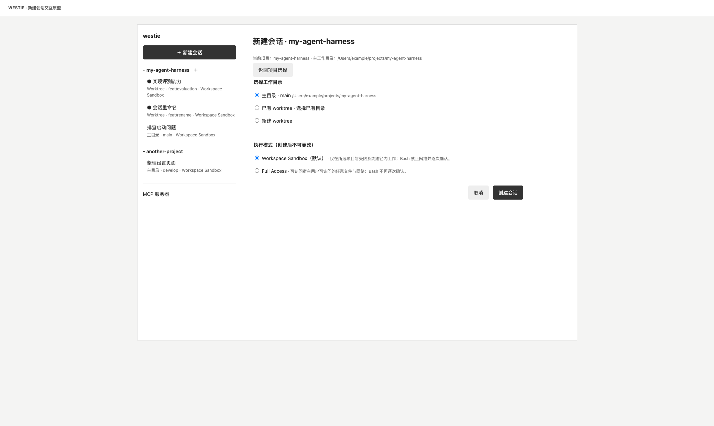
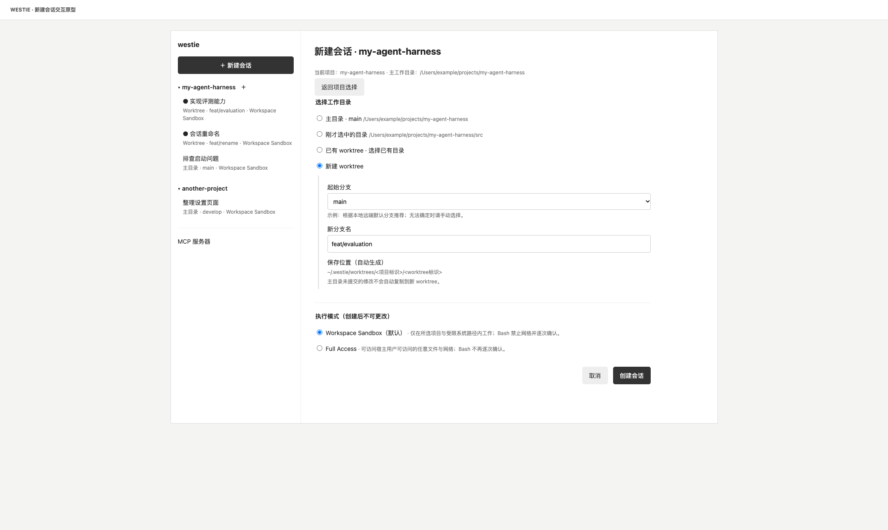
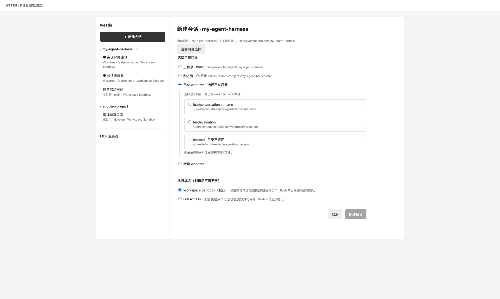
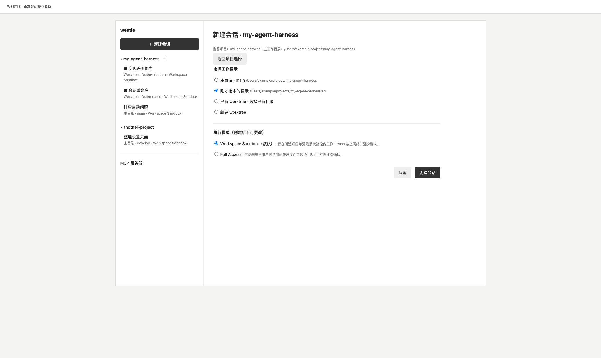

# 项目分组与 Worktree 并行开发产品方案

状态：产品方案，待实施。本文描述用户体验和验收范围；数据迁移、Git 命令、权限边界及失败恢复的具体实现另在技术方案中确定。

## 当前实现

Westie 通过“新建会话”打开执行模式选择弹窗。用户选择 Workspace Sandbox 或 Full Access 后，再通过 macOS 系统目录选择器选择工作目录；随后创建并进入会话。默认选择 Workspace Sandbox，选择 Full Access 需要勾选确认。会话创建后执行模式不可更改。

每个会话绑定一个工作目录。会话侧栏按最近更新时间展示扁平列表，行内显示标题、执行模式、目录路径和更新时间；运行状态显示在对应会话上。当前项目区域展示目录、执行模式和会话 ID。系统可以让用户选择手动创建的 worktree 目录，但没有创建 worktree 的界面，也没有识别 worktree 并按项目聚合会话的产品入口。

当前代码依据：[新建会话流程](../../web/src/hooks/useProjectOpen.ts)、[执行模式弹窗](../../web/src/components/AccessModeDialog.tsx)、[会话列表](../../web/src/components/ConversationList.tsx)、[当前项目区域](../../web/src/components/WorkspacePanel.tsx)。

## 存在的问题

- 同一仓库的不同功能若共用目录，并行修改容易互相影响。用户需要自己创建 worktree 并通过目录选择器打开。
- 同一项目的主目录和 worktree 路径不同，扁平会话列表没有项目归属与目录类型，难以找到同一项目的工作并判断当前会话在哪个目录执行。
- worktree 是独立工作目录，依赖和未提交文件不会自动具备；创建前需要让用户理解起始位置和结果。

## 目标实现

用户在一个项目中同时开发两个功能时，可以为每个功能创建独立 worktree，在侧栏的同一个项目下看到两个会话和各自的分支。打开会话后，界面持续显示实际工作目录与执行模式。

### 概念

| 名称 | 含义 |
| --- | --- |
| 项目 | 侧栏中聚合相关会话的对象。一个 Git 项目的主目录和关联 worktree 归为同一个项目。 |
| 工作目录 | 会话执行时使用的具体目录，可以是主目录、已有 worktree、新建 worktree 或普通目录。 |
| 主目录 | 该 Git 仓库的主要工作目录。 |
| worktree | Git 仓库的另一个工作目录，可以在其中独立检出和修改文件。 |
| 执行模式 | 会话的访问权限，沿用 Workspace Sandbox 和 Full Access。 |

示例中，主目录（即项目根目录）与 Westie 创建的 `~/.westie/worktrees/<项目标识>/<worktree标识>` 属于同一个项目；各会话使用自己选择的实际目录。目录中的标识仅为示意，最终命名规则由技术方案确定。

### 参考与选择

Codex 允许新会话选择工作目录、分支和独立 worktree；本机 Codex 为本项目创建的 worktree 位于 `~/.codex/worktrees/`。Cursor 官方文档将 worktree 放在用户级 `~/.cursor/worktrees/`。DeepSeek Harness 的实验性 worktree 服务默认放在当前 checkout 的 `.agents/worktrees/`，并支持在同一会话中进入新目录。

本方案选择用户级集中目录 `~/.westie/worktrees/`，便于在多个项目之间查找 Westie 管理的 worktree，项目目录保持整洁。会话保持绑定创建时所选工作目录，符合当前会话和运行时的使用方式；切换到其他目录通过新建会话完成。支持已有 worktree，不要求它位于 Westie 管理目录。

参考：[Codex 新会话工作目录](https://developers.openai.com/blog/mastering-codex-remote-for-engineering)、[Cursor worktree 目录](https://prod.cursor.com/docs/cli/using)、[DeepSeek Harness 实验性 worktree](https://github.com/deepseek-ai/deepseek-harness/blob/master/packages/experimental/worktree/README.md)。

## 具体改动

### 侧栏：项目与会话

```text
项目
▾ my-agent-harness                         ＋
    ● 实现评测能力
      Worktree · feat/evaluation · Sandbox
    ● 会话重命名
      Worktree · feat/rename · Full Access
      排查启动问题
      主目录 · main · Sandbox
▾ another-project                           ＋
      整理设置页面
      主目录 · develop · Sandbox
```

- 侧栏以项目为第一层、会话为第二层，项目支持展开和折叠。项目及其会话按最近活动排序。
- 每个会话显示标题、运行状态、执行模式，以及工作目录类型与当前分支。目录路径可查看和复制。项目名称相同时，通过路径区分。
- 多个会话可以选择同一个工作目录；它们显示相同的目录信息，分别保留会话历史与运行状态。
- 非 Git 普通目录仍可创建会话，并作为普通目录项目展示；不存在的分支不显示为 Git 分支。
- 执行中会话仍可切换查看，原 Run 的状态继续显示在对应会话行。现有会话的重命名、删除、加载更多和错误重试入口保留。
- 历史会话按现有工作目录关联项目。暂时无法识别归属时，会话仍可见，并显示可用的原目录信息；不能为了分组将其隐藏。
- 侧栏列表有分页时，不能把尚未加载的会话呈现为不存在。项目分组与加载更多的具体交互在技术方案中确定。

### 新建会话

从侧栏已有项目的 `＋` 进入时，直接打开该项目的新建会话页面，默认选择主工作目录：



新建 worktree 时，用户选择起始分支和新分支，并确认执行模式：



选择已有 worktree 后，页面展示该项目的目录列表与不可用状态：



选择 checkout 内子目录时，原型展示项目主工作目录并保留所选子目录：



[打开交互原型](../../docs/wireframes/create-worktree-session.wireframe.html)，可以切换工作目录和执行模式。原型使用示例数据，不会实际创建会话。

用户点击全局“新建会话”后，可选择侧栏已有项目，或通过系统目录选择器选择新项目目录。选择目录后仅识别项目，不立即创建会话。界面显示实际选择路径及识别出的 Git 主工作目录。用户选择会话工作目录和执行模式后，点击“创建会话”。从侧栏已有项目的 `＋` 进入时，使用该项目的主工作目录作为上下文，直接显示工作目录和模式选择。创建页面提供返回项目选择的操作；新建会话入口仅保留全局入口和项目旁的 `＋`。

| 系统选择器选中的位置 | 展示及默认选择 |
| --- | --- |
| Git 主工作目录的根目录 | 显示主工作目录路径，默认选中“主目录”。 |
| 已有 worktree 的根目录 | 显示项目主工作目录与所选 worktree，默认选中该 worktree。 |
| 主工作目录或已有 worktree 内的子目录 | 显示项目主工作目录、所属 checkout 和所选子目录；默认选中“刚才选中的目录”，会话使用该精确路径。用户可改选其他工作目录。 |
| 普通非 Git 目录 | 显示所选目录，不展示 Git worktree 和分支选项。 |
| Git 信息暂时无法读取或主工作目录不可用 | 显示实际路径和原因，不推断主目录或替换路径；用户可使用实际选中的目录，Git 操作暂不可用。 |

主工作目录由 Git 的 worktree 信息识别；它可以与用户刚才选择的目录不同。系统显示两者并保留用户的选择，不静默改成仓库根目录。

| 工作目录 | 界面与结果 |
| --- | --- |
| 主目录 | 显示主目录和当前分支；会话使用该目录的现有文件和状态。 |
| 已有 worktree | 展示当前项目的 worktree 列表，含当前分支和完整路径。用户选择一项后，会话使用其现有文件和状态。 |
| 新建 worktree | 选择起始分支、填写新分支名，查看自动生成的目标路径；创建成功后在新目录中创建会话。 |
| 刚才选中的目录 | 当选择的是 checkout 内子目录时显示，使用选择器返回的精确路径。 |
| 普通目录 | 不提供 Git worktree 选项；沿用选中目录创建会话。 |

选择普通目录或“刚才选中的目录”均使用实际选中路径。已有 worktree 列表包含 Westie 创建和用户手动创建、可确认属于该仓库的 worktree。目录不可用时显示原因并禁选；无可用项时提示用户选择主目录或新建 worktree。首次打开一个已有 worktree 时，仍可通过目录选择器选择它，并归入其所属项目。

新建 worktree 时，目录集中存放于 `~/.westie/worktrees/`，创建前展示完整路径。起始分支根据本地记录的远端默认分支推荐对应的本地分支，界面显示推荐结果，用户可选择其他可用的本地分支。无法可靠确定时不预选，提示用户手动选择；不自动联网或更新分支。目标分支名或目录冲突时提示原因并保留输入，不覆盖已有内容。起始分支的未提交或未跟踪文件不会自动复制；依赖和本地配置需要用户准备。首版不自动运行初始化脚本。

创建失败时保留用户输入并展示错误；尚未成功创建 worktree 时不显示已成功创建的会话。若失败时已留下文件或 Git 记录，应告知用户，不悄悄删除；具体可恢复操作在技术方案中明确。

### 执行模式

无论选择哪种工作目录，都要在新建会话时选择执行模式：

| 模式 | 默认 | 用户可见说明 |
| --- | --- | --- |
| Workspace Sandbox | 是 | 在所选工作目录及受限系统路径内工作；Bash 禁止网络并逐次确认。 |
| Full Access | 否 | 可访问宿主用户可访问的任意文件与网络，Bash 不再逐次确认；选择后显示现有权限说明并要求勾选确认。 |

未勾选 Full Access 确认时不能创建会话。切回 Sandbox 后清除确认状态。会话创建后执行模式不可更改；侧栏和当前项目区域继续展示模式。创建 worktree 的产品操作如何在现有沙箱及权限策略下完成，属于技术方案的必答问题，不由界面选择隐含扩大权限。

### 会话中的工作目录

打开会话时，当前项目区域显示项目、工作目录类型、当前分支、完整路径和执行模式，保留会话 ID 及复制入口。工作目录在会话中保持固定；需要在另一目录继续工作时，新建会话并选择该目录。

分支在外部改变时，界面应展示重新读取后的实际状态；处于 detached HEAD 或无法读取 Git 信息时清楚说明，不显示过时的分支。目录不存在或不可访问时保留会话历史，提示目录不可用，不能在失效路径上启动新 Run。

### 原型

- [新建会话交互原型](../../docs/wireframes/create-worktree-session.wireframe.html)：可切换三种目录选项与执行模式，已有 worktree 使用示例数据；提交不会创建真实会话。
- [项目会话侧栏原型](../../docs/wireframes/project-sessions.wireframe.html)：项目与会话分组示意。

原型展示主要布局；本文定义产品行为。原型中的路径和分支是示例。

## 保持不变与首版范围

- 现有普通目录选择、会话历史、执行模式及 Full Access 确认继续可用；历史会话继续使用原目录和原模式。
- Sandbox 和 Full Access 的现有权限语义、运行中的审批、会话运行状态与取消行为保持不变。
- 首版不自动清理或删除 worktree，不自动安装依赖，不复制未提交文件，不提供 worktree 合并、PR 管理或会话切换目录。
- 不要求用户通过 Westie 创建所有 worktree；已有目录和其他工具创建的 worktree 仍可使用。

## 验收

1. 从已有项目创建两个新 worktree 会话，侧栏将其聚合在同一项目下，并分别显示各自的目录类型、分支、执行模式和运行状态；两个会话实际使用不同目录。
2. 选择同一项目的主目录及一个外部创建的已有 worktree，分别创建会话；均归入同一项目，并显示正确路径和分支。
3. 首次新建会话时先通过系统选择器选择目录，再显示识别的项目及主工作目录；选择主工作目录根、已有 worktree 根、两者内部子目录及普通目录时，默认选中用户选择的精确位置，不提前创建会话。选择已有 worktree 时显示列表和路径；不可用目录不能选；无可用项时有明确空状态。普通非 Git 目录仍能创建会话。
4. Sandbox 默认选中；Full Access 未确认时不能创建，确认后才可创建；会话创建后模式不可变，侧栏和当前项目区域显示正确模式。
5. 使用本地记录能确定默认分支的仓库时，起始分支推荐对应本地分支；无法确定或没有唯一匹配时不预选，用户可选择其他本地分支。新 worktree 使用选定的本地起始分支，创建前展示路径，并说明未提交文件不复制；分支或路径冲突时不覆盖已有内容，会话不误报创建成功。
6. 原有会话、重命名、删除、分页、运行状态和会话切换仍可使用；旧会话的原工作目录和执行模式不变，无法识别归属的会话仍可见。
7. 目录被移除或不可访问时，会话历史仍可查看，界面提示不可用且不在该路径启动新 Run；外部分支变化和 detached HEAD 状态能正确反映。
8. Westie 不自动清理已有 worktree；取消或失败时不会把工作成果当作可清理的临时数据。

## 技术方案待解决

- 确认 Git 仓库身份、主目录和外部 worktree 的识别规则，处理同名仓库、独立克隆和路径变化。
- 设计历史数据兼容、分页与项目聚合；不得删除现有数据库或重建丢失会话。
- 确认新建 worktree 所需的 Git 元数据写入与现有沙箱策略、审批和运行目录的关系，并处理取消及部分创建失败。
- 确定目录命名、占用分支、普通目录、bare 仓库及 Git 信息不可用时的具体规则。
