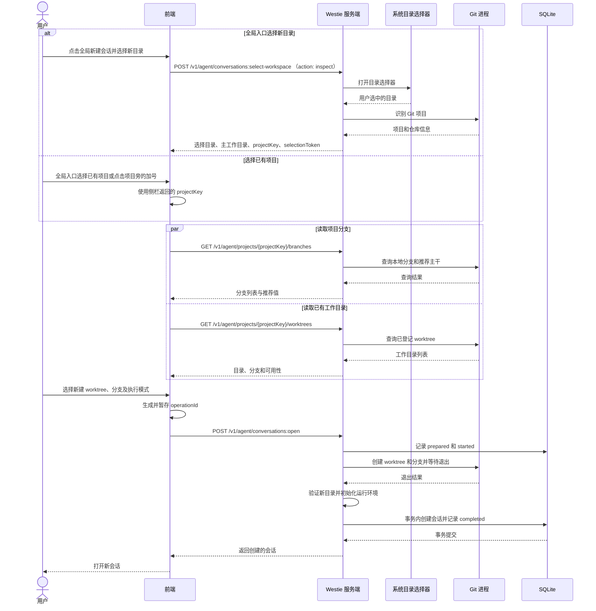
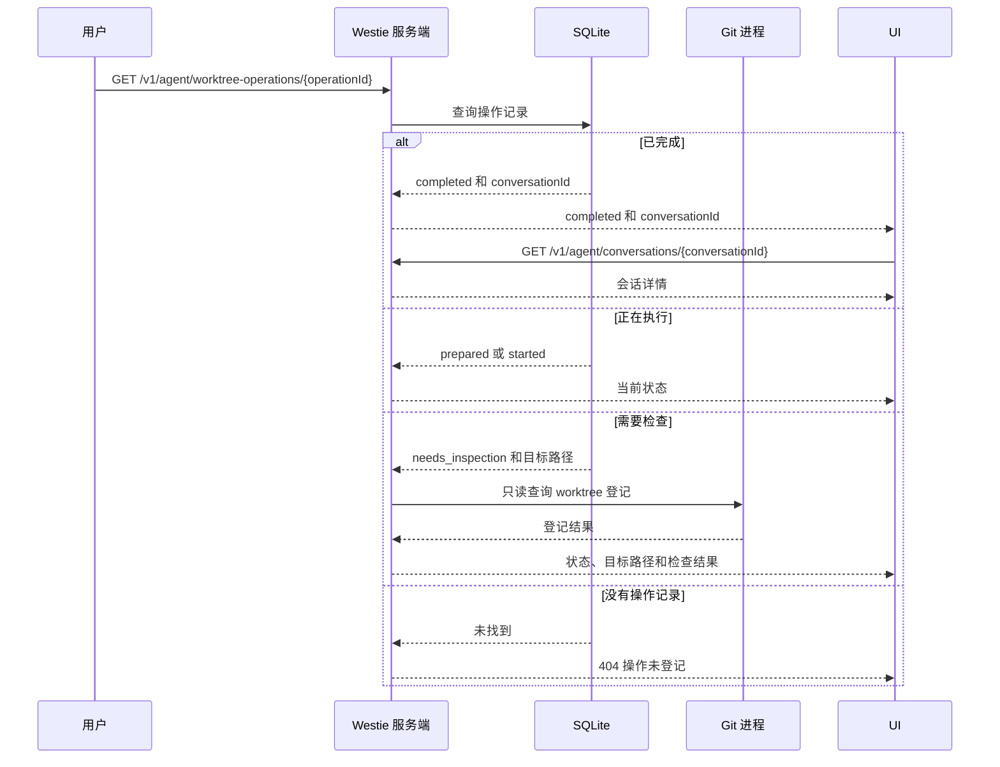

# 项目分组与 Worktree 并行开发技术方案

状态：建议方案，尚未实施。事实基线：`57ada8d`；对应[产品方案](./2026-10-29-project-worktree-product-spec.md)。本文以本机 Web / Electron 使用为范围；下述路径和文件名为实施位置，具体导出符号在实现时按仓库命名约定确定。

## 当前实现

- `WorkspaceSelectionRoute` 接受 `{ executionMode }`，检查 Origin 和 Full Access 条件，调用宿主目录选择器，校验 `realpath`、目录及 runtime 后创建会话。前端 `useProjectOpen` 管理执行模式和 Full Access 确认。
- `conversations.workspace_root` 是会话固定工作目录。`WorkspaceRuntimeProvider` 按工作目录与执行模式创建和缓存运行时；Run 从会话读取目录和模式。Workspace Sandbox 的 Seatbelt 写入范围是工作目录与受控临时目录，Git 的共享管理目录及 `~/.westie` 不一定在范围内。
- 列表按 `(updated_at DESC, id DESC)` 游标分页，前端聚合已加载的会话并展示运行状态。数据库 schema 版本为 1，迁移在事务内执行，版本过新的数据库会拒绝打开。
- 当前没有项目实体、Git 信息读取或 worktree 创建接口。完整代码依据：`src/http/workspace-selection-route.ts`、`src/application/workspace-runtime.ts`、`src/application/conversation-run-service.ts`、`src/infrastructure/sqlite/{schema,migrations,sqlite-conversation-store}.ts`、`web/src/hooks/{useProjectOpen,useConversationList}.ts`。

## 存在的问题

1. 会话只有工作目录路径，主目录和关联 worktree 不能可靠聚为一个项目。路径失效时，仅靠实时 Git 查询不能恢复历史归属。
2. 新 worktree 要同时写入目标目录、仓库共享 Git 管理目录和分支；现有会话沙箱没有授权这个宿主管理操作。
3. Git 文件系统操作与 SQLite 事务无法原子提交；中断或响应丢失后可能存在创建成功但会话未保存的情况。
4. 当前会话分页按全局时间排序，客户端分组只能覆盖已加载会话；把首批结果当作完整项目列表会误导用户。

## 目标实现

### 最小请求与结果

以下仅以主干名为 `main` 的项目为例。用户在已确认的 Git 项目中选择 `main` 作为起始本地分支、输入 `feat/evaluation`，并选择 Sandbox。前端通过 `POST /v1/agent/conversations:open` 向服务端提交创建请求，简化示例如下：

```json
{
  "projectKey": "git:<项目根目录>/.git",
  "executionMode": "workspace_sandbox",
  "workspace": { "kind": "new_worktree", "baseBranch": "main", "branch": "feat/evaluation", "operationId": "c88235f4-10e0-40f5-8ab2-4129b674eb72" }
}
```

服务端确认这是已登记的本机项目，固定 `main` 当前提交，生成 `~/.westie/worktrees/<项目目录>/<operationId>`，创建 worktree 并初始化其 runtime，最后持久化会话。成功响应包含原有会话字段、项目归属和实际工作目录；失败不返回成功会话。

`projectKey` 为本机标识，不是客户端可随意指定的文件访问授权；项目目录名为项目标识哈希，`operationId` 是 UUID，既避免同名项目冲突，也让用户能在响应丢失后定位目标目录。示例路径只表达结构。

### 前端调用顺序

下图展示新建 Git worktree 会话的完整调用。用户从全局入口选择已有项目，或从侧栏项目旁的 `＋` 进入时，直接使用该项目的 `projectKey`；从全局入口选择新目录时，扩展现有选择接口，返回用户实际选择的目录、Git 主工作目录、项目身份和短期选择令牌，不创建会话。两种入口后续使用相同页面。



首次选择项目时，两个 GET 请求携带选择令牌；已有项目不需要令牌。查询可以并行执行；用户选主目录或已有 worktree 时，提交请求不创建 Git worktree，也不写 worktree 创建操作记录。选择普通非 Git 目录时跳过两个 Git 查询。用户选中 checkout 的子目录时，`selected_directory` 使用选择器返回的精确子目录；选中主工作目录或已有 worktree 根时分别使用 `main` 或 `existing_worktree`。

创建请求断开或页面刷新后的查询流程（接口层，首版前端不自动触发）：



服务端提供操作查询接口与幂等重试：同一 `operationId` 重复提交时，`completed` 返回已创建的会话，`prepared` 沿用已固定的 commit 重新推进，`started` 报告进行中，`needs_inspection` 报告目标路径与检查结果；查询返回 404 表示数据库尚无该操作记录，原请求仍可能在并发处理中。

首版前端不实现刷新后自动恢复：不在 `sessionStorage` 暂存 `operationId`，页面刷新或关闭标签页后不自动找回。用户看到的是提交时页面内返回的结果：成功则打开新会话；失败则展示服务端返回的代码、目标路径与原因，并保留用户输入。需要自行确认现场时，可查看 `~/.westie/worktrees/<项目目录>/<operationId>` 下是否已有目录，再用 `GET /v1/agent/worktree-operations/<operationId>` 查询操作状态，或通过目录选择器选择已创建的 worktree 重新建立会话。该接口与服务端状态机已经实现，后续补前端恢复流程不需要改动服务端。

### 创建失败与恢复

| 结果 | 行为 |
| --- | --- |
| Git 创建前校验失败 | 返回具体错误并保留用户输入，不创建会话。 |
| Git 失败、取消、超时或服务中断 | 不创建会话；操作记录标为或恢复为 `needs_inspection`，提示检查目录、分支和 Git 登记。 |
| Git 成功，目录验证、运行环境初始化或会话保存失败 | 不返回成功会话；保留可能已创建的 worktree，提示检查。 |
| 会话及 completed 状态提交成功，但前端未收到响应 | 页面内不自动恢复。用户可用操作 ID 调用 `GET /v1/agent/worktree-operations/{operationId}` 确认状态，或在已有 worktree 列表中选择已创建的目录新建会话；不重复执行 Git。 |

选择主目录、已有 worktree、选中的子目录或普通目录时，不执行新建 worktree 的 Git 操作，也不写创建操作记录；校验所选目录并初始化运行环境后创建会话。

### 参考及适用性

- [Git worktree 文档](https://git-scm.com/docs/git-worktree)定义 worktree 共享仓库、独立 checkout 和 `list --porcelain -z`；以 Git 自身记录发现已有 worktree，避免根据目录名猜测。
- [DeepSeek Harness 实验性 worktree](https://github.com/deepseek-ai/deepseek-harness/blob/master/packages/experimental/worktree/README.md)固定本地提交、保留中断产物，并明确文件策略和共享 Git 元数据写入。Westie 借鉴固定提交和失败保留，使用用户确认的宿主管理入口，工作目录仍在会话创建后固定。
- [Cursor worktree 文档](https://cursor.com/docs/configuration/worktrees)展示用户级 worktree 管理及独立环境准备。Westie 首版集中存放、手动准备依赖，暂不引入自动脚本和清理机制。

## 具体改动

### 数据库：保留会话目录，增加项目归属

当前 `conversations` 有 **8 个物理列**：`id, revision, workspace_root, execution_mode, active_run_id, created_at, updated_at, title`。目标有 **10 个物理列**：原 8 列及 `project_key, project_root`。列 diff 的上下文来自 `src/infrastructure/sqlite/schema.ts`；以下为审阅片段，尚未实施：

```diff
         title TEXT NULL
-          CHECK (title IS NULL OR length(title) BETWEEN 1 AND 120)
+          CHECK (title IS NULL OR length(title) BETWEEN 1 AND 120),
+        project_key TEXT NULL,
+        project_root TEXT NULL
       ) STRICT;
```

| 列 | 类型和约束 | 含义与来源 |
| --- | --- | --- |
| `project_key` | `TEXT NULL` | 项目身份：`git:` 加 canonical Git common dir，或 `dir:` 加 canonical 普通目录；普通文本，非 JSON。NULL 表示尚未可靠识别。 |
| `project_root` | `TEXT NULL` | 当次可靠识别的项目展示和操作锚点，Git 项目使用 `git worktree list` 的主工作目录；普通目录使用所选 canonical 目录。普通文本，非 JSON。 |

`id` 主键、`active_run_id` 外键、已有 CHECK、`conversations_updated_at_id_idx` 均不变；两个新增列无 CHECK、UNIQUE 或索引。数据库不校验上述文本是否为合法路径。无项目表、workspace 表或分支列：项目由会话归属投影；实际分支和可用性实时读取。

升级目标 `user_version = 2`，事务内依次执行：

```sql
ALTER TABLE conversations ADD COLUMN project_key TEXT NULL;
ALTER TABLE conversations ADD COLUMN project_root TEXT NULL;
CREATE TABLE worktree_operations (
  id TEXT PRIMARY KEY,
  project_key TEXT NOT NULL,
  project_root TEXT NOT NULL,
  target_path TEXT NOT NULL UNIQUE,
  branch TEXT NOT NULL,
  base_branch TEXT NOT NULL,
  base_commit TEXT NOT NULL,
  execution_mode TEXT NOT NULL CHECK (execution_mode IN ('workspace_sandbox', 'full_access')),
  status TEXT NOT NULL CHECK (status IN ('prepared', 'started', 'completed', 'needs_inspection')),
  conversation_id TEXT NULL REFERENCES conversations(id) ON DELETE SET NULL
) STRICT;
PRAGMA user_version = 2;
```

`worktree_operations` 是新增的持久操作日志，目标为 **10 个物理列**：`id, project_key, project_root, target_path, branch, base_branch, base_commit, execution_mode, status, conversation_id`。存量行数为 0，不回填历史操作。

| 列 | 类型与约束 | 语义 |
| --- | --- | --- |
| `id` | TEXT，主键 | 客户端生成的 operationId。 |
| `project_key`, `project_root` | TEXT NOT NULL | 操作开始时确认的项目身份与锚点，普通文本。 |
| `target_path` | TEXT NOT NULL UNIQUE | 服务端生成的目标绝对路径，普通文本。 |
| `branch`, `base_branch`, `base_commit` | TEXT NOT NULL | 新分支名、用户选择的起始分支与创建前固定的提交对象 ID，普通文本。 |
| `execution_mode` | TEXT NOT NULL，CHECK | 创建会话的访问模式。 |
| `status` | TEXT NOT NULL，CHECK | `prepared`、`started`、`completed`、`needs_inspection`；状态规则见创建流程。 |
| `conversation_id` | TEXT NULL，外键 | 成功创建的会话；删除会话时设为 NULL，保留操作记录。 |

该表的主键为 `id`，外键为 `conversation_id → conversations(id) ON DELETE SET NULL`，UNIQUE 为 `target_path`，CHECK 仅限制 `status` 与 `execution_mode`；SQLite 为主键和 UNIQUE 建立自动索引，不另建索引。所有 TEXT 均为普通文本，数据库不校验 JSON。历史会话的新增两列为 NULL，原目录与执行模式不变；迁移不访问文件系统或执行 Git。新建库的建表 SQL 包含目标列与 `worktree_operations` 表并按现有机制写入版本 2。旧版本代码遇到版本 2 按现有版本校验抛错并拒绝打开，不降级写库。

读取尚未识别的旧会话时，按本节识别规则异步识别；成功后仅在两列仍为 NULL 时一起写回，不改变 `revision`、`updated_at`、标题或运行状态。Git 命令不可用、超时、权限错误和目录缺失属于“未知”，保留 NULL 并可在下次刷新重试。只有目录可访问且明确判定不在 Git 仓库内，才保存 `dir:` 归属。识别时不得将暂时无法读取的 Git 仓库永久归类为普通目录。

对于 NULL 归属的会话，客户端以其完整 `workspace_root` 放入“未识别”分组并保留入口；目录恢复后可以识别并重新归组。识别后目录失效，仍使用已存项目归属显示历史。项目根路径移动后，旧 key 不自动与新路径合并；需要用户重新选择或后续设计迁移，不根据相同仓库名或远程 URL 合并。

### Git 项目识别与状态

选择器返回路径后，先执行现有 realpath、stat。对可访问目录使用 argv 方式执行 Git：`rev-parse --show-toplevel`、`rev-parse --git-common-dir`，将相对输出解析为绝对路径并 realpath；使用 `git worktree list --porcelain -z` 读取主工作目录和各已登记 worktree。解析 NUL 分隔输出，不能按空格或换行拆分路径。多个独立 clone 的 common dir 不同，属于不同项目；linked worktree 的 common dir 相同，归为同一项目。bare 仓库、无初始提交仓库以及 Git 不可用时不提供新建 worktree，保留普通目录创建会话的现有入口，明确显示原因。

对选中的子目录，选择响应返回其精确路径与所属 checkout；前端默认选择“刚才选中的目录”，只有用户改选主工作目录、已有 worktree 或新建 worktree 才改变目标。选择该项时会话 `workspace_root` 保持选中的子目录；项目归属按 Git common dir 识别。新建 worktree 会话根目录为新 checkout 根目录。工作目录路径、项目归属来自持久化值；branch、detached HEAD、目录可用性从 Git 和文件系统读取，不缓存进数据库。Git 失败时状态为 unknown，不把缺失分支显示为普通目录。

列表和详情在加载、窗口重新获得焦点和用户主动刷新时重新查询当前已显示目录。不同会话共用目录时在一次刷新内复用查询结果；查询失败单独标记，不阻断会话列表。Run 开始前重新检查目录存在及 runtime 根目录匹配；无法建立 runtime 时拒绝启动并保留历史。对于 Git 外部改动，刷新前的显示是上次查询结果；界面提供刷新和查询失败提示。

### 起始分支默认值

创建 worktree 仅使用本地分支。服务端从当前项目的 Git 信息推荐起始分支，不把 `main`、`master` 或当前工作分支写成固定默认值：

1. 若存在 `origin`，读取本地符号引用 `refs/remotes/origin/HEAD`；若没有 `origin` 且恰有一个 remote，读取该 remote 的本地 HEAD。没有 remote、多个非 origin remote 或引用不可读取时，不预选。
2. 枚举本地 `refs/heads/*` 和各自 upstream；仅当恰有一个本地分支的 upstream 精确指向上述远端默认分支时，推荐该本地分支。没有匹配或存在多个匹配时不预选。下拉仍展示全部可用本地分支，用户须手动选择。
3. 这是本地保存的远端默认分支信息，可能过期；不请求远端、不执行 `fetch` 或 `remote set-head`，不自动更新本地分支。界面展示推荐来源并允许用户改选。提交时再次确认所选本地分支仍存在，再固定其当前 commit；后续不受分支移动影响。

例如本仓库当前 `origin/HEAD → origin/main`，本地 `main` 的 upstream 为 `origin/main`，因此推荐本地 `main`。如果仓库使用 `origin/master` 且本地 `master` 跟踪它，则推荐 `master`；无法确认对应关系时要求用户选择，不能把当前功能分支当作主干。Git 的[远端 HEAD 文档](https://git-scm.com/docs/git-remote)说明这个符号引用可能不存在，自动更新它需要查询远端。

分支列表接口返回示例：

```json
{"branches":["main","feat/rename"],"recommendedBranch":"main","recommendationSource":"origin/HEAD"}
```

| 字段 | 类型 | 含义 |
| --- | --- | --- |
| `branches` | string[] | 本地可用分支；空数组表示没有可选分支。 |
| `recommendedBranch` | string 或 null | 唯一匹配的本地分支；null 表示未能可靠推荐。 |
| `recommendationSource` | string 或 null | 推荐依据，例如 `origin/HEAD`；无推荐时为 null。 |

用户手动选择后，后台刷新列表不得覆盖用户选择；若选中分支已不存在，提示重新选择并禁用提交。测试覆盖 main、master、仅有非 origin remote、多 remote、无 remote、缺失或过期的 HEAD、无匹配及多个 upstream 匹配、手动改选和分支消失。

### HTTP 接口与目录授权

现有 `POST /v1/agent/conversations:select-workspace` 只负责打开系统选择器、识别目录并签发短期选择令牌。会话创建统一由 `POST /v1/agent/conversations:open` 处理；其余接口负责分支、worktree 查询和操作状态。接口路由在现有 `src/http/agent-controller.ts` 注册。

| 方法与路径 | 请求 | 响应 / 行为 |
| --- | --- | --- |
| `POST /v1/agent/conversations:select-workspace` | `{ "action": "inspect" }` | 打开现有目录选择器，识别项目并返回选择令牌及目录信息，不创建会话。旧的 `{ "executionMode": ... }` 创建请求已移除。 |
| `GET /v1/agent/projects/{projectKey}/worktrees` | 项目 key；首次选择项目时附选择令牌 | 返回 Git 登记的目录、分支或 detached、可用性；包含主目录，前端筛为主目录和已有 worktree。 |
| `GET /v1/agent/projects/{projectKey}/branches` | 项目 key；首次选择项目时附选择令牌 | 返回本地分支、推荐分支与推荐来源；不 fetch。 |
| `POST /v1/agent/conversations:open` | 下表 | 校验、选择或创建工作目录，初始化 runtime，再保存并返回会话。 |
| `GET /v1/agent/worktree-operations/{operationId}` | 创建操作 UUID | 检查已登记的操作及其 Git / 目录可见状态，用于响应丢失后提示，不进行创建或清理。 |

选择模式的请求与响应示例：

```json
{ "action": "inspect" }
```

```json
{ "projectKey": "git:<项目根目录>/.git", "projectType": "git", "selectedPath": "<项目根目录>/src", "selectedCheckoutRoot": "<项目根目录>", "mainWorkspace": "<项目根目录>", "selectionKind": "subdirectory", "selectionToken": "示例令牌" }
```

| 响应字段 | 类型 | 含义 |
| --- | --- | --- |
| `projectKey` | string 或 null | 可识别的 Git 或普通目录项目身份；未知时为 null。 |
| `projectType` | `git`、`directory` 或 `unknown` | 已识别 Git、确认非 Git 或暂时无法判断。 |
| `selectedPath` | string | 系统选择器返回并规范化的实际路径。 |
| `selectedCheckoutRoot` | string 或 null | 所选目录所属 checkout 根目录；非 Git 或无法识别时为 null。 |
| `mainWorkspace` | string 或 null | Git 主工作目录；不可识别或不可用时为 null。 |
| `selectionKind` | `main`、`worktree`、`subdirectory`、`directory` 或 `unknown` | 区分主工作目录、已有 worktree 根、checkout 内子目录、普通目录或识别失败；子目录所属 checkout 由 `selectedCheckoutRoot` 表示。 |
| `selectionToken` | string | 绑定本次选择的短期令牌。 |

请求使用严格 schema：仅传 `{ "action": "inspect" }` 表示只选目录。该请求复用目录选择器、断连处理与 realpath/stat 校验，检查可信 Origin；取消沿用现有取消响应。它不初始化 runtime、不创建会话。Full Access 的来源检查在后续 `conversations:open` 中执行。

`projectKey` 是 opaque 值，在 URL 中必须编码。已登记项目来自会话中的可靠归属，或本次由系统选择器确认的目录；本次令牌只绑定被选 canonical 目录和已识别 Git 身份，不接受客户端任意路径。令牌通过 `X-Project-Selection` 请求头传给两项 GET，GET 在有效期内可重复使用；最终创建请求在 body 中携带 `selectionToken`。令牌保存在服务端内存，随机生成、5 分钟失效；创建请求通过校验且成功保存 `prepared` 操作记录后消费，主目录、已有 worktree、选中的子目录或普通目录在成功创建会话后消费。校验失败不消费令牌；令牌过期或服务重启后用户重新选择目录。选择已有项目时从已持久化的 `project_key/project_root` 查找，重新验证 common dir；不匹配、路径已失效、存在符号链接逃逸或无法证明归属时拒绝操作并提示重新选择。新建 worktree 必须是用户显式发起，不提供给模型作为工具。

创建请求：

| 字段 | 来源 | 必填 / 默认 | 语义 |
| --- | --- | --- | --- |
| `projectKey` | 列表或选择器 | 已登记项目必填 | 服务器核对项目身份；新选择器项目使用令牌。 |
| `selectionToken` | 选择器 | 新选择目录必填 | 本次选择授权；与 `projectKey` 二选一。 |
| `executionMode` | 用户 | 必填，前端默认 `workspace_sandbox` | 沿用两个现有枚举值。 |
| `workspace.kind` | 用户 | 必填 | `main`、`existing_worktree`、`new_worktree`、`selected_directory` 或 `directory`。未知 Git 状态使用 `selected_directory`，不执行 Git 操作。 |
| `workspace.path` | 服务端返回的列表 | `existing_worktree` 必填 | 必须与当前 Git 列表精确匹配并重新验证，不能任意指定。`selected_directory` 不接受此字段，使用令牌绑定的 `selectedPath`。 |
| `workspace.baseBranch` | 本地分支列表 | `new_worktree` 必填 | 精确本地分支名，服务端创建前解析并固定 commit。 |
| `workspace.branch` | 用户 | `new_worktree` 必填 | 新分支名，Git 校验有效且不存在。 |
| `workspace.operationId` | 前端 UUID | `new_worktree` 必填 | 目标目录标识及响应丢失后查询标识。 |

请求对象使用严格 schema，互斥字段与类型不匹配返回 400；不接受路径穿越的目录名。`main` 使用重新验证的 Git 主工作目录；`selected_directory` 必须有有效选择令牌，使用令牌绑定的原始选中路径并重新验证其可访问性；识别为 Git 时还须重新验证项目归属，识别未知时以未识别归属创建会话；`directory` 在首次选择时使用令牌绑定的普通目录；从已有项目进入时使用服务端重新验证的普通目录项目锚点。所有宿主文件访问和 Git 操作要求可信 Origin（`isTrustedHostActionOrigin`：同源 loopback 或 `CORS_ALLOW_ORIGIN` 明确允许的 Origin），Sandbox 请求沿用这一现行规则，`CORS_ALLOW_ORIGIN` 配置的跨域前端仍可使用；Full Access 追加 `evaluateFullAccessRequest` 的 loopback 与来源检查。`conversations:select-workspace` 的目录识别请求和 `conversations:open` 均执行来源检查。无宿主选择器返回明确不可用错误，不静默降级。仅前端确认框不能替代服务端来源检查。

创建接口通过 `worktree_operations` 防止重放。首次请求在解析本地分支的 commit 后插入 `prepared`；按 ID 查询并比较 project、branch、baseBranch 和 mode，重复请求沿用原先固定的 commit。相同 ID 返回已有状态，不再次执行 Git；不同参数返回冲突。两个并发请求由主键及条件更新裁决。创建之前将 `prepared` 条件更新为 `started` 并提交，再启动 Git；进程重启后 `prepared` 和 `started` 均转为 `needs_inspection`，不自动重跑。Git 完成、runtime 初始化成功后，在同一 SQLite 事务内创建会话并把操作设为 `completed` 和关联会话 ID。所有开始后的错误保留产物并设为 `needs_inspection`。若服务在状态更新前崩溃，重启扫描未完成记录并按同样规则处理。

查询操作只对本机可信来源开放，并以操作记录中的项目身份验证，不依赖该项目已有会话；操作不存在时返回 404；返回 status、目标路径、分支、固定 commit 及会话 ID，`needs_inspection` 附只读 Git 登记与路径检查结果。该状态不声称文件完整；用户手动检查后可选用已登记 worktree 新建会话。删除会话后日志保留，重复请求仍不会重新创建。

### 架构与权限边界

当前进程树：

```text
Electron 主进程（桌面模式）
└── Westie 服务端进程（现有启动关系）
    └── osascript（用户选择目录时启动、等待退出）
```

Web 独立启动时只有服务端及其子进程；浏览器是独立进程，与服务端通过 HTTP 通信，不是子进程。

目标进程树：

```text
Electron 主进程（复用）
└── Westie 服务端进程（修改：增加项目识别与宿主管理入口）
    ├── osascript（复用：选择目录）
    └── git（新增：每次查询或创建时启动，结束后退出）
```

Web 独立启动同样由服务端启动 `git`。图只表达父子进程；前端通过 HTTP 请求服务端，服务端的 Git 管理模块启动并等待子进程，异步等待不阻塞其他 HTTP 请求。进程数量受下表限制。Agent 的 Bash 仍在其原 Sandbox 或 Full Access 策略下执行；**用户通过界面触发的 Git 管理操作由宿主服务执行**，不是 Agent 获得了对用户目录或 Git 元数据的额外写权限。

前端提交 `POST /v1/agent/conversations:open` 后等待创建结果。用户在创建过程中取消，或页面关闭、刷新等导致本次 HTTP 连接断开时，服务端中止该请求启动的 Git 进程并等待退出；超时同样终止并等待。服务端关闭时终止并等待在途子进程。终止不保证 Git 或文件系统无残留，返回或后续查询必须暴露目标路径与不确定状态；不自动删除。并发创建使用不同 operationId，Git 自身负责分支与 worktree 注册的冲突；目标目录原子占用，失败保留结果供检查。

| 对象 | 单位 | 上限 | 超限行为 |
| --- | --- | --- | --- |
| 单次 Git 查询 | 秒 | 10 | 终止并等待；标记 Git 信息不可用，不阻止历史会话查看 |
| 创建 worktree | 秒 | 120 | 终止并等待；报告目标路径和可能残留，禁止自动重试创建 |
| Git 标准输出、标准错误 | 字节／流 | 各 1 MiB | 终止进程并报告输出超限；不将截断输出当作完整结果 |
| 选择令牌有效时间 | 分钟 | 5 | 过期后重新选择目录 |
| 同时运行的 Git 进程 | 个／服务端 | 4 | 等待可取消的队列；请求取消时移出队列 |
| 项目 / 会话列表 | 条／页 | 现有 API 的限制 | 沿用现有游标和“加载更多” |

以上为本方案建议值，测试覆盖超限和取消；不新增持久化作业队列。

### Git 创建与部分失败

1. 用户确认后，复核项目 common dir、选定本地分支及提交；调用 `git check-ref-format --branch` 校验新分支，拒绝已存在分支。固定解析出的 commit，避免创建期间起始分支移动改变结果。
2. 将用户级根目录与项目目录 realpath 并校验祖先链；使用操作 UUID 排除路径注入，检查目标不存在。目录占用和操作记录必须在创建前生效；若目标、分支或注册已存在则停止并展示检查结果，不覆盖。
3. 宿主进程以 argv 调用 Git，不经 shell 拼接；不 fetch、不初始化子模块、不执行项目初始化脚本。Git checkout 可能执行仓库配置的 hook、filter 或其他外部程序，因此界面确认创建时明确告知这是宿主 Git 操作，遵循该项目的 Git 配置；它与 Agent Sandbox 的授权分开。仅允许本机可信来源对用户选定或已登记项目发起，不把调用暴露给模型。不要声称该 Git 操作被会话 Sandbox 限制，也不自动运行额外 setup 脚本。
4. Git 成功后 `realpath/stat` 目标并验证它登记于同一 common dir，获取 `WorkspaceRuntimeProvider.get(target, mode)` 并校验根路径及模式，随后在 SQLite 事务中保存会话与项目归属。成功响应返回真实路径、分支和会话。
5. Git 创建前失败：不创建会话。Git 已启动后的失败、取消、超时、崩溃及 runtime / 数据库失败：可能留下分支、目录或登记；返回操作 ID、目标路径、已知阶段及“需检查”状态。服务重启后用持久操作日志及 Git 只读查询重建状态，不能按不存在响应推断失败。首版不自动删目录、分支或 prune。用户可在已有 worktree 列表中选择已完成的 checkout 创建会话。

### 列表、状态和前端

`ConversationSummaryView` 与 `ConversationView` 在原 `workspace` 外增加 `project`（key、root、name 或 unknown）及 `workspace` 的 `kind`、`branch`、`availability`；分支值允许 null，状态区分 `branch`、`detached`、`unknown`。字段由服务端组合，Web 的 `run-client.ts` 同步类型。`workspace_root`、`executionMode` 和标题字段不变。带有未识别项目的旧客户端兼容要求需通过 API 测试验证。

列表继续使用原 `(updated_at,id)` 游标；前端对**已加载会话**按 project key 分组，项目排序取已加载会话最大 `updated_at`。保留全局“加载更多”，明确文案“显示已加载的会话”；新增页可能为已有项目追加会话或引入项目。每个分组的会话按全局相同规则排序。识别完成或刷新后重新分组，已展开状态按 key 保留。该方案不声明未加载项目或会话不存在；不为首版新增项目全量索引和独立分页协议。

`Sidebar.tsx` / `ConversationList.tsx` 改为项目分组和项目内创建入口，保留原运行标识、访问模式、重命名、删除和加载更多；`WorkspacePanel.tsx` 展示最新目录状态与会话 ID。`useProjectOpen` 和 `AccessModeDialog` 改为项目与目录选择、执行模式、确认、提交四部分状态；用户取消选择时保留当前会话。Full Access 默认不选，切换模式清除确认；服务端仍独立校验。前端不自行创建文件或执行 Git。

## 保持不变

会话的执行模式和工作目录固定；Run、沙箱、Bash 审批、停止及运行状态协议不改变。普通目录、历史会话、标题、删除及未提交工作保留。首版不清理 worktree、不复制未提交文件、不运行项目 setup、不自动合并或提交。现有数据仅通过迁移升级。

## 验证与实施顺序

1. 为项目识别补齐 Git fixture：主目录、外部 worktree、同名独立 clone、子目录、普通目录、detached、路径含空格与换行、Git 不可用及目录缺失；验证归属、实时状态及错误区分。
2. 在临时 SQLite 库测试 0→1→2、1→2、全新库与高版本拒绝；核对 10 列、约束、索引和原始会话数据不变，以及并发懒回填不覆盖已有归属。
3. 实现操作日志、幂等与恢复状态机，并验证宿主 Git 采用项目配置时的权限与提示。测试创建成功、冲突、重复请求、响应丢失、取消、进程超时、重启及 runtime / DB 失败的残留报告。
4. 接口与 UI 测试首次选择项目凭令牌读取分支及 worktree、主目录根 / 已有 worktree 根 / 两者子目录 / 普通目录的默认选择与精确会话根、令牌过期和消费、操作查询的 404 与服务不可达（服务端接口），以及三种目录、Full Access 确认、非 loopback 和不可信来源、授权路径被替换、普通目录、旧会话不可读、实时分支刷新、跨页分组和运行状态保留。
5. 测试前检查 `MY_AGENT_HARNESS_SANDBOX`；为 `seatbelt` 或 `full-access-tagged` 时跳过实际启动 Seatbelt 的用例并标记待宿主验证。运行相关服务端与前端测试、类型检查及构建；桌面宿主验证覆盖目录选择与实际 Git 创建。

创建 worktree 会执行项目已有的 Git 配置；测试需要验证该宿主操作的用户确认、调用来源及 Sandbox 边界。本文为待评审方案，所有验证尚未执行。
