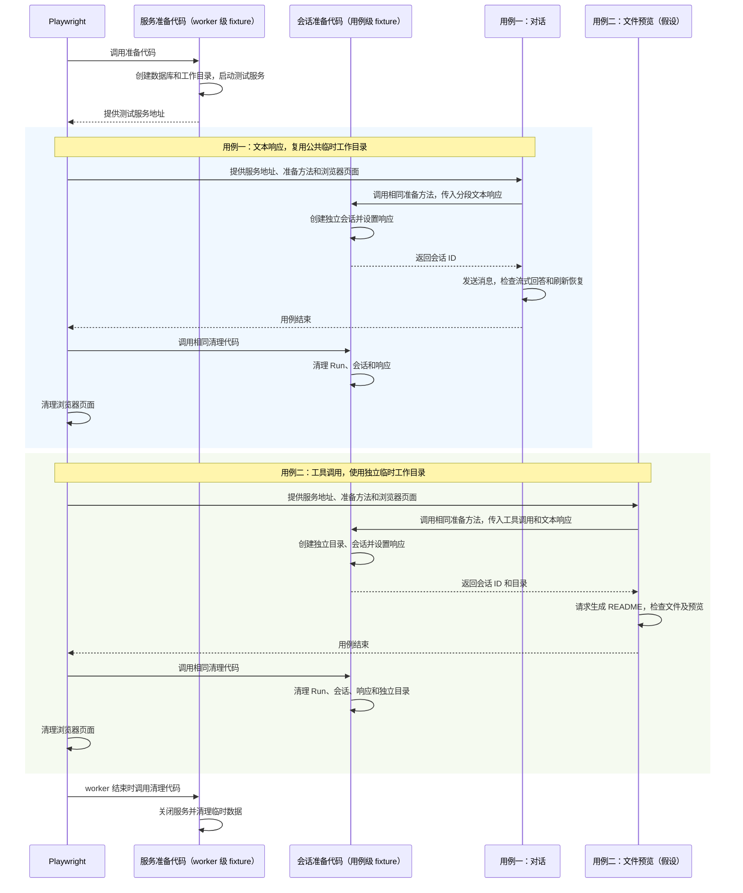

# 前端 E2E 冒烟测试方案

## 当前实现

- `npm test` 分别运行 Node 服务端测试和 Web 的 Vitest 测试。Web 组件测试使用 jsdom，部分测试 mock `run-client`；仓库尚无浏览器 E2E 命令和 CI 配置。
- 页面通过 `/conversations/:conversationId` 加载会话，发送消息经 `POST /v1/agent/conversations/:id/runs:stream` 接收 SSE；刷新后重新读取会话详情。服务端将会话和 Run 结果保存在 SQLite。
- `startAgentServer` 装配真实服务，支持通过 `port: 0` 获取系统分配的端口，通过 `AGENT_DATABASE_PATH` 指定数据库；provider 当前由环境变量创建，启动选项不能注入 provider。服务端测试已有分段 provider 和动态端口示例。
- `SQLiteConversationStore.createConversation` 可在初始化后的数据库中写入一个会话，返回实际生成的会话 ID。服务启动会执行既有迁移。
- workspace runtime 默认初始化 macOS Seatbelt runner 和工具，初始化 Web 搜索工具时需要 `TAVILY_API_KEY`。正式服务还会从用户目录发现 skills 和 MCP 配置。
- `RunRegistry` 保留运行及结束后的事件，workspace runtime 按路径和执行模式缓存；删除会话会清理对应 tool grant。`ProviderRequest` 不包含会话 ID。
- DeepSeek provider 使用 OpenAI SDK，并将 `baseURL` 显式设为 `https://api.deepseek.com`；`OPENAI_BASE_URL` 不能覆盖该地址。当前 SDK 创建客户端时会取得默认 `fetch`。项目已有模拟 Chat Completions HTTP 服务用于 provider 测试。

## 存在的问题

现有测试无法一起验证浏览器操作、真实 HTTP 和 SSE、服务端状态更新及 SQLite 恢复。真实模型输出和耗时不确定；使用日常数据库会积累会话并污染真实数据。多个 worktree 也不能安全共用固定测试端口。

## 目标实现

CI 和 Harness 在 worktree 中执行同一个 `npm run test:e2e`。每个 Playwright worker 使用独立的临时数据库和服务，多条用例顺序复用它们；每条用例准备自己的数据和浏览器 context。本期先实现以下一条用例，预置一个会话：

1. 浏览器打开预置会话，发送 `你好`。
2. 本地模拟模型服务先输出 `流式` 并暂停；页面显示 `流式` 后，测试允许模拟服务继续输出 `回答` 并完成，页面显示 `流式回答`。
3. 等待 Run 完成后刷新页面，确认仍处于同一个会话，`你好` 和 `流式回答` 均可见。

测试使用真实 Web 构建、服务装配、DeepSeek provider、HTTP、SSE 和 SQLite；会话保存在临时数据库，模型请求交给本地模拟服务，沙箱 runner 使用测试替身。刷新验证服务运行期间的持久化读取。

### 测试如何准备和清理数据

Playwright 的 fixture 是准备和清理测试资源的代码。例如，Playwright 提供的 `page` 会为用例准备浏览器页面。项目也可以编写自己的 fixture 来启动服务、准备会话和清理数据。

本方案的测试代码分别负责**测试服务**和**测试会话**：测试服务供多个用例复用；测试会话由需要会话的用例各自准备和清理。它们的准备、清理代码放在 `e2e/fixtures.ts` 中。

例如，本方案中一条对话用例的执行顺序是：

1. **启动测试服务**：测试代码创建临时数据库和 workspace，启动服务，并提供服务地址。同一个 worker 中的多条用例复用这套服务。
2. **准备测试会话**：测试代码创建本用例需要的临时会话、设置模拟模型的响应，把会话 ID 交给用例；Playwright 为用例准备独立浏览器页面。
3. **执行用例**：用例通过页面发送消息，检查流式回答和刷新后的内容。
4. **清理测试会话**：测试代码等待或取消本用例的 Run，删除临时会话并清理模拟模型的响应；Playwright 清理该用例的浏览器 context。
5. **关闭测试服务**：该 worker 的用例运行结束时，测试代码关闭服务和数据库，删除该 worker 的临时目录。

worker 是 Playwright 运行用例的独立进程，本方案默认同时运行一个。测试服务随 worker 启动和关闭；测试会话随用例准备和清理。用例失败后 Playwright 会销毁当前 worker，后续用例使用新 worker 重新准备资源。

### 参考与选型

[OpenHands 的 mock-LLM Playwright 配置](https://github.com/OpenHands/OpenHands/blob/main/playwright.mock-llm.config.ts)运行模拟模型和应用栈并使用单 worker；[Playwright fixture](https://playwright.dev/docs/test-fixtures) 支持按 worker 复用服务，并按用例隔离浏览器 context；[Cypress Real World App](https://docs.cypress.io/app/core-concepts/best-practices#Real-World-Example)通过每条用例前重新准备数据库数据获取确定的初始状态。本项目使用 worker 级服务和 SQLite、用例级数据隔离，以减少重复启动。

### 进程及边界

当前正常启动（复用）：

```text
启动终端或宿主进程
└── Node 服务进程（HTTP、Agent、SQLite；loopback）
```

浏览器由用户或宿主独立启动，通过 HTTP 访问服务；图中的线只表示父子进程关系。

目标测试启动（新增）：

```text
CI job 或 Harness 命令进程
└── Node 测试启动脚本
    └── Playwright 测试运行器
        └── Playwright worker（测试代码、Node 服务、SQLite、本地模拟模型服务）
            └── Chromium 及其子进程
```

测试代码在 worker 内启动本地模拟模型 HTTP 服务，安装请求拦截，再调用 `startAgentServer`；两者运行在该 worker 进程中。DeepSeek provider 发出的模型请求由测试拦截器转发到本地模拟服务；Chromium 是独立进程，通过 `127.0.0.1` HTTP/SSE 访问应用服务。运行在 Harness 沙箱时，worker、服务和浏览器继承该命令的权限边界；浏览器启动及 loopback 访问在目标环境验收。

worker 等待服务启动、页面断言和关闭；异步等待期间服务继续处理浏览器请求。测试框架等待 worker 结束，启动脚本等待测试框架并传递退出状态，CI 或 Harness 等待脚本退出。每个用例清理自己的模型响应、Run、会话和 context；worker 结束时先通过现有 `close()` 关闭应用服务及数据库，再关闭模拟模型服务并删除 worker 临时目录。用例失败后，Playwright 销毁 worker，后续用例启动新的 worker、服务和数据库。启动脚本收到终止信号时转发给测试进程，等待退出并清理临时 HOME。强制终止后，宿主可清理本次运行残留的临时目录。

## 具体改动

### 1. 本地模拟模型服务

现有文件涉及根 `package.json`、`package-lock.json`、`.gitignore` 和 `README.md`，另新增测试启动脚本、Playwright 配置、E2E 类型检查配置、共享测试准备代码、模拟服务和用例；依赖锁文件由安装命令生成。应用服务和 provider 代码保持不变。

worker 在测试代码中启动本地 HTTP 服务，监听 `127.0.0.1` 的动态端口，使用隔离环境设置 `LLM_PROVIDER=deepseek` 和测试用密钥、模型名。应用仍通过现有 `createProviderFromEnvironment` 创建 DeepSeek provider。创建客户端前，测试代码在当前 worker 安装 `fetch` 拦截器，将对 `https://api.deepseek.com/chat/completions` 的请求转发到本地模拟服务；其他非 loopback 请求直接失败。模拟服务按 Chat Completions 流式协议输出预设事件，未配置响应或请求路径不符时失败，不向外网转发。服务关闭后恢复原始 `fetch`。

| 配置 | 来源 | 含义 |
| --- | --- | --- |
| `LLM_PROVIDER` | 测试代码固定为 `deepseek` | 选择 DeepSeek provider |
| `DEEPSEEK_API_KEY` | 测试代码固定测试值 | 满足 SDK 初始化，不使用用户密钥 |
| `DEEPSEEK_MODEL` | 测试代码固定测试值 | 发往模拟服务的模型名称 |

应用启动前检查模拟服务已监听且拦截器已安装。模拟服务不可用时测试失败。拦截器由 worker 统一安装和清理；完整流式 HTTP 链路在验收时验证。

同一套模拟服务由各用例提供响应序列：每次模型请求依次取一项响应。首条用例提供一项分段文本响应；未来需要生成文件的用例可以提供两项响应：第一项发出 `write` 工具调用，第二项在工具执行后返回文本。具体输入和结果如下：

```ts
// 对话用例：一项文本响应，第一段发送后暂停。
responses: [{ type: "text", chunks: ["流式", "回答"], pauseAfterFirst: true }]

// 文件用例示例：先调用 write，再返回最终回答。
responses: [
  { type: "tool_call", name: "write", arguments: { path: "README.md", content: "# 示例\n" } },
  { type: "text", chunks: ["已创建 README.md"] },
]
```

以上是测试代码的接口示意。模拟服务将每项转换为 DeepSeek 使用的 Chat Completions SSE：文本输出 delta 和结束事件；工具调用输出带调用 ID、工具名及 JSON 参数的 `tool_calls`，以 `finish_reason: tool_calls` 结束。实际事件格式参考 `deepseek-provider.test.ts` 和已有的 `test/support/fake-chat-completions-server.ts`，实施时验证 SDK 对 HTTP 状态、SSE 帧及结束标记的要求。

| 字段 | 来源 | 必填 | 含义 |
| --- | --- | --- | --- |
| `responses` | 用例 | 是 | 按模型请求顺序使用的响应列表 |
| `type` | 用例 | 是 | `text` 表示文本；`tool_call` 表示工具调用 |
| `chunks` | 用例 | 文本响应必填 | 依次发送的文本片段 |
| `pauseAfterFirst` | 用例 | 否，默认 `false` | 首段文本发出后暂停，由测试显式继续 |
| `name` | 用例 | 工具调用必填 | 工具名称，本期为复用验证支持 `write` |
| `arguments` | 用例 | 工具调用必填 | 工具调用参数，由测试代码序列化为 JSON |

第一条用例在页面出现 `流式` 后释放暂停，再检查完整回答。每次请求捕获当前响应；响应列表耗尽、工具名未支持或未设置响应时请求失败。连接断开、取消、超时和清理时释放等待并关闭连接。每个 worker 内用例顺序执行，上一用例 Run 终止后切换响应序列。已有其他测试依赖的模拟服务行为保持兼容。

### 2. 测试服务、会话和浏览器用例

- 新增 `playwright.config.ts`、`tsconfig.e2e.json`、`e2e/fixtures.ts`、`e2e/model-mock.ts` 和 `e2e/conversation.spec.ts`，默认使用单 worker、Chromium、无自动重试；失败保留 Playwright trace 和截图，输出放入忽略的测试结果目录。锁定 `@playwright/test` 并提交锁文件，由安装命令安装与依赖版本匹配的 Chromium。

下图展示两条用例如何复用同一套测试服务和准备代码：第一条是本期对话用例；第二条是未来文件预览用例的假设示例。Playwright 负责调用项目编写的准备和清理代码；箭头表示调用和结果返回，进程关系见上方「进程及边界」。



两条用例复用服务准备、会话准备和清理代码，通过输入选择响应序列和工作目录。图示用例在同一 worker 顺序运行，worker 的用例结束后关闭服务。文件预览入口以未来实际实现为准。每个 worker 独立准备服务、数据库、HOME 和端口；每条用例使用独立的浏览器页面及 context。会话和页面清理完成后开始下一条用例。

- worker 内的测试代码在启动应用服务前调用 `initializeSqliteSchema` 初始化临时数据库。需要会话的用例通过 `SQLiteConversationStore.createConversation` 写入会话、取得 ID，并关闭准备数据用的连接；应用服务使用同一 SQLite 文件的独立连接。写入完成后再导航页面。第一条用例只创建一个会话；数据库 schema、迁移、索引均不变。
- 会话需要关联一个实际存在的工作目录。测试启动时创建一个空的临时目录；只发送消息、不修改文件的用例可以将各自的测试会话关联到这个目录。各用例仍使用独立会话，临时目录与执行测试的 Git worktree 是两个目录。会修改文件或目录内配置的用例使用独立临时目录并自行清理。
- 服务会按工作目录缓存运行环境，使用独立目录的用例可能增加缓存条目，服务退出时释放；如用例需要验证或改变全局配置、审批、授权、全局列表或重启恢复，须单独使用独立服务和数据库，直到能够证明共享环境下的隔离机制。
- 测试通过现有 `startAgentServer({ port: 0, sandboxRunnerFactory })` 每 worker 启动一次真实服务，`HOST` 固定 `127.0.0.1`，数据库路径使用 worker 的临时绝对路径。测试 runner 使用不执行任何宿主命令的替身；应用原有 `write` 工具直接在指定工作目录内写入文件，按原权限策略执行。提供测试用非真实 `TAVILY_API_KEY` 以满足当前工具初始化，不发起搜索请求。
- 启动测试 worker 前构造隔离的测试进程环境：临时 HOME、显式的模型容量、loopback HOST 和测试用搜索 key，不加载 `.env`。worker 使用独立的临时数据库路径和 HOME；若服务支持 `AGENT_MEMORY_ROOT`，为每个 worker 指定独立临时目录。临时 workspace 不包含项目配置。验收时确认 `homedir()` 指向临时 HOME。
- 测试前构建 `web/dist`。用例通过页面可见状态断言中间文本、最终文本和 Run 结束状态；刷新后确认同一会话、用户消息和完整回答。中间文本未出现、提前完成或刷新结果丢失时测试失败。

共享测试代码管理服务启动、会话准备及清理；
用例提供自己的响应序列和断言。
每个用例开始前确认没有活跃 Run、模拟模型服务没有残留响应、共享库中没有上一用例的会话；如果不满足，测试代码报错且不继续使用该服务。每个用例结束时先释放响应等待，通过 `GET /v1/agent/runs:watch` 的首条快照查询活动 Run，并对属于本用例的 Run 调用既有取消接口；存在 Run 时等待会话详情显示终态且活动快照中不再包含该 Run，没有创建 Run 时直接跳过终态等待。随后通过现有删除会话接口删除本用例会话并验证删除成功；使用独立工作目录时同时删除该目录。确认无活跃 Run 后清空模拟响应。不能确认终态或清理失败时令用例失败，
由 Playwright 销毁该 worker，不让下一条用例继续复用污染的服务。授权、审批及全局状态测试先使用独立服务。

`RunRegistry` 会暂时保留已结束的 Run；每条用例创建独立会话。用例结束时，等待该会话的 Run 结束并清理会话，再执行下一条用例。

两条用例通过同一个 `testSession.prepare` 准备各自的会话。方法从当前 worker 获取已启动的测试服务，按参数选择工作目录、创建会话并设置模拟响应，返回本次用例需要的数据。每条用例最多调用一次；调用失败时清理已经创建的资源。测试结束后，由同一套清理代码收尾。以下是接口示意：

```ts
test("发送消息并刷新", async ({ page, testSession }) => {
  const responses = [{ type: "text", chunks: ["流式", "回答"], pauseAfterFirst: true }];
  const { url, conversationId, resumeResponse } = await testSession.prepare({ responses });
  await page.goto(`${url}/conversations/${conversationId}`);
  // 发送消息，检查首段出现后调用 resumeResponse，再检查完成和刷新结果。
});

// 未来用例示例：预览入口以产品实际实现为准。
test("生成并预览文件", async ({ page, testSession }) => {
  const responses = [
    { type: "tool_call", name: "write", arguments: { path: "README.md", content: "# 示例\n" } },
    { type: "text", chunks: ["已创建 README.md"] },
  ];
  const { url, conversationId, workspacePath } = await testSession.prepare({
    workspace: "isolated",
    responses,
  });
  await page.goto(`${url}/conversations/${conversationId}`);
  // 发送请求，验证 workspacePath 下的文件及页面中的预览。
});
```

| 输入或结果 | 来源 | 必填 | 含义 |
| --- | --- | --- | --- |
| `responses` | 用例 | 是 | 当前用例按模型请求顺序使用的响应序列 |
| `workspace` | 用例 | 否，默认 `shared` | `shared` 使用 worker 的公共空目录；`isolated` 为用例创建独立临时目录 |
| `url` | 测试代码 | 返回值 | 当前 worker 服务的 loopback 地址 |
| `conversationId` | 测试代码 | 返回值 | 为当前用例预置的会话 ID |
| `resumeResponse` | 测试代码 | 返回值 | 释放当前文本响应的暂停；未暂停时无影响 |
| `workspacePath` | 测试代码 | 返回值 | 当前会话关联的临时工作目录，供用例验证文件 |

两条用例复用服务启动、`prepare`、模型响应控制和清理代码，分别提供响应序列、目录选择及页面断言。当前首期只实现对话用例；文件预览侧栏的入口与行为须以未来实际实现为准。现有 `write` 默认权限为允许，实际测试仍走原有权限判断；若其他用例需要审批或全局状态，按前述方式使用独立服务。

### 3. 命令和环境

根 `package.json` 建议在现有测试脚本旁增加：

```diff
     "test:server": "npm run build:server --silent && node --test dist/test/*.test.js",
     "test:web": "npm --prefix web test",
+    "test:e2e": "npm run build && tsc -p tsconfig.e2e.json && node scripts/run-e2e.mjs",
     "desktop:dev": "npm run build && node scripts/prepare-desktop.mjs && electron .",
```

`scripts/run-e2e.mjs` 创建隔离的运行目录，以隔离后的环境启动 Playwright，等待退出并清理运行目录；每个 worker 在其中创建和清理自己的 HOME、数据库及 workspace。脚本透传 Playwright 命令行参数，支持按文件或 `--grep` 选择用例。浏览器安装目录须通过显式 `PLAYWRIGHT_BROWSERS_PATH` 等方式传入隔离进程，不能因临时 HOME 导致找不到已安装的浏览器。每次运行使用独立的结果输出目录，避免并发运行互相删除诊断文件；失败产物保留并输出路径。`npm test` 保持不变。新增 `.gitignore` 条目忽略 Playwright 结果及报告；README 说明浏览器安装、运行命令和受限环境要求。CI 配置当前不在仓库中，接入时在实际 CI 平台配置 Node 版本、`npm ci`、Chromium 安装及 `npm run test:e2e`。

| 条件 | CI 和 worktree 的要求 |
| --- | --- |
| Node 与依赖 | 满足仓库 Node `>=22.23.0`，执行 `npm ci` |
| 浏览器 | 安装与 Playwright 版本匹配的 Chromium 及系统依赖 |
| 权限 | 可创建临时文件、启动无头浏览器、监听及访问 loopback；不改变现有沙箱策略 |
| 输出 | 构建产物使用当前 worktree，失败时保留 trace 和截图供排查 |

在 CI runner 和 Harness worktree 中分别验证浏览器依赖及网络权限。

| 限制对象 | 单位 | 初始上限 | 超限行为 |
| --- | --- | --- | --- |
| 测试用例 | 秒 | 60 | 测试失败并执行清理 |
| 服务启动 | 秒 | 30 | 启动失败并执行清理 |
| worker | 个 | 1（默认） | 用例顺序执行；未来调整前须验证多 worker 隔离 |

时间上限依据目标环境的实测结果调整。

## 保持不变

- 应用服务装配、日常服务默认 provider、会话管理、SQLite schema 和迁移保持不变；现有测试命令不改变。
- 首条浏览器用例覆盖普通对话；工具响应集成验证使用独立临时工作目录。
- 既有 macOS Seatbelt 测试按仓库规范执行。

## 验收

1. 在 CI runner 和 Harness 实际 worktree 环境分别安装依赖并运行同一 `npm run test:e2e`，各自完整通过；记录系统、权限模式和执行结果。浏览器或 loopback 被沙箱阻止时记录具体错误并标为未通过。
2. 验证首条用例只在 worker 临时库预置一个会话，用户消息、中间文本、最终文本和刷新恢复均符合示例；无真实模型及工具调用。
3. 使用两条独立验证用例检查测试准备和清理：前一条正常写入数据并结束后，后一条在同一个服务上看到干净的会话列表和无活跃 Run；单独运行后一条得到相同结果。另让第一条用例在 Run 等待时失败，验证该 worker 退出，后一条在新 worker 的独立数据库和服务上通过。检查模拟模型响应不串用、浏览器 context 不共享状态，记录服务和数据库标识以证明各自复用或重建。连续运行两次，以及在不同 worktree 并行运行两份命令，确认输出和临时数据互不冲突，正常和失败路径都清理进程、数据库和临时目录。同一 worktree 的并发构建会写入相同 `dist` 和 `web/dist`，不作为支持场景；并行执行使用独立 worktree。
4. 有意让中间输出断言失败及最终输出断言失败，确认命令非零退出、产出诊断材料且不遗留服务或浏览器。确认强制终止的临时目录限制与文档一致。
5. 执行适用的类型检查和既有相关测试；运行前检查 `MY_AGENT_HARNESS_SANDBOX`，按仓库规则标出需宿主验证的真实 Seatbelt 用例。
6. 在 CI 和 Harness 环境记录构建、worker 服务及数据库初始化、浏览器启动、用例执行和清理的耗时；比较首条与后续用例的耗时，依据测量决定是否进一步优化或增加 worker。
7. 用同一个 `testSession.prepare` 和同一 worker 测试服务验证两种输入：文本可暂停与恢复；`write` 工具调用后接最终文本，文件只写入独立临时工作目录。验证两次调用各自产生独立会话、按用例清理，响应耗尽时失败、用例之间不串用，原有模拟服务测试继续通过。文件预览页面的 E2E 留待入口实现后补充。
