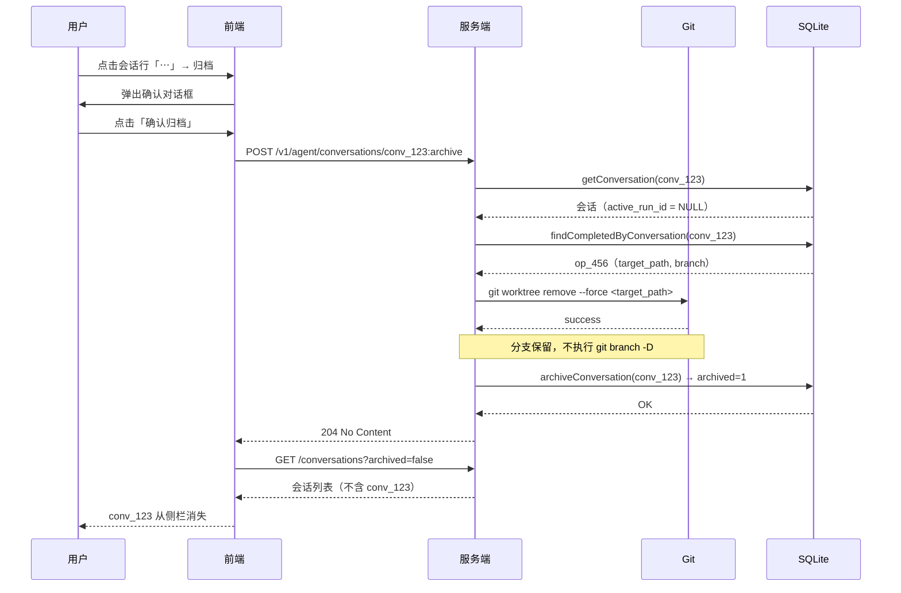

# 会话归档功能 — 技术方案

## 概述

本文档描述会话归档功能的技术实现。归档将会话从侧栏主列表移除、禁止后续写入，并清理该会话创建的 worktree；会话数据保留在数据库中。首版不支持恢复。

## 参考方案与取舍

调研了主流 AI Coding Harness 的会话归档设计：

| 方案 | 归档入口 | 存储方式 | worktree 处理 | 恢复 |
| --- | --- | --- | --- | --- |
| OpenHands | 会话卡片菜单 → Archive → 确认对话框 | 数据库标记 | 不涉及 worktree | 支持 unarchive |
| OpenCode | Chats library → Archive | 数据库标记 | 不涉及 worktree | 支持 Restore |
| VS Code Agents | Hover → Archive / Mark as Done | 数据库标记 | **先提交未提交更改到会话分支，再删除 worktree 文件夹** | 支持 Unarchive / Restore |
| Codex CLI | `codex archive <id>` 命令 | 文件移至 `~/.codex/archived_sessions` 目录 | 不涉及 worktree | 支持 `codex resume` |
| Claude Code | `archiveInactiveSessions` 配置自动归档 | 数据库标记 | 不涉及 worktree | 不适用（自动归档） |

**对本项目的适用性与取舍：**

1. **归档入口**：OpenHands、VS Code 均采用"会话行菜单 → 归档 → 确认对话框"模式，与本项目现有"重命名/删除"菜单结构一致，直接复用。Codex CLI 是命令行入口，不适用于本项目的 GUI 交互。
2. **存储方式**：Codex CLI 用文件系统目录分离（`archived_sessions/`），OpenHands/OpenCode/VS Code 用数据库标记。本项目已用 SQLite 存储会话，采用数据库 `archived` 字段标记，与现有架构一致，无需引入文件系统分离。
3. **worktree 处理**：VS Code 的策略是"先提交未提交更改，再删除 worktree"。本项目 MVP 阶段采用 `git worktree remove --force`，**不提交未提交更改，直接丢弃**。理由：归档语义是"任务已结束"，用户应在归档前自行处理未提交更改；增加自动提交流程会引入 commit message 生成、冲突处理等复杂逻辑，超出 MVP 范围。未提交更改的处理在确认对话框中明确提示用户。
4. **恢复**：OpenHands、OpenCode、VS Code、Codex CLI 均支持恢复。本项目首版不做恢复，归档是单向操作。数据库保留 `archived` 字段，未来恢复只需将其置回 0，不影响数据结构（Codex CLI 的目录分离方式恢复则是移回原目录，复杂度相当）。
5. **归档会话的访问**：OpenHands 从默认列表消失，通过筛选查看；Codex CLI 归档会话在 `archived_sessions` 目录。本项目采用侧栏底部「已归档」入口进入独立归档视图，与产品方案一致。

## 当前实现（事实基线）

### conversations 表

当前 `conversations` 表共 11 个物理列：

| 列名 | 类型 | 约束 | 语义 |
| --- | --- | --- | --- |
| id | TEXT | PRIMARY KEY | 会话 ID |
| revision | INTEGER | NOT NULL DEFAULT 0 CHECK (revision >= 0) | 乐观锁版本号 |
| workspace_root | TEXT | NOT NULL | 工作区根目录 |
| execution_mode | TEXT | NOT NULL CHECK (execution_mode IN ('workspace_sandbox','full_access')) | 执行模式 |
| active_run_id | TEXT | NULL, FOREIGN KEY REFERENCES runs(id) ON DELETE SET NULL | 当前活动 Run ID |
| created_at | TEXT | NOT NULL | 创建时间 |
| updated_at | TEXT | NOT NULL | 最后更新时间 |
| title | TEXT | NULL CHECK (title IS NULL OR length(title) BETWEEN 1 AND 120) | 会话标题 |
| project_key | TEXT | NULL | 项目标识 |
| project_root | TEXT | NULL | 项目主工作区根目录 |
| workspace_kind | TEXT | NULL CHECK (workspace_kind IN ('main','worktree','subdirectory','directory')) | 工作区类型 |

无归档状态字段。

### 会话列表查询

`ConversationListQuery`（[conversation-store.ts](../../src/application/conversation-store.ts)）仅支持 `projectKey`、`limit`、`offset` 三个过滤条件，不支持按归档状态过滤。`listConversations` 返回所有会话，前端全量展示。

### worktree 创建与记录

- `WorktreeCreator`（[worktree-creation.ts](../../src/application/worktree-creation.ts)）创建 worktree 时，通过 `WorktreeOperationStore.record` 写入 `worktree_operations` 表，记录 `conversation_id`、`project_root`、`target_path`、`branch` 等字段。
- `worktree_operations` 表当前没有按 `conversation_id` 查询单条记录的方法，只有 `listRecent` 和 `markInterruptedOperations`。
- worktree 创建时执行 `git worktree add`，分支与 worktree 绑定。当前没有删除 worktree 的流程。

### Run 启动流程

- `POST /v1/agent/conversations/:id/runs:stream` → `RunRegistry.start` → `ConversationRunService.startRun` → `ConversationStore.beginRun`。
- `beginRun`（[sqlite-conversation-store.ts](../../src/infrastructure/sqlite/sqlite-conversation-store.ts)）检查 `active_run_id` 为 NULL，写入新 Run 的 turns 记录。
- `runs:steer` 路由调用 `RunRegistry.getByConversation`，不经过 store 的写入检查。

## 存在的问题

1. `conversations` 表没有归档状态字段，无法区分活动会话与归档会话。
2. 会话列表查询无法按归档状态过滤，前端只能全量展示。
3. 没有归档操作入口，也没有归档后的只读约束。
4. worktree 创建后没有对应的清理流程，归档会话的 worktree 会残留。

## 端到端示例

以一个使用 worktree 的会话为例，走通归档的完整路径：

**前置状态**：会话 `conv_123` 项目为 `my-agent-harness`，工作区类型为 `worktree`，关联 worktree 操作记录 `op_456`（`target_path = ~/.westie/worktrees/conv_123`，`branch = feat/archive`，`status = completed`）。该会话没有活动 Run。

**步骤**：

1. 用户在侧栏点击会话 `conv_123` 行的「⋯」菜单，选择「归档」。
2. 前端弹出确认对话框，显示：
   - 该会话将从主列表移除，移入「已归档」
   - 此会话创建的 worktree 目录将被删除（feat/archive 所在的工作目录）
   - worktree 内未提交的更改将被直接丢弃，且无法恢复
   - 对应的本地分支会保留，不会被删除
   - 归档后无法继续对话，操作不可撤销
3. 用户点击「确认归档」。
4. 前端调用 `POST /v1/agent/conversations/conv_123:archive`。
5. 服务端 `ConversationService.archiveConversation`：
   a. 读取会话，确认无活动 Run。
   b. 通过 `worktreeOperations.findCompletedByConversation('conv_123')` 找到 `op_456`。
   c. 在 `op_456.project_root` 下执行 `git worktree remove --force ~/.westie/worktrees/conv_123`。
   d. 调用 `conversationStore.archiveConversation('conv_123')`，将 `archived` 置为 1。
6. 服务端返回 `204 No Content`。
7. 前端刷新侧栏会话列表（`archived=false`），`conv_123` 从侧栏消失。

**时序图**：



## 目标实现

### 数据库变更

在 `conversations` 表新增 `archived` 列，表示归档状态。

**Schema diff（conversations 表）**

| 变更类型 | 列名 | 类型 | 约束 | 默认值 | 语义 |
| --- | --- | --- | --- | --- | --- |
| 新增 | archived | INTEGER | NOT NULL CHECK (archived IN (0, 1)) | 0 | 0=未归档，1=已归档 |

变更后 `conversations` 表共 12 个物理列：id, revision, workspace_root, execution_mode, active_run_id, created_at, updated_at, title, project_key, project_root, workspace_kind, archived。

不新增主键、外键、索引或其他约束。`archived` 不需要索引（首版归档会话数量少，且查询条件通常带 `project_key`）。

**迁移方式**

目标 `user_version`：5（当前为 4）。

升级 DDL：

```sql
ALTER TABLE conversations
  ADD COLUMN archived INTEGER NOT NULL DEFAULT 0 CHECK (archived IN (0, 1));
```

存量行取值：所有已有会话 `archived = 0`（未归档），由 `DEFAULT 0` 自动填充。

新建库同步：`initializeSqliteSchema` 中 `CREATE TABLE conversations` 同步新增 `archived` 列定义，使新建库直接包含该列。

旧代码遇到新版本库的行为：旧代码不感知 `archived` 列，查询时该列被忽略；写入时因列有 `DEFAULT 0`，旧代码的 INSERT 不会出错。旧代码不会设置 `archived = 1`，因此旧代码写入的会话始终为未归档，不影响新代码的归档过滤。

### 服务端改动

#### Store 层

`ConversationStore` 接口（[conversation-store.ts](../../src/application/conversation-store.ts)）变更：

1. `ConversationListQuery` 新增可选字段 `archived?: boolean`。`listConversations` 根据该字段过滤：传 `false` 只返回未归档会话，传 `true` 只返回已归档会话，不传则返回全部。
2. 新增方法 `archiveConversation(conversationId: string): void`：将 `archived` 置为 1，`revision` 自增，`updated_at` 更新为当前时间。要求该会话 `active_run_id IS NULL`，否则抛出 `ConversationHasActiveRunError`（复用现有错误）。
3. `beginRun` 增加检查：若会话 `archived = 1`，抛出新增错误 `ConversationArchivedError`。
4. `renameConversation` 增加检查：若会话 `archived = 1`，抛出 `ConversationArchivedError`。
5. `Conversation`、`ConversationSummary` 领域对象新增 `archived: boolean` 字段，`getConversation`、`listConversations` 返回时填充。

`SQLiteWorktreeOperationStore`（[worktree-operation-store.ts](../../src/infrastructure/sqlite/worktree-operation-store.ts)）新增方法：

6. `findCompletedByConversation(conversationId: string): WorktreeOperationRecord | null`：按 `conversation_id` 且 `status = 'completed'` 查询最新一条 worktree 操作记录（按 `created_at DESC` 取第一条）。用于归档时定位需要清理的 worktree。

#### 错误类型

新增 `ConversationArchivedError`（位于 `conversation-store.ts`）：

```ts
export class ConversationArchivedError extends Error {
  constructor(conversationId: string) {
    super(`会话已归档，无法执行该操作: ${conversationId}`);
    this.name = "ConversationArchivedError";
  }
}
```

#### Service 层

`ConversationService`（[conversation-service.ts](../../src/application/conversation-service.ts)）新增方法 `archiveConversation`，编排归档与 worktree 清理：

```
archiveConversation(conversationId):
  1. conversation = conversationStore.getConversation(conversationId)
     若不存在 → ConversationNotFoundError
  2. 若 conversation.activeRunId !== null → ConversationHasActiveRunError
  3. operation = worktreeOperations.findCompletedByConversation(conversationId)
  4. 若 operation 存在：
     a. git worktree remove --force <operation.target_path>
        （cwd = operation.project_root；若报错为 worktree 不存在，视为已清理）
     b. 若步骤 a 发生其他错误 → 抛出，归档中止，数据库不变更
     c. 不删除分支：分支可能由用户在「检出已有分支」模式下带入，
        也可能含有尚未合并、未推送的提交；保留分支的磁盘成本可以忽略，
        删除分支则会让这些提交在 gc 后永久丢失
  5. conversationStore.archiveConversation(conversationId)
```

关键设计：**先清理 worktree，再更新数据库**。保证 `archived = 1` 时 worktree 目录一定已清理；若清理失败，会话保持未归档，用户可重试。归档只删 worktree 目录，分支一律保留，由用户按自己的 Git 工作流处理。

`ConversationService` 构造函数新增依赖：`worktreeOperations: SQLiteWorktreeOperationStore` 和 `gitRunner: GitProcessRunner`。两者均来自 `createProjectServices` 的返回值，由 `server-bootstrap.ts` 注入。

#### HTTP 路由

**新增接口**

`POST /v1/agent/conversations/:id:archive`

| 项目 | 说明 |
| --- | --- |
| 方法 | POST |
| 路径参数 | `id`：会话 ID（必填，string） |
| 请求体 | 无 |
| 成功响应 | `204 No Content` |
| 调用方 | 前端归档确认对话框的「确认归档」按钮 |

错误响应：

| 错误 | HTTP 状态码 | 触发条件 |
| --- | --- | --- |
| ConversationNotFoundError | 404 | 会话不存在 |
| ConversationHasActiveRunError | 409 | 会话有活动 Run |
| ConversationArchivedError | 409 | 会话已归档（重复归档） |
| worktree 清理失败 | 500 | `git worktree remove` 发生非"不存在"错误 |

**扩展接口**

`GET /v1/agent/conversations` 新增查询参数：

| 参数 | 类型 | 必填 | 默认值 | 语义 |
| --- | --- | --- | --- | --- |
| archived | string (`"true"` \| `"false"`) | 否 | 无（返回全部） | 按归档状态过滤 |

- 透传到 `ConversationListQuery.archived`。
- 前端侧栏调用时传 `archived=false`，归档视图调用时传 `archived=true`。
- 不传时返回全部会话（兼容现有调用）。

**响应字段扩展**

`ConversationSummary` / `ConversationDetail` HTTP 响应新增字段：

| 字段 | 类型 | 必填 | 语义 |
| --- | --- | --- | --- |
| archived | boolean | 是 | 是否归档 |

**已有接口的归档拦截**

| 接口 | 拦截点 | 行为 |
| --- | --- | --- |
| `POST /:id/runs:stream` | `beginRun` 检查 `archived` | `ConversationArchivedError` → 409 |
| `POST /:id/runs:steer` | 路由层检查会话 `archived` | 已归档 → 409 |
| `PATCH /:id`（重命名） | `renameConversation` 检查 `archived` | `ConversationArchivedError` → 409 |
| `DELETE /:id`（删除） | 不拦截 | 归档会话仍可删除 |

### 前端改动

#### 类型与 API 客户端

1. `ConversationSummary`、`ConversationDetail` 新增 `archived: boolean`。
2. `parseConversationSummary`、`parseConversationDetail` 解析 `archived` 字段。
3. `run-client.ts` 新增 `archiveConversation(conversationId)` 方法，调用 `POST /v1/agent/conversations/:id:archive`。
4. `fetchConversations` 支持 `archived` 参数。

#### 侧栏

1. `ConversationList` 调用 `fetchConversations({ archived: false })`，只展示未归档会话。
2. 侧栏底部、MCP 服务器入口上方新增「已归档」导航项，点击切换到归档视图。

#### 会话行操作菜单

1. 活动会话行的操作菜单新增「归档」项，位于「重命名」和「删除」之间。
2. 运行中的会话「归档」与「删除」一并禁用。
3. 点击「归档」弹出确认对话框，说明后果（含 worktree 将被删除的提示）。
4. 确认后调用 `archiveConversation`，成功后刷新会话列表。

#### 归档视图

1. 新增归档列表视图：调用 `fetchConversations({ archived: true })`，按项目分组卡片展示。
2. 卡片展示会话标题、工作目录类型、归档时间（用 `updatedAt`，归档时会更新）。
3. 卡片操作菜单只保留「删除」。
4. 点击卡片进入该会话的只读详情。

#### 归档会话只读详情

1. 详情页不渲染输入框和发送按钮，页面结束于最后一条消息。
2. 顶部项目栏标注「已归档」标识。
3. 顶部显示「← 返回归档列表」，点击回到归档列表。
4. 历史消息与 Run 轨迹展示逻辑不变。

## 失败路径

| 场景 | 检测位置 | 响应 | 用户可执行的恢复 |
| --- | --- | --- | --- |
| 会话不存在 | `getConversation` 返回 null | 404 | 刷新列表 |
| 会话有活动 Run | `activeRunId !== null` | 409 | 等待 Run 结束或取消后重试 |
| 会话已归档（重复归档） | `archived = 1` | 409 | 无需操作 |
| `git worktree remove` 失败（非"不存在"） | git 命令返回非零退出码 | 500 | 检查 worktree 状态后重试 |
| 数据库更新失败 | `archiveConversation` 抛出 | 500 | 重试（worktree 可能已清理，git 步骤会视为已清理）；分支始终保留，不涉及分支清理 |
| `runs:stream` 对归档会话 | `beginRun` 检查 | 409 | 新建会话 |
| `runs:steer` 对归档会话 | 路由层检查 | 409 | 新建会话 |
| 重命名归档会话 | `renameConversation` 检查 | 409 | 无需操作 |

## 具体改动

### 文件清单

| 文件 | 改动 |
| --- | --- |
| `src/infrastructure/sqlite/schema.ts` | `CREATE TABLE conversations` 新增 `archived` 列 |
| `src/infrastructure/sqlite/migrations.ts` | 新增 version 5 迁移（`ALTER TABLE`） |
| `src/infrastructure/sqlite/rows.ts` | `ConversationRow`、`ConversationSummaryRow` 新增 `archived` 字段映射 |
| `src/infrastructure/sqlite/sqlite-conversation-store.ts` | `listConversations` 支持 `archived` 过滤；新增 `archiveConversation`；`beginRun`、`renameConversation` 增加归档检查；返回对象填充 `archived` |
| `src/application/conversation-store.ts` | `ConversationListQuery` 新增 `archived`；接口新增 `archiveConversation`；`Conversation`、`ConversationSummary` 新增 `archived`；新增 `ConversationArchivedError` |
| `src/infrastructure/sqlite/worktree-operation-store.ts` | 新增 `findCompletedByConversation` 方法 |
| `src/application/conversation-service.ts` | 新增 `archiveConversation` 方法及 worktree 清理逻辑；构造函数新增 `worktreeOperations`、`gitRunner` 依赖 |
| `src/http/conversation-archive-route.ts`（新建） | 新增 `POST /v1/agent/conversations/:id:archive` 路由 |
| `src/http/conversation-item-routes.ts` | `PATCH` 路由处理 `ConversationArchivedError` → 409 |
| `src/http/conversation-list-routes.ts` | 解析 `archived` 查询参数 |
| `src/http/conversation-run-sse-route.ts` | 处理 `ConversationArchivedError` → 409 |
| `src/http/conversation-run-steer-route.ts` | 增加归档检查 → 409 |
| `src/server-bootstrap.ts` | 注入 `worktreeOperations`、`gitRunner` 到 `ConversationService`；注册 archive 路由 |
| `web/src/types.ts` | `ConversationSummary`、`ConversationDetail` 新增 `archived` |
| `web/src/run-client.ts` | 解析 `archived`；新增 `archiveConversation`；`fetchConversations` 支持 `archived` |
| `web/src/hooks/useConversationList.ts` | 支持 `archived` 过滤参数 |
| `web/src/components/ConversationList.tsx` | 新增「归档」菜单项；归档视图列表 |
| `web/src/components/Sidebar.tsx` | 新增「已归档」导航入口 |
| `web/src/components/ConversationDetail.tsx`（或对应文件） | 归档会话不渲染输入框；只读标识；返回按钮 |

## 保持不变

- 会话删除逻辑不变：归档会话仍可删除，删除后从数据库永久移除。
- 会话创建逻辑不变：新建会话默认 `archived = 0`。
- Run 的执行、消息流转、工具调用逻辑不变。
- worktree 创建逻辑不变。
- `worktree_operations` 表结构不变。
- 历史消息、Run 轨迹的读取逻辑不变。
- 前端活动会话的详情页交互不变（输入框、发送按钮正常展示）。

## 验收标准

### 数据库

- [ ] 新建库 `conversations` 表包含 `archived` 列，类型 `INTEGER NOT NULL DEFAULT 0 CHECK (archived IN (0, 1))`。
- [ ] 存量库从 version 4 升级到 version 5，已有会话 `archived = 0`。
- [ ] `archiveConversation` 后会话 `archived = 1`，`revision` 自增，`updated_at` 更新。

### 服务端

- [ ] `POST /:id:archive` 对无活动 Run 的未归档会话返回 204，会话 `archived` 变为 1。
- [ ] 有活动 Run 的会话归档返回 409。
- [ ] 已归档会话再次归档返回 409。
- [ ] 归档时若会话有关联 worktree 操作，worktree 目录被删除，分支保留（不执行 `git branch -D`）。
- [ ] `GET /conversations?archived=false` 不返回归档会话；`archived=true` 只返回归档会话；不传返回全部。
- [ ] 对归档会话调用 `runs:stream`、`runs:steer`、重命名均返回 409。
- [ ] 归档会话仍可删除（`DELETE /:id` 返回 204）。
- [ ] worktree 清理失败时归档中止，会话保持未归档。

### 前端

- [ ] 侧栏只展示未归档会话。
- [ ] 侧栏底部有「已归档」入口，点击进入归档视图。
- [ ] 活动会话行菜单有「归档」项，运行中会话禁用。
- [ ] 点击「归档」弹出确认对话框，确认后调用接口，成功后侧栏刷新。
- [ ] 归档视图按项目分组展示归档会话卡片。
- [ ] 归档会话详情不显示输入框，有「已归档」标识和「返回归档列表」按钮。
