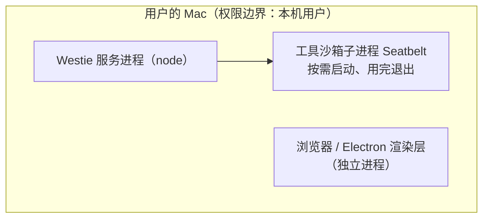
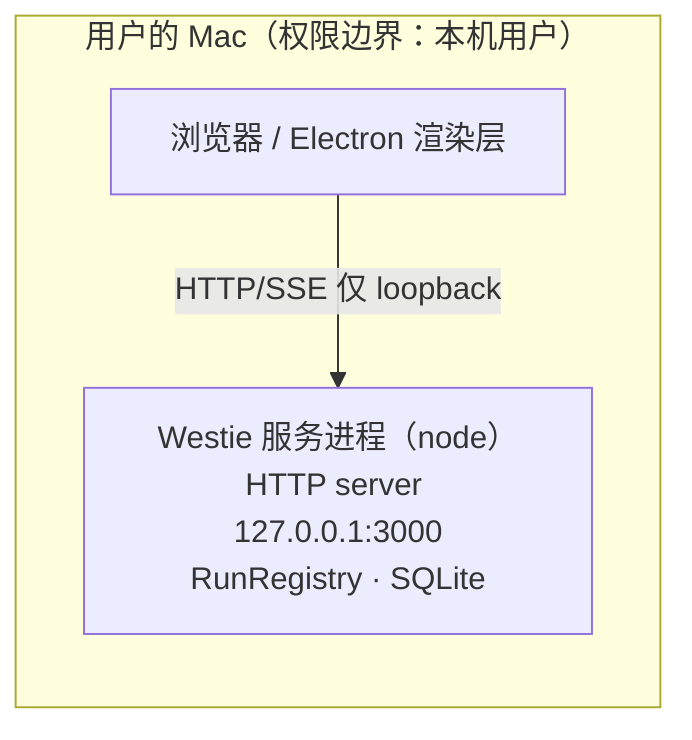
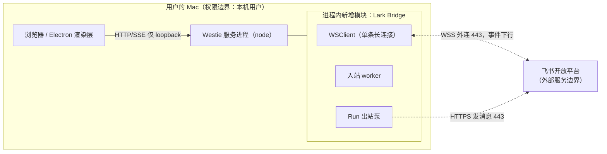
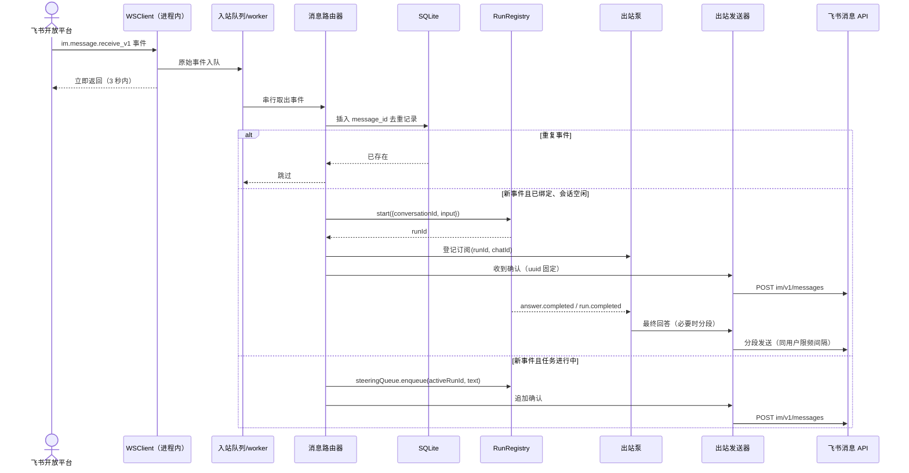
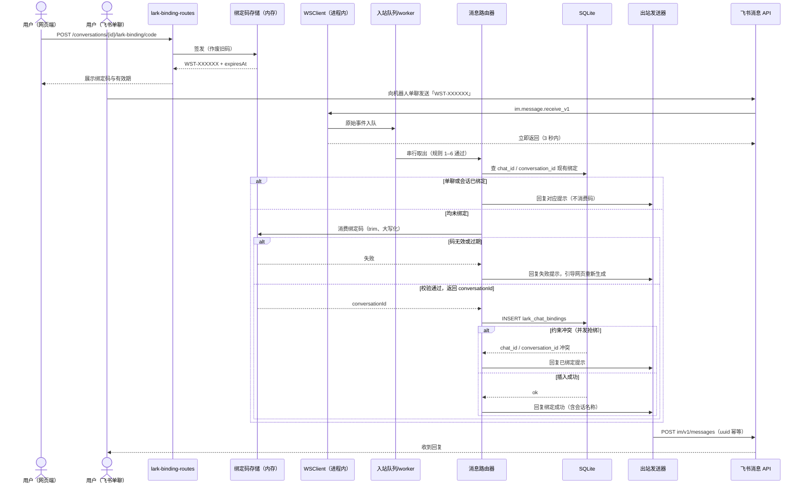
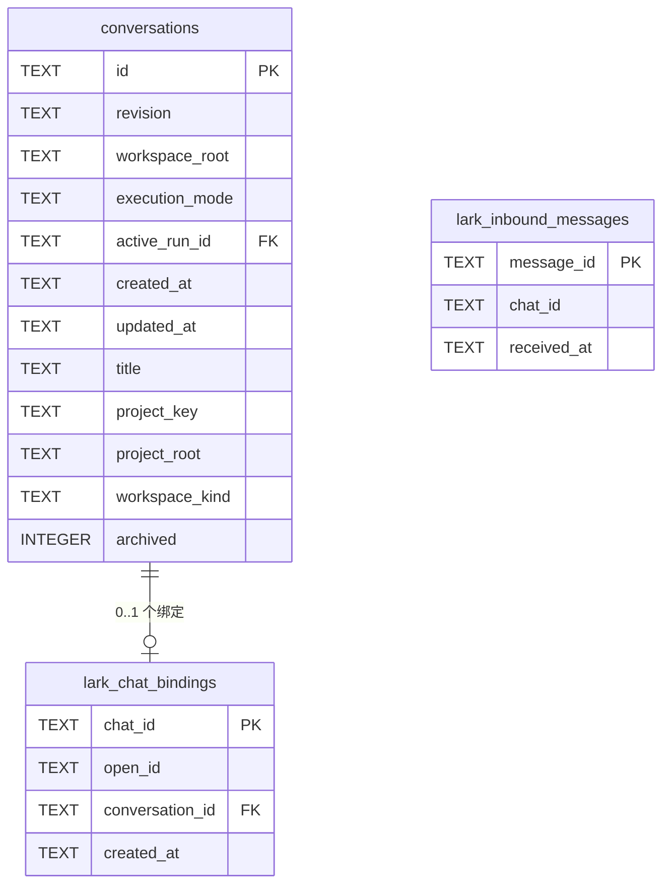

# 飞书单聊绑定会话（链路验证版）技术方案

状态：已在分支 `feat/feishu-chat-binding-v2` 实施，待评审合入主干。事实基线：`582adb4`；对应[产品方案](./2026-11-05-feishu-chat-binding-product-spec.md)与原型 [绑定弹窗](../wireframes/feishu-binding-dialog.wireframe.html)、[单聊对话流](../wireframes/feishu-chat-flow.wireframe.html)。下述路径和文件名为实施位置，具体导出符号在实现时按仓库命名约定确定。

## 当前实现

- 会话由 `conversations` 表持久化，创建时固定工作目录与执行模式，当前共 12 个物理列：`id, revision, workspace_root, execution_mode, active_run_id, created_at, updated_at, title, project_key, project_root, workspace_kind, archived`。末列 `archived INTEGER NOT NULL DEFAULT 0 CHECK (archived IN (0, 1))` 是会话归档功能在版本 5 迁移中加入的归档标记（0 未归档、1 已归档）。`active_run_id` 为可空外键指向 `runs(id)`；`beginRun` 以条件更新保证一个会话同一时间只有一个 Run，冲突抛 `ConversationBusyError`（[sqlite-conversation-store.ts](../../src/infrastructure/sqlite/sqlite-conversation-store.ts)）。
- Run 由服务端进程持有的 `RunRegistry` 管理（[run-registry.ts](../../src/application/run-registry.ts)）：`start({conversationId, input})` 同步返回 `{runId}`，内部泵取事件写入 `RunEventLog` 并更新快照；HTTP SSE 路由只通过 `subscribe(runId, afterSeq, signal)` 订阅，连接断开不影响 Run。`onActivity(listener)` 广播状态变化，状态为 `running / awaiting_interaction / waiting_sub_agents / ended`。终态事件为 `run.completed / run.error / run.cancelled`；`answer.completed` 事件携带 `data.answer: string`；`run.error` 携带公开的 `{code, message}`（`RunErrorData`）。
- 运行中追加消息（steering）由内存队列 `RunSteeringQueue` 承载（[run-steering-queue.ts](../../src/application/run-steering-queue.ts)）：`enqueue(runId, content)` 以 active run id 为键，单条上限 16 KiB、每 Run 最多挂起 4 条（`MAX_STEERING_MESSAGE_BYTES`、`MAX_PENDING_STEERING_MESSAGES`），超限分别抛 `ProtocolError` 与 `SteeringQueueFullError`。网页端发起新 Run 的 HTTP 请求体只校验非空，没有字节上限。
- 工具授权由内存 `InMemoryInteractionBroker` 等待响应；Run 有待处理交互时，registry 状态进入 `awaiting_interaction`，用户只能在网页批准。
- HTTP 服务默认绑定 `127.0.0.1:3000`（[server-config.ts](../../src/server-config.ts)），所有接口在 `/v1/agent/` 下，路由在 `AgentController` 内以正则分发；Full Access 相关接口有 Origin/loopback 门禁。桌面端通过 `desktop/backend-entry.mjs` 复用同一个 `startAgentServer` 装配。
- SQLite 当前 `user_version = 5`（[migrations.ts](../../src/infrastructure/sqlite/migrations.ts)），版本 5 迁移为 `conversations` 增加 `archived` 归档列；打开时 `PRAGMA foreign_keys = ON`（[database.ts](../../src/infrastructure/sqlite/database.ts)）；迁移在事务内逐级执行，版本高于代码支持版本时抛 `SchemaVersionError` 拒绝打开。重启时 `recoverStaleRuns` 把残留 running Run 标记为 failed。
- 进程关闭顺序（[server-bootstrap.ts](../../src/server-bootstrap.ts)）：停止接收新连接 → `runRegistry.cancelAll`（上限 10 秒）→ 关闭残留连接 → 关库 → 关闭 MCP 连接池。
- 系统当前没有任何外部聊天渠道：消息入口只有网页，结果出口只有 SSE；依赖中没有飞书 SDK。

## 存在的问题

1. 缺少飞书侧的事件接入通道与发送出口，服务也没有公网监听地址，无法接收机器人消息。
2. 缺少「飞书单聊 ↔ 会话」的绑定关系存储，以及让用户在网页之外安全授权一个会话的一次性凭证机制。
3. 飞书事件按至少一次投递并可能重复推送，当前没有以消息 ID 为键的幂等落点。
4. Run 的结果目前只有 SSE 订阅者消费；需要一个与网页无关的进程内消费者，把飞书启动的 Run 的结果和待批准状态送回单聊。

会话必须绑定工作目录的模型在本次保持不变。本阶段验证渠道链路，不引入调度会话与工单。

## 调研与选型

### 事件接入：长连接与 Webhook 回调

| 方式 | 机制 | 对本项目的适用性 |
| --- | --- | --- |
| 飞书长连接（选用） | 官方 Node SDK 的 `WSClient` 由服务进程主动向开放平台建立 WebSocket 外连，事件经连接推送，SDK 负责鉴权与重连 | Westie 默认只监听 loopback、桌面版跑在用户 Mac 上，没有公网地址；外连方式不需要内网穿透、域名或回调白名单 |
| Webhook 回调 | 开放平台 POST 事件到公网 URL，需要自行处理 challenge、Encrypt Key 解密与验签 | 需要公网入口与证书运维，个人本机 MVP 成本过高；后续若把 Westie 部署为常驻服务器可再评估 |

选型依据来自官方 Node SDK「处理事件」文档与 SDK 1.76.0 类型定义（`@larksuiteoapi/node-sdk`，长连接要求 SDK ≥ 1.24.0）。长连接的硬约束直接决定本方案的设计：

| 约束 | 来源 | 对设计的要求 |
| --- | --- | --- |
| 仅支持企业自建应用 | 官方文档 | 应用形态固定为自建应用 |
| 事件处理函数 3 秒内必须返回，超时触发重试 | 官方文档 | 处理函数只做内存入队，所有业务逻辑在独立 worker 执行 |
| 推送为集群模式：同应用多连接时，每条事件只随机投递给一个客户端 | 官方文档 | 同一套 App 凭证同一时间只允许一个 Westie 进程开启桥接；配置说明中写明 |
| 单应用最多 50 条连接 | 官方文档 | 单进程单连接，余量充足 |
| SDK 内部自动重连 | SDK 类型定义（`WSClient` 的 reconnect 状态与 `getConnectionStatus()`） | 进程不自行实现重连；只记录连接状态日志 |

dsh-superagent-prototype 的「主会话路由 + 每工单一个执行会话」是后续阶段的目标形态（见此前调研结论）。其执行会话同样强绑定工作目录，差别只在目录由系统按工单自动准备。本阶段与其链路相关的部分只有「消息来源 → 执行会话 → 报告回到来源」这一条最小路径，因此不引入 Source、Ticket、Policy 等概念。

### 需要的应用权限与配置

在飞书开放平台对自建应用完成：开启机器人能力；订阅事件 `im.message.receive_v1`，事件方式选「使用长连接接收事件」；添加读取用户发给机器人的单聊消息、以应用身份发消息两项权限；配置可用范围并发布版本。权限标识以后台「权限管理」页面展示为准（读取单聊消息对应 `im:message.p2p_msg:readonly` 一类 scope，发消息对应 `im:message:send_as_bot`）；代码不依赖 scope 字符串，只依赖事件与 API 的实际可达性。

## 目标实现

### 最小端到端示例

用户已把与机器人的单聊绑定到会话 `c882`。用户发送文本「帮我跑下测试」，开放平台经长连接推送 `im.message.receive_v1` 事件（只保留本方案使用的字段）：

```json
{
  "sender": { "sender_type": "user", "sender_id": { "open_id": "ou_a1" } },
  "message": {
    "message_id": "om_1a2b3c",
    "chat_id": "oc_p2p_7",
    "chat_type": "p2p",
    "message_type": "text",
    "content": "{\"text\":\"帮我跑下测试\"}"
  }
}
```

事件字段含义：

| 字段 | 含义 | 本方案用途 |
| --- | --- | --- |
| `sender.sender_id.open_id` | 发送者在**当前自建应用**下的用户标识（`ou_` 前缀）；同一用户在不同应用下 open_id 不同，只在本应用内稳定 | 白名单判断依据；绑定成功时写入 `lark_chat_bindings.open_id` 留档 |
| `message.chat_id` | 消息所在会话的标识（`oc_` 前缀）；p2p 单聊中对应该用户与机器人之间唯一的单聊 | 绑定关系主键；调发消息 API 时作为 `receive_id`，回复发回同一 `chat_id` |
| `message.message_id` | 平台为每条消息生成的唯一标识（`om_` 前缀）；平台重试的同一条消息保持不变 | 幂等键，写入 `lark_inbound_messages` 去重 |
| `message.chat_type` | 会话类型：`p2p` 为单聊，`group` 为群聊 | 只接受 `p2p` |
| `message.message_type` | 消息类型，如 `text`、`image`、`file` | 本阶段只接受 `text` |
| `message.content` | JSON 编码后的**字符串**，解析后才是对象；文本消息时为 `{"text":"..."}` | 用 `JSON.parse(message.content).text` 取文本 |

同一应用内，一个用户 open_id 与其机器人单聊 chat_id 一一对应；绑定仍以 `chat_id` 为键，因为它是发消息的接收目标。

处理函数把事件原样压入内存队列后立即返回。worker 完成去重与路由：会话空闲，调用 `registry.start({conversationId: "c882", input: "帮我跑下测试"})` 得到 `runId = "r_9"`，先回一条收到确认；Run 结束后把最终回答发回同一 `chat_id`。

下文按相对 Westie 进程的方向称呼消息：飞书经长连接推来的事件称为**入站消息**；Westie 主动调用飞书 API 发往单聊的内容称为**出站消息**（本例的收到确认与最终回答都是出站消息）。两条出站消息都调用 `POST /open-apis/im/v1/messages?receive_id_type=chat_id`，以收到确认为例：

```json
{
  "receive_id": "oc_p2p_7",
  "msg_type": "text",
  "content": "{\"text\":\"收到，已开始处理。任务结束后我会把结果发到这里。\"}",
  "uuid": "westie-ack-r_9"
}
```

`uuid` 是出站幂等键：每条通知的 uuid 由其业务身份派生（新任务收到确认与终态通知用 runId，追加确认用入站 message_id，终态通知再加终态类型），不同通知互不相同，同一通知的重试保持同一个值；飞书侧一小时内同 uuid 只成功发送一条。

### 总体结构

新增能力全部在 Westie 服务进程内完成，不新增进程。模块划分如下，每个文件承担单一职责：

| 文件 | 职责 |
| --- | --- |
| `src/lark/lark-config.ts` | 读取并校验飞书相关环境变量，导出配置类型；未配置凭证时返回「桥接关闭」 |
| `src/lark/lark-client.ts` | 创建 SDK `Client` 与 `WSClient`，封装启动、关闭与连接状态日志；对上层只暴露事件源与消息发送两个端口 |
| `src/application/lark-binding-token-store.ts` | 内存一次性绑定码的签发、校验、消费与过期清理 |
| `src/application/lark-inbound-queue.ts` | 有界内存队列 + 单串行 worker；保证处理函数 3 秒内返回 |
| `src/application/lark-message-router.ts` | 入站消息的过滤、绑定/解绑、空闲开 Run、忙时追加等全部路由决策 |
| `src/application/lark-run-bridge.ts` | 登记并订阅飞书启动的 Run，消费事件流，发送结果、失败、取消与待批准提醒 |
| `src/application/lark-outbound.ts` | 出站文本发送：切片、按单聊串行、频控间隔、有界重试、uuid 幂等 |
| `src/infrastructure/sqlite/lark-binding-store.ts` | 绑定关系与入站消息去重的 SQLite 读写 |
| `src/http/lark-binding-routes.ts` | 网页使用的能力查询、绑定码签发、绑定状态查询与解绑接口 |

表结构定义仍集中在 [schema.ts](../../src/infrastructure/sqlite/schema.ts)，迁移集中在 [migrations.ts](../../src/infrastructure/sqlite/migrations.ts)，装配集中在 [server-bootstrap.ts](../../src/server-bootstrap.ts)。

### 进程与边界

本次不新增、不删除任何进程，进程树当前与目标一致。父子关系只有一对：Westie 服务进程按需启动 Seatbelt 沙箱子进程并等待其结束；浏览器 / Electron 渲染层是独立进程，与 Westie 服务进程之间没有父子关系（桌面版下由 Electron 主进程启动，与本次改动无关）。



进程树中唯一的连线是父子进程关系；UI 节点没有连线，表示它与 Westie 服务进程之间没有父子关系。

网络通道与进程内模块的当前形态：



目标形态在同一进程内新增一个指向飞书开放平台的外连通道，不改变上面的进程树：



网络/模块图中 `WSClient`、worker、出站泵都是 Westie 进程内模块，只有与飞书开放平台之间是跨网络通信；工具沙箱仍是唯一按需启动的子进程，父子关系以进程树为准。

生命周期（回答「谁启动、谁等待、谁清理」）：

- **启动**：`startAgentServer` 完成建库与现有组件装配后，仅当配置了 App ID 与 App Secret 才创建 `LarkBridge`：先建 SDK 客户端，再调用 `WSClient.start({eventDispatcher})` 并捕获其拒绝。启动阶段的错误只记录结构化日志，HTTP 服务照常启动（网页功能不受影响）；连接建立、断线探测与自动重连都由 SDK 在内部完成，进程不自行实现重连。
- **运行**：长连接的数据到达由事件循环驱动，SDK 在主线程事件循环中回调注册的处理函数；处理函数同步入队后立即返回（处理函数占用唯一的 JavaScript 线程，执行过久会阻塞 HTTP 服务，3 秒限制由此而来）。worker 是事件循环上的一条 promise 链串行消费；`registry.start` 与 `steeringQueue.enqueue` 都是同步调用，worker 不等待 Run 结束。每个飞书启动的 Run 由 `lark-run-bridge` 登记一个独立的异步订阅泵，泵之间互不等待，网页 SSE 的订阅与消费完全不受影响。桥接不引入 `worker_threads`：worker、出站泵与 WebSocket 回调全部运行在主线程事件循环上；进程内另有 libuv 线程池（默认 4 个线程，服务于文件 I/O 等阻塞操作）与 V8 内部线程，均为运行时自带，本方案不改变其数量。Seatbelt 沙箱与 MCP server 是子进程，不属于线程。
- **关闭**：纳入现有 shutdown 序列，顺序为：
  1. HTTP 停止接收新连接（现有步骤）；
  2. `wsClient.close({force: true})` 停止接收飞书事件；
  3. 等待 worker 把已入队事件处理完，宽限 3 秒，超时丢弃未处理事件；
  4. 执行现有 `runRegistry.cancelAll`（飞书启动的 Run 一并被取消，宽限仍为现有 10 秒）；
  5. Run 终态事件推动各出站泵把取消/结果通知放入出站队列，等待全部泵结束；
  6. 出站队列做最多 5 秒的尽力发送，随后关库、关 MCP 连接池（现有收尾）。
- **异常清理**：出站泵在 Run 终态后自动注销；订阅使用 `AbortSignal`，关闭时中止订阅只停止消费事件，不取消 Run。SDK 连接异常由 SDK 自身重连，进程不重启连接对象；长时间不可用时收不到事件，恢复后继续，断线期间的消息不补发（与产品方案一致）。

### 端到端调用顺序



### 入站处理规则

worker 对每条事件严格按以下顺序处理，命中即停止。群聊与非用户发送者两类事件直接忽略，不写去重记录；其余事件先执行 `INSERT OR IGNORE` 写去重记录（下表第 3 行），插入冲突即停止，之后的回复与任务动作最多执行一次，飞书重试不产生第二次效果。空文本（第 6 行）的忽略发生在去重写入之后：留下去重记录，但不产生任何回复。

| 顺序 | 条件 | 处理 |
| --- | --- | --- |
| 1 | `chat_type !== "p2p"` | 忽略，不回复 |
| 2 | `sender.sender_type !== "user"` | 忽略（过滤机器人自身与应用消息） |
| 3 | `message_id` 去重记录已存在 | 忽略 |
| 4 | 配置了 `LARK_ALLOWED_OPEN_IDS` 且发送者不在名单 | 回复无权限提示；后续绑定与消息规则全部不执行 |
| 5 | `message_type !== "text"` | 回复仅支持文本，不发起任务 |
| 6 | 文本 trim 后为空 | 忽略，不回复 |
| 7 | 文本匹配绑定码格式且校验有效 | 完成绑定，回复成功 |
| 8 | 文本为解绑指令 `/unbind`（兼容 `/解绑`） | 删除绑定，回复解绑成功 |
| 9 | 单聊无绑定的其他文本 | 回复绑定引导，不访问任何会话 |
| 10 | 已绑定且会话空闲 | 启动新 Run，回复收到确认 |
| 11 | 已绑定且任务进行中 | 入 steering 队列，回复追加确认 |

文本内容取自 `JSON.parse(message.content).text`；单聊没有 @机器人 占位，不做 mention 清洗。绑定码输入做 trim、大写化与去空格后匹配。

忙闲判定与竞态处理：

- 先读 `conversationStore.getActiveRunId(conversationId)`：无 active run 走 `registry.start`，有则直接入 steering 队列。
- `registry.start` 抛 `ConversationBusyError` 时（消息判定空闲后网页端先开了 Run），重新读取 active run id 并改走 steering 入队，不向用户报错。
- `registry.start` 抛 `ConversationNotFoundError` 时（会话在绑定后被删除，正常情况下外键级联已删除绑定行），防御性删除该单聊的绑定并回复「原会话已不存在」。
- steering 入队抛 `SteeringQueueFullError` 时回复队列已满提示；抛 16 KiB 超限错误时回复过长提示。这两种情况下消息不进入任务。
- 启动 Run 后立即把 `{runId, chatId}` 交给出站泵登记；登记与启动在同一个 worker 步内完成，保证终态事件不会漏接。

去重记录先于副作用写入（`INSERT OR IGNORE`，冲突即跳过）。这样飞书重复推送绝不会产生第二个 Run；代价是若副作用步骤自身抛出意外错误，平台重试也不会再执行，该消息按已处理结束并留下错误日志。绑定、解绑等写库操作以数据库约束为最终裁决，不依赖先查后写。

### 绑定关系模型与绑定码

一个 Westie 进程只配置一组 App 凭证，对应唯一的自建应用机器人与唯一一条长连接；机器人是所有单聊的共同对端，本身不进入绑定关系。每个飞书用户与该机器人有且只有一个单聊。绑定关系是「单聊 ↔ 会话」的数据级对应：

```text
机器人（1 个，由 LARK_APP_ID 确定）
├── 用户 A 与机器人的单聊  chat_id=oc_a  ↔ 会话 c1
├── 用户 B 与机器人的单聊  chat_id=oc_b  ↔ 会话 c2
└── 用户 C 与机器人的单聊  chat_id=oc_c  （未绑定，不接触任何会话）
```

由此得到两个推论：第一，未绑定的会话机器人完全接触不到，是否绑定逐个会话由用户手动发起；第二，同一用户与机器人只有一个单聊，单人使用时同一时间最多有一个会话处于绑定状态，换绑需先解绑，多个用户则可各自绑定不同会话（可用 `LARK_ALLOWED_OPEN_IDS` 限定允许的用户）。一个用户同时驱动多个会话属于后续「调度会话 + 工单」阶段，本版不做。

绑定码沿用 [project-selection-tokens.ts](../../src/application/project-selection-tokens.ts) 的内存短期令牌模式，单独实现为 `LarkBindingTokenStore`（载荷是 `conversationId`，与目录选择令牌语义不同）。

| 规则 | 具体值 / 行为 |
| --- | --- |
| 格式 | `WST-` 前缀加 6 位编码；字符集为大写字母去掉易混的 `O`、`I`（剩 24 个）加数字 `2–9`（8 个），共 32 个字符，32⁶ ≈ 10.7 亿种组合，便于人工输入 |
| 有效期 | 签发后 10 分钟；过期自动失效并在下次签发时清理 |
| 一次性 | 绑定成功后立即删除；任何校验失败都不消费，允许用户改正后重试 |
| 每会话唯一 | 一个会话同一时间只有一组有效码；重新签发直接作废旧码 |
| 存储 | 仅内存；进程重启后全部失效，用户重新生成即可 |
| 枚举防护 | 同一个 `chat_id` 在 10 分钟内绑定码校验失败达到 10 次后，后续尝试只回复简短失败提示、不再查库，直到窗口滚动 |

注意区分绑定码与绑定关系：10 分钟 TTL 只约束**配对用的一次性码**；码校验成功后写入 `lark_chat_bindings` 表的绑定关系持久化在 SQLite 中，进程重启后保留，飞书消息仍可凭 `chat_id` 查到会话，无需重新绑定。进程重启唯一丢失的是重启时尚未使用的绑定码，重新生成即可。

校验成功时的写库顺序：先查该单聊是否已绑定、目标会话是否已被其他单聊绑定（命中则回复对应提示且不消费码），再插入绑定行；`chat_id` 主键冲突或 `conversation_id` 唯一约束冲突分别对应当前单聊已绑、会话已绑，回复以数据库结果为准。成功回复中用会话标题或工作目录名（`ConversationWorkspaceView.name`）帮助用户辨认。

绑定全过程的调用顺序（图中省略枚举防护分支：同一 `chat_id` 10 分钟内失败 10 次后只回复简短提示、不再查码与查库）：



### 出站通知

出站泵只跟踪**由飞书消息启动的 Run**；网页端启动的 Run 不推送飞书。每个跟踪泵用 `registry.subscribe(runId, 0, signal)` 消费事件流，事件流在 Run 终态后自动结束：

| 触发 | 通知内容 | 数据来源 |
| --- | --- | --- |
| 新任务启动后 | 「收到，已开始处理」确认 | 路由器直接发送 |
| steering 入队后 | 「已追加到当前任务」确认 | 路由器直接发送 |
| Run 状态沿边沿进入 `awaiting_interaction` | 「任务需要批准，请回到 Westie 界面操作」提醒 | `registry.onActivity`，仅对跟踪中的 runId；每次进入该状态发一条，同一段等待不重复 |
| `run.completed` | 最终回答，取最后一个 `answer.completed` 的 `data.answer`；缺失时回复任务已完成但无文本结果 | 订阅事件流 |
| `run.error` | 一条失败通知，附公开的 `code/message`，不发送内部错误细节 | 订阅事件流 |
| `run.cancelled` | 一条取消通知 | 订阅事件流 |

解绑时若 Run 仍在运行，出站泵持有启动时快照的 `chatId`，该 Run 的终态通知仍发回原单聊一次（产品方案默认值），之后不再有任何往来。网页端取消飞书启动的 Run 时，订阅泵同样收到 `run.cancelled` 并发出取消通知。

发送限制与超限行为：

| 对象 | 单位 | 上限 | 超限行为 |
| --- | --- | --- | --- |
| 入站文本（新任务与追加一致） | UTF-8 字节 | 16 KiB | 不发起任务 / 不入队，回复超长提示 |
| 单条出站文本请求体 | 飞书接口限制 | 150 KB | 发送侧按 120 KiB 切片，留足 JSON 与头部余量 |
| 回答切片 | UTF-8 字节 | 每片 ≤ 120 KiB，优先在换行、其次空格边界切分，不切断多字节字符 | 多片连续发送，文末标注 `（i/n）` |
| 对同一接收者频控 | 飞书限制 | 5 QPS | 每个 `chat_id` 一条 FIFO 队列，相邻发送间隔 ≥ 210 ms |
| 发送失败重试 | 次数 / 间隔 | 首次失败后重试 3 次，间隔 2s、10s、60s | 仍失败则放弃，写结构化日志（含 runId、chatId、飞书错误码），会话内结果保持完整 |
| 入站队列容量 | 事件条数 | 256 | 满后丢弃新事件并记录告警；个人使用量级下不应触发 |

通知严格限定为产品方案的三类：收到确认、待批准提醒、终态结果。步骤与工具调用过程不推送。发送器为纯文本消息（`msg_type: "text"`），本阶段不使用卡片。

### 配置

在 [server-config.ts](../../src/server-config.ts) 的 `AgentServerConfig` 中新增以下字段，沿用现有环境变量解析风格：

| 环境变量 | 必填 | 默认 | 含义 |
| --- | --- | --- | --- |
| `LARK_APP_ID` | 与 Secret 同时填写才启用 | 无 | 自建应用 App ID；缺省或留空时桥接完全不启动 |
| `LARK_APP_SECRET` | 同上 | 无 | 自建应用 App Secret |
| `LARK_DOMAIN` | 否 | `open.feishu.cn` | API 与长连接域名；国际版 Lark 填 `open.larksuite.com` |
| `LARK_ALLOWED_OPEN_IDS` | 否 | 空（不限制） | 逗号分隔的 open_id 白名单；绑定码本身仍是授权入口 |

变量的读取与所有现有配置一致：`loadAgentServerConfig(process.env, ...)` 从进程环境读取。两种运行方式下的填写位置：

| 运行方式 | 配置文件 | 加载方式 |
| --- | --- | --- |
| Node 服务端（`npm run start:server`、`npm start`） | 仓库根目录 `.env` | 启动命令 `node --env-file=.env ...`（[package.json](../../package.json)） |
| 桌面版（Electron） | `~/Library/Application Support/westie/.env` | 首次启动由 [main.mjs](../../desktop/main.mjs) 写入模板，[backend-process.mjs](../../desktop/backend-process.mjs) 解析后注入后端子进程环境 |

App ID 与 App Secret 的值取自飞书开放平台自建应用的「凭证与基础信息」页；修改后重启进程生效。

桥接关闭时：不创建 SDK 对象、不建立任何外连，网页与现状完全一致；能力查询仍返回 `{ "enabled": false }`，其余三个绑定接口返回 501 与错误码 `LARK_BRIDGE_DISABLED`。`.env.example` 同步补充上述变量与「同一凭证只能单进程开启桥接」的说明。

新增运行时依赖：`@larksuiteoapi/node-sdk`（当前最新稳定版 1.76.0，声明 `^1.76.0`）。该包为纯 JavaScript 依赖（内含 `ws`），无原生模块，Electron 打包随普通 npm 依赖处理；代码运行在服务端 Node 进程，不进入渲染层。

### 网页接口（新增，仅本机 UI 使用）

接口沿用现有 `/v1/agent/` 路由的 CORS、JSON 错误格式与会话不存在时的 404 响应，在 `AgentController` 中新增正则分发。能力查询为只读接口，Origin 策略同会话列表（`public`）；签发绑定码与解绑是变更操作，使用 `trusted` Origin。`isAgentApiPath` 已用 `/v1/agent/conversations/` 前缀覆盖三个会话子路径的 OPTIONS 预检，只需新增 `/v1/agent/lark/capability` 一条。

| 方法与路径 | 请求 | 成功响应 | 说明 |
| --- | --- | --- | --- |
| `GET /v1/agent/lark/capability` | 无 | `{ "enabled": boolean }` | 只暴露是否配置了凭证，不返回任何密钥；为假时前端不显示绑定入口 |
| `POST /v1/agent/conversations/{id}/lark-binding/code` | 无 | `{ "code": "WST-XXXXXX", "expiresAt": "ISO-8601" }` | 签发绑定码；重复调用作废旧码 |
| `GET /v1/agent/conversations/{id}/lark-binding` | 无 | 未绑定 `{ "bound": false }`；已绑定 `{ "bound": true, "createdAt": "..." }` | 不下发 open_id 与 chat_id |
| `DELETE /v1/agent/conversations/{id}/lark-binding` | 无 | `{}` | 删除绑定；重复删除返回同样的成功结果 |

会话列表与会话详情响应新增 `larkBound: boolean` 字段。该字段是路由层装饰字段，不进入 `ConversationSummaryView` 领域类型：列表序列化时用一次 `findBoundConversationIds(ids)` 批量查询补充，详情按单个 id 查询。

### 前端改动

- `web/src/run-client.ts` 新增四个 API 函数并补类型校验：能力查询、签发绑定码、读取绑定状态、解绑。
- 新增 `web/src/hooks/useLarkBinding.ts`：管理弹窗的三态（未绑定/已绑定/码已过期）与请求错误。
- 新增 `web/src/components/FeishuBindingDialog.tsx`：布局与[绑定弹窗原型](../wireframes/feishu-binding-dialog.wireframe.html)一致，复用现有 `components/ui/dialog.tsx`。
- `ConversationList.tsx` 的行操作菜单新增「绑定飞书单聊」项（`capability.enabled` 为假时不渲染）；已绑定会话在说明行显示飞书标记，与原型一致。
- 弹窗在绑定码到期（超过 `expiresAt`）后本地切到过期态，引导重新生成；实际绑定状态在打开弹窗时以 `GET` 接口为准。

## 数据库变更（user_version 5 → 6）

### 变更概览（schema diff）

| 表 | 变更 | 物理列数 |
| --- | --- | --- |
| `conversations` | 主干升级路径不变；历史 v5 lark 开发库由 v6 迁移补 `archived` 列 | 12 → 12 |
| `lark_chat_bindings` | 新增 | 4 |
| `lark_inbound_messages` | 新增 | 3 |

`conversations` 当前 12 个物理列：`id, revision, workspace_root, execution_mode, active_run_id, created_at, updated_at, title, project_key, project_root, workspace_kind, archived`。其中 `archived` 由会话归档功能的版本 5 迁移加入；主干上的版本 5 库已含该列，v6 迁移对 `conversations` 不做改动。主干历史重写前曾有开发库占用版本号 5 装载 lark 表且缺少 `archived`，这类库的兼容处理见「迁移方式」。

### ERD



ERD 中 `lark_chat_bindings`、`lark_inbound_messages` 两张表及其各自全部列（4 列、3 列）均为本次新增，已在列旁标注 PK / FK；`conversations` 实体含 12 列，其中 `archived` 由版本 5 迁移先行加入，主干升级路径下 v6 不改动该表，仅历史 v5 lark 开发库会在 v6 迁移中补上这一列。本次范围之外的既有表未在图中画出。变更后的实际物理列数：`conversations` 12 列、`lark_chat_bindings` 4 列、`lark_inbound_messages` 3 列。

关系线 `||--o|` 的读法：绑定表一侧的 `o|` 表示一个会话对应 **0 或 1** 个绑定行——「0」因为绑定可选、没有任何约束强制建表时产生行，「至多 1」由 `conversation_id UNIQUE` 保证；会话表一侧的 `||` 表示每个绑定行必须恰好引用一个存在的会话（NOT NULL 外键，会话删除时级联删除）。加上 `chat_id` 主键限制一个单聊至多一行，单聊与会话构成严格一一对应。

`lark_inbound_messages` 与其他表无外键关系：未绑定单聊的消息也要记录以实现幂等，它的生命周期独立于绑定关系。

### 新表精确结构

`lark_chat_bindings`（4 列）：

| 列 | 类型 | 约束 | 语义 |
| --- | --- | --- | --- |
| `chat_id` | TEXT | NOT NULL，主键 | 飞书 p2p 单聊 ID；一个单聊至多一行 |
| `open_id` | TEXT | NOT NULL | 完成绑定的发送者 open_id，仅用于审计与可选白名单核对 |
| `conversation_id` | TEXT | NOT NULL，UNIQUE，外键 | 引用 `conversations(id)`，`ON DELETE CASCADE`；一个会话至多被一个单聊绑定 |
| `created_at` | TEXT | NOT NULL | 绑定时间，ISO-8601 字符串 |

单列语义之外的约束：主键 `(chat_id)`；唯一约束（由 `conversation_id UNIQUE` 产生唯一索引）；外键一条；无 CHECK 约束；无额外索引。

`lark_inbound_messages`（3 列）：

| 列 | 类型 | 约束 | 语义 |
| --- | --- | --- | --- |
| `message_id` | TEXT | NOT NULL，主键 | 飞书消息 ID，幂等键 |
| `chat_id` | TEXT | NOT NULL | 来源单聊，用于排查，不做外键 |
| `received_at` | TEXT | NOT NULL | 服务端写入时间，ISO-8601 字符串，清理依据 |

单列语义之外的约束：主键 `(message_id)`；无外键、无 CHECK、无索引。该表只保留 24 小时数据，个人使用量级下按 `received_at` 全表扫描清理即可；进程启动时清理一次，之后每小时清理一次。

两张表的所有 TEXT 列都是普通文本，不存放 JSON，数据库无需做 JSON 校验。

### 迁移方式

- 目标版本：`LATEST_SCHEMA_VERSION = 6`。版本 5 迁移（`conversations` 加 `archived` 列）已随会话归档功能存在，本次在 `MIGRATIONS` 末尾新增 version 6 迁移。迁移函数先查询 `conversations` 的列信息，缺少 `archived` 时执行与版本 5 相同的补列 DDL，再以 `IF NOT EXISTS` 创建两张 lark 表：

```sql
-- 仅当 pragma_table_info('conversations') 中缺少 archived 列时执行
ALTER TABLE conversations
  ADD COLUMN archived INTEGER NOT NULL DEFAULT 0
    CHECK (archived IN (0, 1));

CREATE TABLE IF NOT EXISTS lark_chat_bindings (
  chat_id TEXT NOT NULL PRIMARY KEY,
  open_id TEXT NOT NULL,
  conversation_id TEXT NOT NULL UNIQUE
    REFERENCES conversations(id) ON DELETE CASCADE,
  created_at TEXT NOT NULL
) STRICT;

CREATE TABLE IF NOT EXISTS lark_inbound_messages (
  message_id TEXT NOT NULL PRIMARY KEY,
  chat_id TEXT NOT NULL,
  received_at TEXT NOT NULL
) STRICT;
```

列检查用 `SELECT name FROM pragma_table_info('conversations')` 在迁移函数内完成；`IF NOT EXISTS` 使建表对已含 lark 表的库成为空操作，保证迁移可重复执行。
- 存量行取值：两张 lark 表为新增表，没有存量行；补 `archived` 列时存量会话由 `DEFAULT 0` 自动填充为未归档。主干上的版本 5 库已含 `archived`，v6 迁移只建两张新表，`conversations` 及其余所有表不做改动。
- 历史 v5 lark 开发库的收敛：飞书功能在主干历史重写前曾占用版本号 5，这类库 `user_version = 5`、已含两张 lark 表但缺少 `archived` 列。新代码打开时只执行 version 6 迁移：先补 `archived`（存量行默认 0），再对已存在的 lark 表执行空操作建表，库内既有绑定与入站去重数据原样保留，一次启动自动收敛到版本 6 结构，无需手工处理、不删库重建。
- 新建库：`conversations` 的 `archived` 列与两张 lark 表都在 `initializeSqliteSchema` 的建库脚本中定义，新库直接写成 v6，不经过升级路径。
- 迁移与版本号写入在现有迁移事务内完成。
- 旧代码遇到 v6 数据库：`readSchemaVersion` 得到 6，大于合入前旧代码的 `LATEST_SCHEMA_VERSION = 5`，启动时抛 `SchemaVersionError` 拒绝打开，不会写坏结构；用户升级程序后正常打开。

## 具体改动清单

| 文件 | 改动 |
| --- | --- |
| `src/infrastructure/sqlite/migrations.ts` | `LATEST_SCHEMA_VERSION` 升到 6，新增 version 6 迁移：缺 `archived` 列时补列，再建两张 lark 表 |
| `src/infrastructure/sqlite/schema.ts` | 建库脚本加入两张新表 |
| `src/infrastructure/sqlite/lark-binding-store.ts` | 新增：绑定 CRUD、`findBoundConversationIds`、消息去重与清理 |
| `src/lark/lark-config.ts`、`src/lark/lark-client.ts` | 新增：配置解析与 SDK 生命周期封装 |
| `src/application/lark-binding-token-store.ts` | 新增：内存一次性绑定码 |
| `src/application/lark-inbound-queue.ts` | 新增：有界队列与串行 worker |
| `src/application/lark-message-router.ts` | 新增：入站路由决策 |
| `src/application/lark-run-bridge.ts` | 新增：飞书启动 Run 的订阅泵与待批准提醒 |
| `src/application/lark-outbound.ts` | 新增：切片、频控、重试、uuid |
| `src/http/lark-binding-routes.ts` | 新增：能力查询、绑定码签发、绑定状态查询与解绑四个接口 |
| `src/http/agent-controller.ts` | 注册新路由的正则分发；`isAgentApiPath` 增加能力查询路径；向控制器注入绑定查询依赖 |
| `src/http/conversation-list-routes.ts` | 列表项序列化补充 `larkBound`，经注入的绑定查询一次性批量取已绑定会话 id |
| `src/http/conversation-item-routes.ts` | 详情序列化补充 `larkBound`，按单个会话 id 查询绑定 |
| `src/server-config.ts`、`.env.example` | 新增四个环境变量与说明 |
| `desktop/main.mjs`、`scripts/prepare-desktop.mjs` | 两处桌面版 `.env` 模板（`ENV_TEMPLATE`、`DESKTOP_ENV_TEMPLATE`）同步加入飞书变量 |
| `src/server-bootstrap.ts` | 装配绑定存储、令牌、桥接；接入关闭序列 |
| `web/src/run-client.ts`、`web/src/hooks/useLarkBinding.ts` | 新增 API 客户端与状态 hook |
| `web/src/components/FeishuBindingDialog.tsx`、`ConversationList.tsx` | 新增弹窗、入口与已绑定标记 |

## 保持不变

- 会话的创建方式、工作目录与执行模式固定、沙箱与工具权限、网页审批、Run 的启动/记账/恢复语义全部不变；飞书渠道与网页操作同一份会话数据。
- HTTP 仍只绑定 loopback；飞书集成不开放任何入站监听端口，安全边界仍为本机用户。
- 网页端启动的 Run 不向飞书推送；本阶段不做群聊、非文本消息、飞书内审批、流式输出和自动创建会话/目录。
- 进程重启的既有语义不变：`recoverStaleRuns` 把运行中的 Run 标记为 failed；内存绑定码、入站队列与出站重试队列都不跨重启存活。重启时未送达的出站通知不补发，完整结果仍保留在会话历史中，失败发送有结构化日志可查。

## 验收

自动化测试（node:test，沿用现有 `test/*.test.ts` 风格）：

1. 版本 4 存量库经迁移逐级升级为 v6：`archived` 列补齐且存量行取默认值 0，两张新表结构与约束符合 DDL，原会话数据不变，绑定行随会话删除级联清除；历史 v5 lark 开发库（已含两张 lark 表、缺 `archived`）升级到 v6 后自动补列、lark 数据原样保留，再次执行迁移保持幂等；新库直接为 v6；旧版本代码打开 v6 库抛 `SchemaVersionError`。
2. 绑定码：签发/过期/一次性消费/重新签发作废/失败尝试计数。
3. 消息路由器在注入的假存储、假 registry、假发送器下覆盖：群聊与机器人消息忽略、非文本拒绝、空消息忽略、未绑定引导、白名单拒绝、空闲开新 Run、忙时入 steering、`ConversationBusyError` 回退为 steering、队列满与超长拒绝、绑定码五种结果、解绑、会话已删除、同一 `message_id` 重复只生效一次。
4. 出站发送器：中英文混合文本按字节切片不切断多字节字符并正确编号；同一 `chat_id` 串行且满足最小间隔；失败按计划重试且 uuid 保持不变；重试耗尽后落日志且不抛断 Run。
5. 出站泵：completed/error/cancelled 三种终态产生对应通知；`awaiting_interaction` 边沿只提醒一次，同段等待重复状态不重复提醒；解绑后在跑 Run 的终态仍送达一次。
6. HTTP 接口：能力开关、签发/查询/解绑的成功与 404 路径；会话列表与详情的 `larkBound` 装饰正确。
7. 前端组件测试：弹窗三态渲染、入口在 capability 关闭时不出现、已绑定标记显示。

本次不涉及启动 macOS Seatbelt 沙箱的测试，无需因 `MY_AGENT_HARNESS_SANDBOX` 跳过用例。

待宿主验证（需真实企业自建应用与飞书客户端，标记为手动验收，不宣称自动化覆盖）：长连接建立与断线自动恢复；手机端飞书发消息到收到结果的完整往返；150 KB 级长回答的分段送达；同一凭证在第二个进程开启时事件随机投递的告警行为。

## 待确认问题

1. 产品方案中「运行中消息按 steering 处理」「解绑后在跑任务结果仍发一次」「保留收到确认」三项默认值，本方案已按此实现，需评审最终确认。
2. 是否需要 `LARK_ALLOWED_OPEN_IDS` 白名单：默认不启用，绑定码是唯一授权入口；如团队环境需要，配置项已预留。
3. 失败通知是否随 `message` 一并展示公开错误码 `code`：当前计划展示公开的 `code/message`（见「出站通知」表），不展示内部错误细节，需评审确认。
