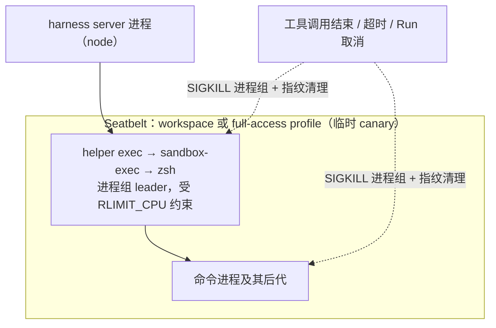
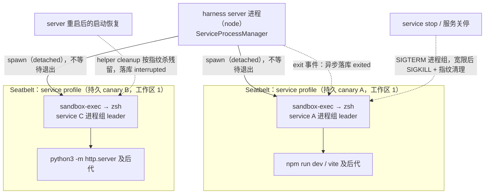
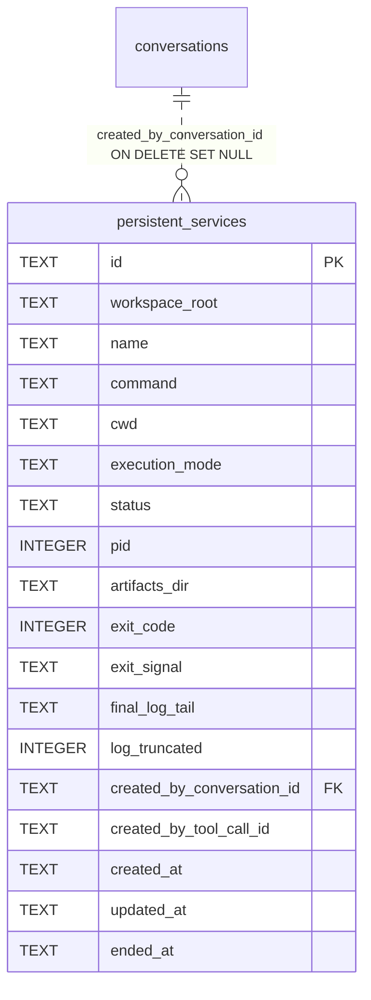

# 持久进程（常驻服务）技术方案

状态：建议方案，尚未实施。事实基线：`b759cca`（`origin/main`）。本文以本机 Web / Electron 使用为范围；下述路径和文件名为实施位置，具体导出符号在实现时按仓库命名约定确定。

## 背景与术语

- **持久进程（persistent service，下称 service）【本次新增】**：由 agent 通过 `service` 工具显式启动、生命周期独立于单次工具调用和 Run、需要显式停止的工作区级进程，典型用途是 `npm run dev` 这类常驻开发服务器。
- **工作区（workspace）**：会话固定的 canonical 工作目录，语义与现有 `conversations.workspace_root` 一致。service 属于工作区，同工作区的任意会话（含子 Run）都能看到并控制它。
- **指纹（fingerprint）**：现有 macOS Seatbelt 收容机制中，由一对 canary 文件刻画的沙箱身份。原生 helper 通过「处于沙箱、可读 allowed canary、不可读 denied canary」枚举同 uid 进程并清理，详见 `src/sandbox/darwin-process-containment.ts` 与 `native/process-containment-helper.c`。
- **artifacts 目录【本次新增】**：每个 service 独占的宿主目录，存放 canary、临时 HOME、TMPDIR 与日志，路径为 `<数据库所在目录>/services/<serviceId>/`。

## 当前实现

- agent 启动进程的唯一通道是 `bash` 工具（`src/tools/bash.ts`）。每次调用由 `MacOsSeatbeltSandboxRunner.run` 创建一对临时 canary，经 `process-containment-helper exec` 包裹 `/usr/bin/sandbox-exec -p <profile> /bin/zsh -f -c <command>` 启动，`detached: true` 使 shell 成为新进程组 leader（`src/sandbox/process-runner.ts`、`src/sandbox/macos-seatbelt-sandbox-runner.ts`）。
- 进程的生命周期绑定在**单次工具调用**上。命令自行退出、超时（默认 30s，上限 120s）、Run 取消（`AbortSignal`）或输出超限时，`runSpawnedCommand` 都会进入同一条清理路径：先尝试 containment 清理，再对进程组发 `process.kill(-pid, "SIGKILL")`；`finally` 中还会执行一次 helper `cleanup`，按指纹枚举并 `SIGKILL` 全部后代，10ms 一轮最多 50 轮。`&`、`nohup`、`setsid`、双重 fork 都在清理范围内。
- `workspace_sandbox` 的 Seatbelt profile 为 `(deny default)`，只放行 `AF_SYSTEM` 系统套接字，没有任何 `network*` 许可，进程无法绑定 TCP 端口；`full_access` 的 permissive profile 放行一切，仅保留 canary 指纹用于统计和清理。
- 工具按工作区装配并缓存：`CachedWorkspaceRuntimeProvider` 以 `<executionMode>\0<canonicalRoot>` 为键缓存 `WorkspaceRuntime`（含 `sandboxRunner` 与 `tools`），随服务进程存活（`src/application/workspace-runtime.ts`、`src/runtime.ts`）。
- 服务关停序列（`src/server-bootstrap.ts`）：停止接收连接 → `LarkBridge.shutdown` 门面内执行 `runRegistry.cancelAll()` 并最多等待 10 秒（飞书启动的 Run 一并取消，终态由出站泵补发通知）→ 关闭残留 SSE 连接 → 关 SQLite → 关闭 MCP pool。启动时已有恢复先例：`worktreeOperations.markInterruptedOperations()` 与 `conversationStore.recoverStaleRuns()` 把上次未走完的状态标记为中断并输出 warn 日志。
- 进程身份的事实来源：进程内是 `RunRegistry` 这类单例 Map；跨重启的状态在 SQLite（`src/infrastructure/sqlite/`，当前 `PRAGMA user_version = 6`，共 11 张表）。审批与授权经 `AuthorizedToolExecutor` + 策略链，`bash` 在 `workspace_sandbox` 下为 `confirm`，`full_access` 下首位中间件直接放行（`src/tool-permissions.ts`）。

## 存在的问题

1. agent 无法在工作区里保留常驻服务。前台启动 dev server 必然超时被杀；后台启动（`&`）在 shell 退出的瞬间被指纹清理。端口绑定在 `workspace_sandbox` 下还会被 Seatbelt 直接拒绝。
2. 进程没有跨工具调用的身份和可观测面：agent 拿不到稳定 id、存活状态、PID 与持续输出，只能反复重启或用 `curl`/`ps` 侧面猜测，容易在缺少证据时误报「服务已启动」。
3. 现有清理语义对常驻服务是反向的：helper `exec` 强制设置 `RLIMIT_CPU`（默认聚合 120 秒 CPU 时间），监督器检测到超限即终止进程树；canary、临时 HOME 都建在 `tmpdir()` 并在调用结束时删除。这套机制服务于「一次调用一棵树、结束即焚」，无法直接承载跨 Run 存活的进程。

## 主流方案调研与选型

| 方案 | 后台进程模型 | 作用域与终止 | 可观测面 |
| --- | --- | ---|---|
| Claude Code（Bash 工具 `run_in_background`、`/tasks`、`TaskStop`） | bash 调用加后台标记；超时的前台命令可自动转后台 | 会话级；后台任务有存活时间上限，可配置调大；会话结束即销毁 | 任务 id + 落盘输出文件，agent 用 `Read` 读尾部 |
| OpenHands（`CmdRunAction` 的 `blocking: false`） | 命令在长活 Docker runtime 容器内后台运行，宿主记录 PID 与日志文件 | 绑定容器生命周期，容器随会话/环境销毁 | PID、退出状态、日志文件，另有显式 kill 动作 |
| 通用 agent 外壳（Command Code、opencode 的 background/tmux 插件等） | `run_in_background` 后立即返回 task id、PID、cwd、日志路径 | 多数为会话级，部分靠 tmux 脱离会话 | 轮询状态/日志、结束通知 |
| tmux / pm2 / launchd | 进程由独立监督者托管 | 完全脱离 agent，agent 没有统一控制面 | 各工具自有，模型需要拼 shell |

这些方案的共同骨架是「显式启动 → 返回稳定句柄 → 状态/日志可查询 → 显式停止」。差异在作用域和隔离底座：Claude Code/OpenHands 都把后台进程绑定在会话或短活容器上。

本项目已有常驻 HTTP 服务、工作区实体和跨重启的 SQLite，因此选型采用共同骨架并把作用域定为**工作区**：service 跨 Run、跨会话存活，直到显式停止或服务进程退出；隔离沿用 macOS Seatbelt 与指纹清理，不引入容器或 tmux。不设存活时间上限（「显式生命周期」由 start/stop 表达），不做 shell 会话复用（现有工具都是一次性命令模型，复用 shell 会引入状态串扰）。

## 目标实现

### 端到端最小示例

agent 在 `workspace_sandbox` 会话中启动 Vite。调用新增工具 service, 工具输入：

```json
{ "action": "start", "name": "web", "command": "npm run dev", "cwd": "web" }
```

服务端在该工作区的 artifacts 目录下创建 canary 与独立 HOME/TMPDIR，spawn 出新进程组（`spawn` 返回时即带 pid），随后落库一条带 pid 的 `starting` 记录：

```
sandbox-exec -p <service-profile> /bin/zsh -f -c 'npm run dev'
```

宽限窗口（1.5 秒）结束时进程仍存活，状态推进为 `running`，工具返回：

```json
{
  "action": "start",
  "service": {
    "id": "8f31c2e4-7a6b-4d90-9c11-2b8f0a5e9d33",
    "name": "web",
    "command": "npm run dev",
    "cwd": "web",
    "status": "running",
    "pid": 58214,
    "startedAt": "2026-11-06T09:12:31.482Z",
    "logBytes": 312,
    "logTail": "\n  VITE v5.4.0  ready in 412 ms\n\n  ➜  Local:   http://localhost:5173/\n"
  }
}
```

随后该 Run 结束，service 继续运行；下一个 Run 可用 `{"action":"list"}` 看到它，用 `{"action":"logs","id":"..."}` 读尾部，用 `{"action":"stop","id":"..."}` 停止。若进程在宽限窗口内退出（如端口占用、脚本不存在），`start` 直接返回 `status: "exited"`、退出码与日志尾部，不产生「已启动」的假阳性。

工具只报告进程事实（存活、PID、自身输出）。「端口可访问」「页面可用」不属于工具职责，agent 需要时仍用 `bash` 执行 `curl` 等命令取得证据。

### 进程模型

当前（每个 bash 调用一棵树，调用结束即焚）：



目标（每个 service 一棵树，生命周期独立）：



图中每个方框都是一个进程或进程组：实线表达父子关系，虚线表达跨进程信号（SIGTERM/SIGKILL、指纹清理、退出事件），二者分开。目标图中，harness server 进程与 Seatbelt 边界为复用现有形态；`ServiceProcessManager` 模块、service 进程组及其持久 canary 为新增；bash 工具的进程树维持当前图不变。

模块与等待关系（文字说明，补充进程树图）：

- **谁启动**：`service` 工具在 Run 内被调用，经审批后由进程内单例 `ServiceProcessManager` 执行 spawn；spawn 的父进程是 harness server。
- **谁等待**：`start` 只等待 spawn 完成和 1.5 秒宽限窗口，不等待 service 退出；service 退出由 manager 的 `exit` 监听器异步处理。`stop` 等待进程确认终止（优雅上限 5 秒）。这两个等待只占用发起工具调用的那个工具槽位，Run 内其他串行逻辑与其他 Run、其他 HTTP 请求均不阻塞。
- **谁清理**：正常停止由 manager 发 SIGTERM → 等待 → SIGKILL 进程组 → helper `cleanup` 按指纹兜底 → 捕获最终日志尾部 → 删除 artifacts 目录；server 崩溃留下的孤儿进程在下次启动时由恢复流程按同一指纹机制清理。

### 状态机

一条 service（持久进程记录）的生命周期状态机 ，即`persistent_services` 表`status` 列的取值和转移规则

| 状态 | 含义 | pid 列 | ended_at |
| --- | --- | --- | --- |
| `starting` | 记录已落库、进程已 spawn，宽限窗口未结束 | 非空 | NULL |
| `running` | 宽限窗口结束时进程存活 | 非空 | NULL |
| `stopping` | 已发起停止（SIGTERM），等待退出确认 | 非空 | NULL |
| `exited` | 进程在未被请求停止时自行终止（含崩溃） | NULL | 非空 |
| `stopped` | 由 `stop` 或服务关停序列终止 | NULL | 非空 |
| `failed` | 未能 spawn（沙箱不可用、cwd 无效等启动前失败） | NULL | 非空 |
| `interrupted` | 服务重启时上一进程仍在 starting/running/stopping | NULL | 非空 |

转换规则（所有推进都用带状态条件的 UPDATE，由 SQLite 裁决并发）：

- start 校验失败（超过工作区数量上限、参数非法、沙箱不可用、cwd 越界）：返回对应错误；除「沙箱不可用」这类环境错误外，落一条 `failed` 记录留存命令与原因，不创建进程。
- spawn 成功并同步拿到 pid 后插入 `starting` 行。表级 CHECK 要求 live 行必须带 pid，因此顺序固定为先 spawn 后落库：exit 监听在 spawn 后立即挂到进程句柄上，若进程在 spawn 与 insert 之间退出，insert 直接写 `exited` 与退出码/信号；正常情况下宽限窗口内收到 exit → `exited`，窗口结束仍存活 → `running`。insert 本身失败时，SIGKILL 刚 spawn 的进程并返回 `SERVICE_START_FAILED`，不留库内残留。
- `running`/`starting` 收到 exit 事件：→ `exited`。`stopping` 状态下退出一律 → `stopped`，退出码或信号记录在案。
- stop：`running`/`starting` → `stopping` → `stopped`；`force: true` 跳过 SIGTERM 等待。对终态记录调用 stop 为幂等 no-op，直接返回当前记录。
- 启动恢复：`starting`/`running`/`stopping` → `interrupted`，不自动重启。

### Seatbelt profile 与资源边界

- 新增 **service profile**：由现有模块级函数 `createSeatbeltProfile`（`src/sandbox/macos-seatbelt-sandbox-runner.ts`，当前为模块私有）增加一个 `networkAllowed` 分支生成，追加 `(allow network*)`（含绑定与出站），文件读写 allowlist、敏感路径拒绝、canary 规则与 workspace profile 完全相同。这样 service 能绑定 loopback 端口，同时仍读不到工作区外文件和真实 HOME 内容。
- `full_access` 会话启动的 service 复用现有 `createFullAccessSeatbeltProfile`（同样改为导出）：`(allow default)` + canary deny，网络与宿主文件均可访问，指纹清理同样有效。
- 环境变量沿用 bash 白名单（现有 `createCommandEnvironment`）：`HOME`、`TMPDIR`、`PATH`、`SHELL`、`LANG`、`LC_ALL`、`TERM`、`MY_AGENT_HARNESS_SANDBOX`，不注入 Provider API Key。workspace 模式下 `HOME` 与 `TMPDIR` 指向 artifacts 目录内的 `home/`、`tmp/`，service 终止时随目录删除；full_access 模式下 `HOME` 为真实用户主目录（与 bash full access 一致）。
- service 链路不经过 helper `exec`（不设置 `RLIMIT_CPU`/`RLIMIT_FSIZE`），也不启动聚合资源监督器（`DarwinProcessContainment` 的私有构造函数会 spawn `monitor` 进程，service 不实例化该类）。120 秒聚合 CPU 上限与常驻语义直接冲突，监督器另一条 10ms 采样链路按天长运行也不经济。MVP 的边界由以下约束组成：每工作区 live service 数量上限、单文件 10 MiB 日志上限、Seatbelt 文件写入边界、显式停止与关停清理。聚合内存/进程数/磁盘配额留待后续，性质与现有文档中「reactive guardrail，非 cgroup」的已知缺口相同。
- 不修改 `native/process-containment-helper.c`：启动直接 spawn `sandbox-exec`（与 helper `exec` 内部 `execv` 的目标一致，pid/pgid 保持），停止与恢复复用现成的 `cleanup` 模式。

### 日志与 artifacts

目录布局（`<id>` 为 UUID）：

```
<数据库所在目录>/services/<id>/
├── canary/
│   ├── allowed.canary
│   └── denied.canary
├── home/           # workspace 模式下的 HOME（full_access 不使用）
├── tmp/            # TMPDIR
└── service.log     # stdout/stderr 合并，append
```

- spawn 后 stdout/stderr 持续 append 到 `service.log`，写入达到 10 MiB 后停止写入但继续排空管道，记录 `log_truncated = 1`（与 `desktop/backend-process.mjs` 的 `LOG_LIMIT_BYTES` 做法一致）。
- `logs` 动作只读文件尾部，默认 8 KiB、最大 32 KiB。
- 进程进入终态（`exited`/`stopped`）时，manager 截取最后 4 KiB 存入 `final_log_tail`，随后删除整个 artifacts 目录。终态记录的 `logs` 动作返回库内尾部。
- `failed` 与 `interrupted` 没有日志尾部：前者进程未起来；后者进程死在崩溃窗口里、管道随进程消失。启动恢复在杀残留后删除孤儿 artifacts 目录。

### 工具接口

新增内置工具 `service`，在 `createDefaultWorkspaceRuntime` 中与 `bash` 并列注册，构造时闭包绑定 canonical workspace root、execution mode 与共享的 `ServiceProcessManager`。

输入字段：

| 字段 | 适用 action | 必填 | 默认 | 含义 |
| --- | --- | --- | --- | --- |
| `action` | 全部 | 是 | — | `start` / `list` / `status` / `logs` / `stop` |
| `command` | start | 是 | — | 经 `/bin/zsh -f -c` 执行的命令字符串，1–4096 字符 |
| `name` | start | 否 | `null` | agent 提供的易记名称（如 `web`），trim 后 1–64 字符；不做唯一约束 |
| `cwd` | start | 否 | `"."` | 相对工作区的启动目录，经现有 `createWorkspacePathResolver` 同款真实路径校验，禁止越界与符号链接逃逸 |
| `id` | status/logs/stop | 是 | — | start 返回的 service UUID |
| `tailBytes` | logs | 否 | `8192` | 返回尾部字节数，范围 1024–32768 |
| `force` | stop | 否 | `false` | true 时跳过 SIGTERM 宽限，直接 SIGKILL + 指纹清理 |

各动作返回：

| action | 返回主体 |
| --- | --- |
| start | `{ action, service: ServiceSnapshot }`；service 含 `id,name,command,cwd,status,pid,startedAt,logBytes,logTail?`，宽限内退出时附 `exitCode`/`exitSignal` |
| list | `{ action, services: ServiceSummary[] }`：全部 live 记录 + 最近 10 条终态记录（按 `ended_at DESC`）；summary 不含日志 |
| status | `{ action, service: ServiceSnapshot }`；终态且有尾部时附 `finalLogTail` |
| logs | `{ action, id, status, logBytes, logTruncated, tail }`；live 读文件，终态读库内尾部 |
| stop | `{ action, service: ServiceSnapshot }`，幂等 |

新增工具错误码（加入 `src/protocol.ts` 的 `ToolErrorCode` 联合类型，当前最后一个码为 `FETCH_BLOCKED_ADDRESS`，在其后追加）：

| code | 触发场景 |
| --- | --- |
| `SERVICE_NOT_FOUND` | id 不存在，或不属于当前工作区（不区分两种回答，避免跨区探测） |
| `SERVICE_LIMIT_REACHED` | 当前工作区 live（starting/running/stopping）service 已达 16 个 |
| `SERVICE_START_FAILED` | spawn 失败、profile 生成失败、artifacts 初始化失败 |
| `SANDBOX_UNAVAILABLE` | 复用现有码：非 macOS、`sandbox-exec` 或 helper 不可用时 fail closed |

权限：在 `defaultToolPermissionRules` 中增加 `service: { effect: "confirm" }`，理由为该工具启动跨 Run 存活、可绑定网络端口的进程。`deriveGrantOptions` 对非 bash 工具默认返回「本会话允许该工具」的 tool 级授权，沿用现有审批卡片；`full_access` 会话由策略链首位直接放行。`impact` 文案明确「starts a process that outlives the run and can bind network ports」。子 Run 共享同一份工具与授权（与 bash 一致），子 Run 启动的 service 同样属于工作区。

Run 取消语义：

- manager spawn 不接收 Run 的 `AbortSignal`，service 不会因 Run 取消而终止。
- `start` 的宽限等待被 signal 打断时，工具调用按现有中断路径返回，记录与进程照常保留，watcher 继续把状态推进到 `running`/`exited`；agent 随后可用 list 查到。
- `stop` 的等待被打断时，停止流程继续执行直到进程终止，调用方下次查询得到 `stopped`。

### 限制表

| 对象 | 单位 | 上限 | 超限行为 |
| --- | --- | --- | --- |
| 每工作区 live service 数 | 个 | 16 | start 返回 `SERVICE_LIMIT_REACHED` |
| `command` 长度 | 字符 | 4096 | `INVALID_TOOL_INPUT` |
| `name` 长度（trim 后） | 字符 | 64 | `INVALID_TOOL_INPUT` |
| start 宽限窗口 | 毫秒 | 1500 | 到点仍存活即置 running |
| stop 优雅等待 | 毫秒 | 5000 | SIGKILL 进程组并执行指纹清理 |
| 关停阶段停止全部 service 的总预算 | 毫秒 | 10000 | 超时后对残留全部 SIGKILL + 指纹清理 |
| `service.log` | 字节 | 10 MiB（10 \* 1024 \* 1024） | 停写并置 log_truncated，管道继续排空 |
| logs 动作返回 | 字节 | 默认 8192，最大 32768 | 只取文件尾部 |
| `final_log_tail` 落库 | 字节 | 4096 | 截取尾部 |
| list 返回终态记录 | 条 | 10 | 更早终态不返回，行仍保留在库 |
| 工具结果总大小 | 字节 | 64 KiB（现有 `MAX_TOOL_OUTPUT_BYTES` 上限） | `TOOL_OUTPUT_TOO_LARGE`；摘要字段已按此预算裁剪 |

## 数据库变更

新增一张表 `persistent_services`，现有 11 张表（含 `worktree_operations`、`lark_chat_bindings`、`lark_inbound_messages`）列数与结构均不变。目标库共 12 张表。

### 目标表列定义（18 个物理列）

| # | 列 | 类型与约束 | 语义 |
| --- | --- | --- | --- |
| 1 | `id` | `TEXT PRIMARY KEY` | service UUID（`randomUUID()`） |
| 2 | `workspace_root` | `TEXT NOT NULL` | 归属工作区 canonical 绝对路径；查询作用域键 |
| 3 | `name` | `TEXT NULL CHECK (name IS NULL OR length(trim(name)) BETWEEN 1 AND 64)` | agent 给的易记名；普通文本 |
| 4 | `command` | `TEXT NOT NULL CHECK (length(trim(command)) > 0 AND length(command) <= 4096)` | 原始命令字符串；普通文本 |
| 5 | `cwd` | `TEXT NOT NULL CHECK (length(cwd) BETWEEN 1 AND 4096)` | 相对工作区的启动目录，`.` 表示根；普通文本 |
| 6 | `execution_mode` | `TEXT NOT NULL CHECK (execution_mode IN ('workspace_sandbox','full_access'))` | 启动时会话的执行模式，决定 profile 与环境 |
| 7 | `status` | `TEXT NOT NULL CHECK (status IN ('starting','running','stopping','exited','stopped','failed','interrupted'))` | 生命周期状态 |
| 8 | `pid` | `INTEGER NULL CHECK (pid IS NULL OR pid > 0)` | 进程组 leader（sandbox-exec）pid；终态置 NULL |
| 9 | `artifacts_dir` | `TEXT NOT NULL` | artifacts 目录绝对路径；终态行保留路径值仅作审计，目录可能已删除 |
| 10 | `exit_code` | `INTEGER NULL CHECK (exit_code IS NULL OR (exit_code >= 0 AND exit_code <= 255))` | 退出码；被信号杀死时为 NULL |
| 11 | `exit_signal` | `TEXT NULL CHECK (exit_signal IS NULL OR length(exit_signal) BETWEEN 1 AND 32)` | 致死信号名，如 `SIGTERM` |
| 12 | `final_log_tail` | `TEXT NULL CHECK (final_log_tail IS NULL OR length(final_log_tail) <= 4096)` | 终态日志尾部，普通文本（非 JSON，数据库不校验 JSON） |
| 13 | `log_truncated` | `INTEGER NOT NULL DEFAULT 0 CHECK (log_truncated IN (0, 1))` | 日志是否触及 10 MiB 停写 |
| 14 | `created_by_conversation_id` | `TEXT NULL REFERENCES conversations(id) ON DELETE SET NULL` | 启动它的会话；删会话后置 NULL |
| 15 | `created_by_tool_call_id` | `TEXT NULL CHECK (created_by_tool_call_id IS NULL OR length(created_by_tool_call_id) <= 128)` | 启动它的工具调用 id，仅审计用 |
| 16 | `created_at` | `TEXT NOT NULL` | 落库（≈ spawn）时间，ISO 字符串 |
| 17 | `updated_at` | `TEXT NOT NULL` | 每次状态推进刷新 |
| 18 | `ended_at` | `TEXT NULL` | 进入终态的时间 |

主键：`id` 单列主键。外键：仅 `created_by_conversation_id → conversations(id) ON DELETE SET NULL` 一个。无 UNIQUE 约束（同名、同命令允许并存，端口冲突由进程自行报错）。CHECK 约束除上表逐列约束外，另有三条表级一致性约束：

```sql
CHECK ((status IN ('starting', 'running', 'stopping')) = (pid IS NOT NULL))
CHECK (
  (status IN ('starting', 'running', 'stopping')) = (ended_at IS NULL)
)
CHECK (
  (status IN ('exited', 'stopped'))
  = (exit_code IS NOT NULL OR exit_signal IS NOT NULL)
)
```

含义：live 状态必须有 pid 且没有结束时间；`exited`/`stopped` 必须带退出码或信号；`failed`/`interrupted` 既无 pid 也无退出信息。

索引：

```sql
CREATE INDEX persistent_services_workspace_status_idx
  ON persistent_services(workspace_root, status, created_at DESC);
```

支撑按工作区列 live 服务与 list 的「live + 最近终态」查询。不建额外索引。

ERD（仅画出与既有表的关系；新列以 **加粗** 表示新增）：



### 迁移方式

目标 `user_version = 7`。存量库从版本 6 升级，执行纯新增 DDL（新表、新索引，无存量行需要取值）：

```sql
CREATE TABLE persistent_services (
  id TEXT PRIMARY KEY,
  workspace_root TEXT NOT NULL,
  name TEXT NULL
    CHECK (name IS NULL OR length(trim(name)) BETWEEN 1 AND 64),
  command TEXT NOT NULL
    CHECK (length(trim(command)) > 0 AND length(command) <= 4096),
  cwd TEXT NOT NULL CHECK (length(cwd) BETWEEN 1 AND 4096),
  execution_mode TEXT NOT NULL
    CHECK (execution_mode IN ('workspace_sandbox', 'full_access')),
  status TEXT NOT NULL
    CHECK (status IN (
      'starting', 'running', 'stopping',
      'exited', 'stopped', 'failed', 'interrupted'
    )),
  pid INTEGER NULL CHECK (pid IS NULL OR pid > 0),
  artifacts_dir TEXT NOT NULL,
  exit_code INTEGER NULL
    CHECK (exit_code IS NULL OR (exit_code >= 0 AND exit_code <= 255)),
  exit_signal TEXT NULL
    CHECK (exit_signal IS NULL OR length(exit_signal) BETWEEN 1 AND 32),
  final_log_tail TEXT NULL
    CHECK (final_log_tail IS NULL OR length(final_log_tail) <= 4096),
  log_truncated INTEGER NOT NULL DEFAULT 0 CHECK (log_truncated IN (0, 1)),
  created_by_conversation_id TEXT NULL
    REFERENCES conversations(id) ON DELETE SET NULL,
  created_by_tool_call_id TEXT NULL
    CHECK (
      created_by_tool_call_id IS NULL
      OR length(created_by_tool_call_id) <= 128
    ),
  created_at TEXT NOT NULL,
  updated_at TEXT NOT NULL,
  ended_at TEXT NULL,
  CHECK ((status IN ('starting', 'running', 'stopping')) = (pid IS NOT NULL)),
  CHECK (
    (status IN ('starting', 'running', 'stopping')) = (ended_at IS NULL)
  ),
  CHECK (
    (status IN ('exited', 'stopped'))
    = (exit_code IS NOT NULL OR exit_signal IS NOT NULL)
  )
) STRICT;

CREATE INDEX persistent_services_workspace_status_idx
  ON persistent_services(workspace_root, status, created_at DESC);
```

- 存量行：无。表为全新增，不回填、不转换任何既有数据。
- 新库：把上述 DDL 同步加入 `src/infrastructure/sqlite/schema.ts` 的 `initializeSqliteSchema` 建表脚本，并直接写 `user_version = 7`；新库与迁移后存量库结构一致。
- 升级路径：在 `src/infrastructure/sqlite/migrations.ts` 的 `MIGRATIONS` 数组末尾追加 `{ version: 7, apply(database) { ... } }`，与既有迁移同形；迁移与版本号在现有初始化事务内提交，失败回滚，服务不开始监听。
- 旧代码遇到新库：当前代码 `LATEST_SCHEMA_VERSION = 6`，打开 `user_version = 7` 的库时在 `initializeSqliteSchema` 抛 `SchemaVersionError` 拒绝启动，提示升级程序。降级路径不存在，与既有策略一致。

## 具体改动

新增文件：

| 文件 | 单一职责 |
| --- | --- |
| `src/infrastructure/sqlite/persistent-service-store.ts` | `persistent_services` 表读写：insert、按状态条件推进、按工作区查询、启动时批量标记中断；命名与 `lark-binding-store.ts`、`worktree-operation-store.ts` 对齐 |
| `src/sandbox/service-artifacts.ts` | artifacts 目录布局：canary 创建、HOME/TMP 目录准备、10 MiB 上限日志写入与尾部读取、终态目录清理 |
| `src/sandbox/service-sandbox-launcher.ts` | service profile 组装（复用导出后的 Seatbelt profile 构造）、spawn `sandbox-exec`、SIGTERM/SIGKILL 进程组、调用 helper `cleanup` |
| `src/application/service-process-manager.ts` | 进程单例（与 `run-registry.ts` 同层）：工作区 → 活进程句柄的 Map、start/list/status/logs/stop 编排、宽限窗口与 exit watcher、`reconcileInterrupted()`、`shutdown()` |
| `src/tools/service.ts` | `service` 工具：zod schema、动作分发、结果裁剪 |
| `test/service-process-manager.test.ts` 等 | 见验收节，沿用 `test/` 平铺命名 |

修改文件（关键接口与最小改动点）：

- `src/sandbox/darwin-process-containment.ts`：导出当前模块私有的 `createCanary`（或包一层 `createCanaryPair(dir)`）与 `runContainmentHelper`（按 helper `cleanup` 子命令封装为导出函数）。`DarwinProcessContainment` 类维持现状，service 链路不实例化它，因此不启动 `monitor` 监督进程。
- `src/sandbox/macos-seatbelt-sandbox-runner.ts`：把模块私有函数 `createSeatbeltProfile`、`createFullAccessSeatbeltProfile` 改为导出，并给前者增加 `networkAllowed` 参数生成 service profile；类内私有 `#createProfile` 改为调用导出函数，现有 runner 行为不变。
- `src/runtime.ts`：`DefaultWorkspaceRuntimeOptions` 增加可选 `serviceProcessManager`；`createDefaultWorkspaceRuntime` 在工具列表中追加 `createServiceTool(workspaceRoot, executionMode, manager)`。未注入 manager 时（CLI 入口 `src/index.ts` 走 `createDefaultTools`、部分测试）不注册工具。
- `src/server-bootstrap.ts`：
  1. schema 初始化后构造 `SQLitePersistentServiceStore` 与默认 launcher（macOS 上预检 `sandbox-exec` 与 helper，失败时 fail closed，不注册 service 工具）；
  2. 构造进程内单例 `ServiceProcessManager`，在现有 `markInterruptedOperations()` / `recoverStaleRuns()` 之后、`server.listen` 之前执行 `reconcileInterrupted()`（对每条历史 live 记录调用 helper `cleanup` 清理孤儿进程，再置 `interrupted` 并删除其 artifacts），输出与现有 `worktree_operation_recovery` 同形的 warn 日志；
  3. 经 `CachedWorkspaceRuntimeProvider` 的工厂把 manager 注入 `createDefaultWorkspaceRuntime`；
  4. 关停序列在 `await bridge.shutdown(...)`（含 `runRegistry.cancelAll()`）之后、`conversationStore.close()` 之前插入 `manager.shutdown()`（总预算 10 秒），保证状态写库时数据库仍打开；启动失败的 catch 分支同步补 manager 关停，与现有 LarkBridge 回收同形。
- `src/tool-permissions.ts`：`defaultToolPermissionRules` 增加 `service: confirm` 规则与理由。
- `src/protocol.ts`：`ToolErrorCode` 联合类型末尾增加三个 `SERVICE_*` 码。
- `src/infrastructure/sqlite/{schema,migrations,index}.ts`：`LATEST_SCHEMA_VERSION` 升到 7，按上一节加入建表 DDL 与 version 7 迁移，`index.ts` 导出新 store。
- `src/server-config.ts`：artifacts 根目录由 `databasePath` 的目录派生（`<dir>/services/`），不新增环境变量。
- `docs/runtime-boundaries.md`、`docs/tools-and-mcp.md`：实施时补充 service 的生命周期、边界与工具条目。

装配形态（模块调用，不含进程父子关系）：

```mermaid
sequenceDiagram
    participant Loop as agent loop（Run 内）
    participant Tool as service 工具
    participant Mgr as ServiceProcessManager（进程单例）
    participant Launcher as ServiceSandboxLauncher
    participant Art as artifacts 目录 / service.log
    participant DB as SQLite
    participant P as service 进程组（Seatbelt）

    Loop->>Tool: start（经审批）
    Tool->>Mgr: start(command, cwd, actor)
    Mgr->>Art: 创建 canary/home/tmp/log
    Mgr->>Launcher: spawn(profile, zsh -c command)
    Launcher->>P: detached spawn（同步返回 pid）
    Mgr->>DB: insert starting（带 pid）
    Mgr-->>Tool: 宽限窗口内：exit → exited；存活 → running
    Tool-->>Loop: ServiceSnapshot

    P-->>Mgr: 宽限后自行退出（exit 事件）
    Mgr->>Art: 截取 4 KiB 尾部并删除目录
    Mgr->>DB: 条件 UPDATE → exited

    Loop->>Tool: stop
    Tool->>Mgr: stop(id)
    Mgr->>DB: running/starting → stopping
    Mgr->>P: SIGTERM -pgid
    alt 5 秒内退出
        P-->>Mgr: exit
    else 超时
        Mgr->>P: SIGKILL -pgid
        Mgr->>Launcher: helper cleanup（按指纹兜底）
    end
    Mgr->>DB: → stopped，写 final_log_tail
    Mgr-->>Tool: 终态快照
```

关停与重启恢复（不经过工具，无调用方等待 HTTP 请求）：

- 关停：server 收到退出信号后，现有 shutdown 序列在 `LarkBridge` 门面关停（含 Run 取消与出站泵排空）之后调用 `manager.shutdown()`；manager 对全部 live service 并行 SIGTERM，总预算 10 秒，到期对残留 SIGKILL 并执行 helper `cleanup`，逐条置 `stopped`，然后控制流才进入关库步骤。Electron 桌面端复用同一路径（`desktop/backend-entry.mjs` 的退出调用 `startAgentServer` 返回的 `server.close()`，与 Web 入口共用同一份装配，IPC shutdown、父通道断开和 SIGINT/SIGTERM 都汇入该调用）。
- 启动恢复：server 崩溃 / 断电时 service 成为 reparent 到 launchd 的孤儿进程，但仍带着本次 Seatbelt 指纹。启动时 manager 对每条历史 live 记录以其持久 canary 调用 helper `cleanup`（按 uid 枚举 + `sandbox_check` 指纹匹配，不依赖 pid 也不受 PID 复用影响）；canary 目录已丢失时跳过杀进程、只做标记。随后记录置 `interrupted`、artifacts 删除。不尝试重新拉起。

## 保持不变

- `bash` 工具的执行、超时、取消、输出上限和「调用结束即清理整棵进程树」的语义完全不变；service 与 bash 是两个独立工具、两套 profile 实例，bash 仍然无法启动常驻服务。
- Seatbelt 的文件读写 allowlist、敏感路径拒绝、环境变量白名单、full-access loopback/Origin 约束、canary 指纹算法与原生 helper 行为不变；service profile 是在现有 profile 上仅增加 `(allow network*)`。
- 权限中间件链、审批卡片、会话级 tool 授权机制、子 Run 共享授权的行为不变，`service` 作为一张静态规则接入。
- Run / SSE / steering / 压缩 / transcript 落库路径不变；service 状态变化不产生新的 SSE 事件，其可见性全部通过工具结果进入 transcript。
- 数据库既有 11 张表的列、约束、索引与 `user_version 1–6` 的迁移路径不变；迁移只前向。
- WorkspaceRuntime 缓存键、会话的 workspace 与执行模式不可变约束不变。

## 明确不做（MVP 边界）

- 不提供 HTTP 路由与 Web 服务面板；用户需要观察或停止服务时，通过下一条消息让 agent 调用工具。
- 不做端口就绪探测、端口占用预检、端口转发或预览 URL 生成。
- 不做 service 退出的 SSE/通知推送、自动重启、TTL、空闲回收。
- 不支持自定义环境变量、交互式 stdin / PTY、工作区外 cwd。
- 不做 worktree 删除联动（当前产品没有删除 worktree 的流程）。
- 不提供聚合 CPU / 内存 / 进程数 / 磁盘配额（见资源边界节的取舍说明）。

## 验收

单元与集成测试（使用假 launcher，不依赖 Seatbelt）：

1. start：宽限窗口内退出返回 `exited` + 退出码 + 日志尾部；窗口后存活返回 `running`；落库行与返回一致。
2. 状态机：自然退出、stop（正常/超时强杀）、重复 stop 幂等、stop 与 exit 竞争时终态一致（条件 UPDATE 裁决）、超过 16 个 live 返回 `SERVICE_LIMIT_REACHED`。
3. 日志：写入达 10 MiB 停写且 `log_truncated=1`；logs 尾部读取的字节边界；终态后文件删除、`final_log_tail` 可读；`failed`/`interrupted` 返回空尾部。
4. 取消：宽限等待期间 Run abort，service 仍存活并最终 running；stop 等待期间 abort，进程仍被停止。
5. 权限：workspace_sandbox 下 start 走 confirm、拒绝后无进程无 starting 残留行（审批在落库前）、会话 tool 授权后放行；full_access 直接放行。
6. SQLite：空库得到 version 7 与 12 张表；version 6 存量库升级后表结构一致且既有数据行数不变；二次初始化幂等；CHECK 边界（pid/ended_at/退出信息一致性、name/command 长度）；version 高于代码时拒绝启动。
7. 关停与恢复：`shutdown()` 在预算内置全部 live 为 stopped；`reconcileInterrupted()` 把历史 live 行置 interrupted 并对每条调用 launcher 的孤儿清理、删除 artifacts；重启后 list 可见 interrupted 终态。

待宿主验证（Seatbelt 与真实进程，CI 或 `MY_AGENT_HARNESS_SANDBOX` 为 seatbelt/full-access-tagged 的环境跳过，标记「待宿主验证」）：

8. `python3 -m http.server` / Vite 经 service 启动后，发起 Run 结束、再开新 Run，进程仍存活且 loopback 端口可访问；`workspace_sandbox` 下 bash 仍不能 bind 端口。
9. stop 后端口关闭；service 内用 `nohup`/`setsid`/双 fork 派生的后代被指纹清理干净（helper cleanup 返回收敛）。
10. 强杀 server 进程后重启：孤儿 service 被启动恢复清除，记录为 interrupted，`ps` 无残留指纹进程。
11. Electron 桌面端退出后端时 service 同步停止。
12. Playwright e2e：会话中 agent 启动 service → 刷新页面 → 新 Run list 仍见 running → stop 后 bash 探测端口失败。本机与 CI 的 e2e 结果分别如实标注。

## 未决事项

- service profile 使用 `(allow network*)` 覆盖出站与绑定；若后续要求只允许 loopback 绑定或限制出站目标，需要细化 SBPL 规则，实施时在 macOS 上验证具体谓词支持情况。
- 终态行长期保留（体积仅受 4 KiB 尾部约束），暂不做清理策略；如果未来工作区量级很大，再引入按时间或条数的归档。
