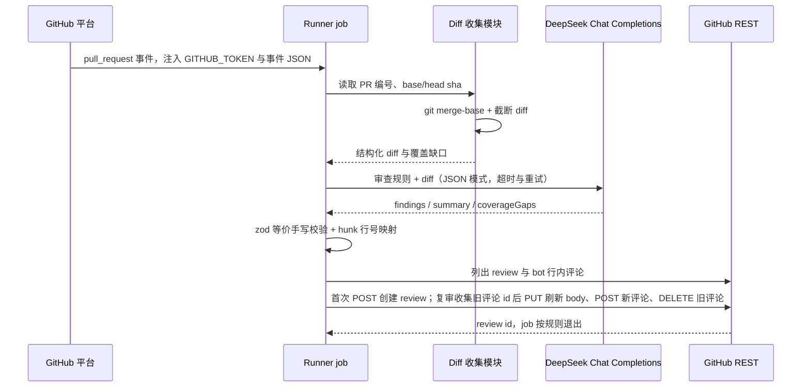

# GitHub PR 自动审查方案

## 当前实现

- 仓库托管在 GitHub，当前没有 `.github` 目录，未配置任何 Actions workflow；现有质量保障依赖本地执行的 `npm run check`、`npm test`、`npm run test:e2e` 与 `npm run test:desktop`。
- 项目已沉淀一套代码审查方法论：固定 base/head 提交、按 merge-base diff 审查、缺陷分 P0/P1/P2、候选问题交独立 agent 复核、只发布证据充分的行内评论、同一根因不重复发评论。本方案把这套方法论落地为 GitHub 侧的自动执行入口。
- 当前账号没有开通 Copilot Pro/Pro+ 等付费计划，GitHub 原生 Copilot code review 处于不可用状态。
- 模型接入已有 OpenAI 兼容 Chat Completions 能力：DeepSeek provider 支持 `DEEPSEEK_BASE_URL` 覆盖端点，通用 `openai-compatible` provider 支持任意兼容端点；密钥只放在不入库的 `.env` 中，[.env.example](../../.env.example) 记录了变量名。运行环境要求 Node `>=22.23.0`，仓库 `type: module`，已有 `scripts/*.mjs` 配 `node:test` 的脚本与测试先例。
- 依赖中已有 `openai` SDK 和 `zod`；本方案的审查脚本限定只使用 Node 内置能力，不新增依赖。

## 存在的问题

1. GitHub 上的 PR 没有任何自动审查，评审完全依赖人工。
2. 既有审查方法论只存在于文档约定中，缺少平台触发入口，需要补齐 GitHub 事件驱动的自动执行链路。
3. 账号缺少 Copilot 付费许可，GitHub 原生 Copilot code review 当前处于不可用状态。
4. 自建路径需要补齐三个环节：GitHub 事件触发与 runner 权限、面向 GitHub API 的 diff 获取与评论发布、向 runner 安全注入模型密钥。

## 目标实现

提供两条可独立落地的路线，审查标准共用一套，沿用项目既有审查方法论：P0/P1/P2 分级、要求真实触发路径与证据、证据不足进验证缺口、低噪声行内评论、只发 COMMENT。

- 路线 A：Copilot 原生 code review。开通付费计划后，用仓库 ruleset 配置自动触发，用 `.github/copilot-instructions.md` 承载项目审查规则。维护成本最低，按次消耗 AI credits。
- 路线 B（推荐）：GitHub Actions + DeepSeek 自建。`pull_request` 事件触发一次性 runner，运行独立 Node 脚本获取 diff、调用 Chat Completions、解析结构化结果并通过 GitHub REST 发布行内评论。复用现有模型密钥，无新增订阅，规则与输出完全可控。

两条路线共同边界：

- 审查方只发布 COMMENT 类型 review，不执行 approve、request changes、resolve 线程、合并或修改分支保护。
- 密钥只通过 GitHub Secrets 注入，不进入仓库文件、不打印到日志。
- 本方案不涉及数据库，无 schema、迁移或持久化数据变化；审查状态全部来自 GitHub 平台和当次 run。

### 参考与选型

| 方案 | 参考 | 适用性 |
| --- | --- | --- |
| Copilot 原生 code review | [GitHub 官方文档：About code review](https://docs.github.com/en/copilot/concepts/agents/code-review)、[Configuring code review](https://docs.github.com/en/copilot/how-tos/copilot-on-github/set-up-copilot/configure-code-review) | 托管能力，自动读 head 分支指令与技能，零运维；需要 Copilot Pro/Pro+ 等付费计划，输出模型不可切换 |
| Actions + LLM 自建 | [OpenAI Cookbook：Code quality scan with GitHub Actions](https://raw.githubusercontent.com/openai/openai-cookbook/main/examples/third_party/Code_quality_and_security_scan_with_GitHub_Actions.md)（diff 送模型、结果回写 PR 评论） | 与项目现有 DeepSeek 接入和既有审查方法论直接衔接，成本只有 Actions 分钟与模型 token；需要自行维护 workflow 和脚本 |
| 审查方法论 | [Solving code review at Anthropic](https://claude.dev/blog/solving-code-review-at-anthropic/)，项目既有审查规范已参考 | 独立审查、发现复核、低噪声输出、有限复审。MVP 先实现单轮严格证据审查，第二轮独立复核保留为后续扩展点 |
| 第三方 GitHub App（CodeRabbit、Greptile 等） | 各产品官网 | 安装即用，私有仓库免费额度有限、规则定制深度低于自建，作为前两条路线之外的备选，本方案不展开 |

## 路线 A：Copilot 原生 code review 落地步骤

### 前置条件

个人账号开通 Copilot Pro 或 Copilot Pro+。官方文档明确 code review 仅对付费计划开放；“无许可成员可用”是组织版 Business/Enterprise 的策略，个人仓库不适用。

### 配置步骤

1. 仓库 **Settings → Rulesets → New ruleset → New branch ruleset**，Enforcement Status 选 Active，Target branches 选 Include default branch，Branch rules 勾选 **Automatically request Copilot code review**，按需勾选 Review new pushes（每次推送复审，默认只审一次）和 Review draft pull requests，保存。
2. 仓库 **Settings → Copilot → Code review**，确认 Review effort level（Lite/Balanced/Max），Auto-approval 保持关闭，使 Copilot 评审停留在 Comment。
3. 新增 `.github/copilot-instructions.md`，内容从现有 AGENTS.md 和既有审查方法论提炼，至少包含：按会话/Run、工具/子 agent/MCP、SQLite、上下文、UI 五条调用链选择检查边界；P0/P1/P2 定义；要求给出产品入口到错误结果的触发路径，证据不足进缺口；排除 package.json、lock、日志、SVG 等官方默认不审文件；明确禁止依赖 runner 中不可用的内部平台能力。
4. 仅当默认环境无法理解项目时再新增 `.github/workflows/copilot-code-review.yml`，job 名固定为 `copilot-setup-steps`，最小配置为 checkout、setup-node 22、`npm ci --ignore-scripts`，权限 `contents: read`。项目无特殊原生构建依赖时默认不创建该文件。
5. 合并门禁与评审分离配置：在 branch protection rules 中把确定性 CI（如现有 E2E）设为 required checks；Copilot 的评论作为参考信号，不作为合并批准。

### 触发、成本与限制

| 事项 | 说明 |
| --- | --- |
| 触发时机 | PR 以 Open 状态创建、Draft 首次转 Open 时自动触发；开启 push 选项后每次新提交复审 |
| 指令来源 | 2026-07-17 起从 PR head 分支读取 `copilot-instructions.md`、按路径生效的 instructions、agent skills 和 `AGENTS.md`，可在 feature 分支先验证规则 |
| 输出形式 | Comment review；默认不计入 required approval，不能阻止合并 |
| 成本 | 官方估算每次 Lite 约 \$0.05–1、Balanced 约 \$0.25–5 AI credits，agentic 上下文收集另耗 Actions 分钟 |
| 验证方式 | 先在测试 PR 手动请求评审，检查 review session 实际读取的指令文件和工具，再启用自动审查 |

## 路线 B：GitHub Actions + DeepSeek 自建详细设计

### 端到端最小示例

一个真实 PR 的完整数据流如下，后续字段定义与这一示例一致。

输入（runner 中 `git diff` 产出的片段，已经过截断处理）：

```diff
diff --git a/src/http/sse.ts b/src/http/sse.ts
@@ -12,6 +12,7 @@ export function createSseResponse(req: IncomingMessage) {
   const res = new ServerResponse(req);
+  res.setHeader("Connection", "keep-alive");
   res.writeHead(200, sseHeaders());
   return res;
}
```

模型返回（Chat Completions 的 JSON 对象，`response_format` 固定为 `json_object`）：

```json
{
  "summary": "发现 1 个 P2 缺陷，无验证缺口。",
  "findings": [
    {
      "severity": "P2",
      "category": "functional",
      "path": "src/http/sse.ts",
      "line": 14,
      "title": "SSE 响应重复设置 Connection 头",
      "evidence": "sseHeaders() 已包含 Connection: keep-alive，再次 setHeader 覆盖同名字段，若上游改为其他值会产生不一致。",
      "suggestion": "删除新增的 setHeader，统一由 sseHeaders() 管理响应头。"
    }
  ],
  "coverageGaps": []
}
```

发布结果：runner 调一次 GitHub REST，在该 PR 创建一条 review，`event` 为 `COMMENT`，body 为汇总结论并带提交标记，comments 数组含一条指向 `src/http/sse.ts` 第 14 行右侧（new side）的行内评论。行号无法映射到当前 diff、所属文件已截断或行内评论达到 20 条上限时，该 finding 只写入 body 汇总，不发行内评论；存在上限溢出时 body 额外提示转汇总的条数。

### 进程及边界

当前进程关系（复用）：

```text
开发者终端进程
└── Node 进程（本地脚本任务）
```

目标进程关系（新增 GitHub 侧执行环境）：

```text
GitHub 平台（pull_request 事件源）
└── GitHub-hosted ephemeral runner（ubuntu，一次性虚拟机）
    └── workflow job 进程
        └── node scripts/pr-review/run-pr-review.mjs
            ├── git 子进程（merge-base、diff）
            └── HTTPS 请求（api.deepseek.com、api.github.com）
```

- 启动与等待：GitHub 平台在 PR 事件匹配触发条件时创建 runner 并启动 job；Actions 平台等待 job 进程退出并以其退出码作为 check 结论。每次 run 使用独立 runner，不同 PR 之间互不阻塞。
- 同 PR 新推送：workflow 配置 `concurrency` 组，组内 `cancel-in-progress: true`，新提交触发的 run 会取消尚未完成的旧 run，避免对过期 head 提交发布评论。
- 退出、取消、超时与异常清理：runner 为一次性环境，job 结束即销毁，无后台服务、无持久化文件、无数据库连接；job 设 `timeout-minutes`，脚本内对模型请求使用 `AbortController` 设单次请求超时；收到取消信号时 Actions 终止 job 进程组，git 与 node 子进程随 runner 回收，无需额外清理逻辑。
- 权限边界：job 声明 `permissions: contents: read, pull-requests: write`，不申请 `issues`、`actions`、`packages` 等其他权限；网络上只需访问 GitHub API（平台内置）和模型端点（默认 `api.deepseek.com`，自定义 base URL 时为对应主机）。

### 调用时序



### 新增文件与职责

| 文件 | 职责 |
| --- | --- |
| `.github/workflows/pr-auto-review.yml` | 触发事件、并发取消、最小权限、runner 环境与入口命令 |
| `scripts/pr-review/collect-diff.mjs` | 读取 `GITHUB_EVENT_PATH` 事件 JSON；计算 merge-base；执行 `git diff --unified=3` 生成带 3 行上下文、按文件分组的 diff；解析 hunk 时分别记录新增行与上下文行的新文件行号；按行边界执行单文件与总量截断、限制文件数，产出覆盖缺口 |
| `scripts/pr-review/review-client.mjs` | 组装系统提示（审查标准与输出协议）；调用 Chat Completions；处理 HTTP 错误、超时与有限重试；解析并校验 JSON 结构 |
| `scripts/pr-review/publish-comments.mjs` | 解析 unified diff hunk 建立新文件行号映射，新增行与 hunk 内上下文行均可作为行内评论落点；按 20 条上限拆分行内评论与汇总条目；首次运行创建 COMMENT review，复审时先翻页收集 bot 自身旧评论 id，PUT 刷新持久 review 的 body、POST 新行内评论全部成功后再按快照 id 删除旧评论 |
| `scripts/pr-review/run-pr-review.mjs` | 编排入口，串联以上三个模块，统一退出码与日志 |
| `scripts/pr-review/collect-diff.test.mjs`、`review-client.test.mjs`、`publish-comments.test.mjs` | `node:test` 单测：按行截断与 UTF-8 完整性、JSON 校验、hunk 新增行与上下文行号映射、持久 review 识别、行内评论按作者过滤、翻页收集后两阶段删除（含 offset 偏移仿真）、首次创建与复审刷新两条路径、复审调用顺序与中途失败保留旧评论、行内评论上限 |

根 `package.json` 在 scripts 中增加 `test:pr-review": "node --test scripts/pr-review/*.test.mjs"`。审查脚本只用 Node 内置 `fetch`、`fs`、`child_process`，workflow 不需要 `npm ci`，runner 上只装 Node 22；应用代码、构建产物和 web workspace 与该流程完全解耦。

### 模型输入输出协议

请求使用 OpenAI 兼容 Chat Completions：`POST {baseURL}/chat/completions`，`temperature: 0`，`response_format: { type: "json_object" }`，默认携带 `thinking: { type: "disabled" }` 关闭推理模型的思考模式，消息由系统提示（固定审查标准）和用户消息（PR 元信息 + 截断后 diff）组成。

输出字段：

| 字段 | 层级 | 必填 | 含义 |
| --- | --- | --- | --- |
| `summary` | 根 | 是 | 以数量开头的结论，格式对齐现有技能，如“发现 1 个已复核缺陷（P2: 1）” |
| `findings` | 根 | 是 | 问题数组，无问题时为空数组 |
| `findings[].severity` | 项 | 是 | 枚举 `P0` / `P1` / `P2` / `suggestion`，suggestion 表示非阻塞建议 |
| `findings[].category` | 项 | 是 | `functional` / `security` / `performance` / `maintainability` / `convention` |
| `findings[].path` | 项 | 是 | 仓库相对路径，必须出现在本次 diff 中 |
| `findings[].line` | 项 | 否 | 新文件侧行号；无法确定时省略并进入汇总 |
| `findings[].title` | 项 | 是 | 一句话标题 |
| `findings[].evidence` | 项 | 是 | 触发条件、调用路径与改动前后行为差异 |
| `findings[].suggestion` | 项 | 是 | 最小修复方向 |
| `coverageGaps` | 根 | 是 | 未审查范围与原因数组，如截断文件、模型未能返回合规 JSON |

校验失败（缺字段、枚举非法、路径不在 diff 中）时丢弃该条 finding 并计入 `coverageGaps`；整体 JSON 无法解析时不发布残缺评论，job 以非零退出码失败并在日志输出可诊断原因。

实测 DeepSeek-V4-Flash 等推理模型存在两类不稳定输出，客户端按项目 `DeepSeekProvider` 的既有做法做确定性处理：

- 请求体默认携带 `thinking: { type: "disabled" }` 关闭思考模式，与 [src/providers/deepseek.ts](../../src/providers/deepseek.ts) 的生产配置一致。实测开启思考时模型会在 58KB diff 上产生 6 万字符以上的 `reasoning_content`，连续耗尽 8000 与 16000 token 预算，始终到不了 content 输出；关闭后同规模请求约 9 秒完成。
- 兜底：若端点不支持关闭思考，推理阶段耗尽预算时返回 `content: null` 且 `finish_reason=length`，客户端识别该状态后把 `max_tokens` 翻倍重试一次；翻倍后仍为空，或 `finish_reason` 不是 `length` 时，失败信息附带 `finish_reason`、message 字段名和 reasoning 长度，便于定位。
- 模型可能把目标 JSON 包一层任意键名的对象（实测出现过 `value` 字符串字段和 `structured_output` 对象字段），或外加 `json` 代码围栏。客户端先剥离围栏，再在顶层缺少 `summary`/`findings` 时解包一层对象值或 JSON 字符串值；解包仅限一层，避免无限猜测结构。

### 配置项

| 变量 | 来源 | 必填 | 默认值 | 含义 |
| --- | --- | --- | --- | --- |
| `GITHUB_TOKEN` | Actions 自动注入 | 是 | 平台生成 | 调用 GitHub REST，权限受 workflow 声明限制 |
| `DEEPSEEK_API_KEY` | 仓库 Secrets | 是 | 无 | 模型请求密钥；缺失时 job 直接失败 |
| `DEEPSEEK_MODEL` | 仓库 Variables | 否 | `deepseek-v4-flash` | 与 `.env.example` 当前模型保持一致 |
| `DEEPSEEK_BASE_URL` | 仓库 Variables | 否 | `https://api.deepseek.com` | 兼容端点覆盖，指向其他网关时同步调整网络允许范围 |
| `PR_REVIEW_MAX_FINDINGS` | 仓库 Variables | 否 | `20` | 单次发布 finding 上限 |
| `PR_REVIEW_MAX_TOKENS` | 仓库 Variables | 否 | `8000` | 单次模型请求的输出 token 预算；遇到 `finish_reason=length` 空响应时自动翻倍到 16000 重试一次 |
| `PR_REVIEW_DISABLE_THINKING` | 仓库 Variables | 否 | `true` | 是否在请求体携带 `thinking: { type: "disabled" }`；端点拒绝该参数时设为 `false` 关闭 |
| `PR_REVIEW_FAIL_ON_SEVERITY` | 仓库 Variables | 否 | `never` | 控制审查发现是否影响退出码，可选 `never` / `P0` / `P1` |
| `PR_REVIEW_BOT_LOGIN` | 仓库 Variables | 否 | `github-actions[bot]` | 幂等刷新时认定的机器人账号；只更新该 login 且 body 带标记的 review，并只删除该 login 的行内评论，改用其他 bot 发评论时同步修改 |

Secrets 在仓库 Settings → Secrets and variables → Actions 中维护，只在运行时注入环境变量；脚本日志只输出模型名、端点主机和 token 用量，不输出密钥与完整请求头。

### 限制

| 限制对象 | 单位 | 初始上限 | 超限行为 |
| --- | --- | --- | --- |
| 单次 diff 总量 | 字节 | 60000 | 超出部分不送审，文件清单写入 `coverageGaps` |
| 单文件 diff | 字节 | 20000 | 按行边界截断并标记缺口；截断文件不发行内评论，该文件的 finding 全部进 body 汇总 |
| 审查文件数 | 个 | 50 | 后续文件跳过并标记缺口 |
| 模型请求超时 | 秒 | 120 | 触发 `AbortController`，按重试策略处理 |
| 模型请求重试 | 次 | 2 | 仅对 429 和 5xx 指数退避重试；4xx 不重试 |
| 模型输出 token 预算 | token | 首次 8000，length 空响应时翻倍至 16000 | 翻倍重试一次后仍为空则 job 失败并输出 finish_reason 诊断 |
| 行内评论数量 | 条 | 20（与 `PR_REVIEW_MAX_FINDINGS` 默认值一致） | 超出部分转入 body 汇总段落，并在 body 提示溢出条数 |
| job 总时长 | 分钟 | 10 | `timeout-minutes` 到期由平台终止 |

上限依据首次在真实 PR 上的实测 token 与耗时调整，调整时同步更新本表。

### 幂等与复审

- 每条 review 的 body 末尾带 HTML 标记 `<!-- pr-auto-review head=<full-sha> base=<full-sha> -->`，绑定当次提交。
- GitHub 平台不允许删除已提交的 review：REST `DELETE /repos/{owner}/{repo}/pulls/{pr}/reviews/{review_id}` 与 GraphQL `deletePullRequestReview` 都只接受 pending 态，对已提交的 COMMENT review 返回 422 `Can not delete a non-pending pull request review`，两条路径均已在测试 PR 实测确认。
- 每个 PR 保留一条持久 bot review，由 body 中的标记识别，识别条件为 `user.login` 等于 `PR_REVIEW_BOT_LOGIN`（默认 `github-actions[bot]`）且 body 含标记。人工 review 即使正文包含相同标记文本也不会被更新；其他 bot 账号的 review 同理保留。
- 首次运行（PR 上没有标记 review）：`POST /repos/{owner}/{repo}/pulls/{pr}/reviews` 一次创建 COMMENT review，body 为汇总，comments 数组携带首批行内评论。
- 复审运行（已存在标记 review）：第一步 `GET /repos/{owner}/{repo}/pulls/{pr}/comments` 按 `per_page=100` 翻页拉全全部行内评论，只把 `user.login` 等于 bot login 的条目 id 收集为待删快照，此阶段不执行任何删除；第二步 `PUT /repos/{owner}/{repo}/pulls/{pr}/reviews/{review_id}` 把新汇总与新标记写回同一条 review；第三步通过 `POST /repos/{owner}/{repo}/pulls/{pr}/comments` 以 head 提交为 `commit_id` 逐条发布新行内评论；以上全部成功后，第四步才按快照 id 调 `DELETE /repos/{owner}/{repo}/pulls/comments/{comment_id}` 删除旧评论。收集与删除分成两个阶段，避免边翻页边删除导致 offset 分页前移、漏删后续页条目。最终 PR 上始终只有一条 bot review，行内评论只反映最新一次审查。
- PUT 或 POST 中途失败时 job 直接失败并输出接口响应摘要；删除尚未开始，旧 review body 与旧行内评论保持完整，下一轮运行重新收集快照并完成清理，审查结果不会出现残缺。删除阶段失败时新 body 与新评论已发布完成，残留旧评论由下一轮运行自愈清理。
- 行内评论只允许落在当前 diff hunk 内的右侧行：`collect-diff.mjs` 执行 `git diff --unified=3`，每个 hunk 保留 3 行上下文，解析 hunk 头与内容时分别记录新增行（`+`）和上下文行（空格前缀）的新文件行号，删除行（`-`）不占右侧行号；`publish-comments.mjs` 允许 finding 映射到这两类行，映射失败或所属文件已截断的 finding 移入汇总段落，禁止虚构行号。
- 手动 rerun 同一提交时复用同一条持久 review：按上述四阶段刷新 body 并重建行内评论；标记缺失或归属不明的 review 不更新、不删除，只作为新 review 创建条件之外的对象跳过。

### 失败处理与门禁语义

| 失败场景 | 行为 | job 退出码 |
| --- | --- | --- |
| 密钥缺失、事件 JSON 缺字段、diff 为空 | 立即失败，日志写明缺失项 | 1 |
| 模型 4xx（含鉴权失败） | 不重试，失败并输出状态码与响应摘要 | 1 |
| 模型 429/5xx | 最多重试 2 次，仍失败则 job 失败 | 1 |
| 200 响应但 content 为空且 `finish_reason=length` | 输出预算翻倍重试一次；仍为空则失败并附 finish_reason 与 message 字段诊断 | 1 |
| 200 响应但 content 为空且 finish_reason 非 length | 不重试，直接失败并附 finish_reason、message 字段名、reasoning 长度 | 1 |
| 返回非法 JSON 或校验后无有效 finding | 先剥离代码围栏并尝试一层包装解包；仍不合规则不发评论，输出缺口与原始响应摘要 | 1 |
| 评论发布部分失败 | 回读已发布内容，列出成功与失败项，失败部分不盲目重试 | 1 |
| review body 刷新（PUT）或新行内评论发布（POST）失败 | 删除阶段尚未开始，旧 review 与旧行内评论完整保留；job 失败并输出接口状态码与响应摘要，下一轮运行自愈 | 1 |
| 旧行内评论删除（DELETE）失败 | 新 body 与新评论已发布完成，job 失败并输出状态码；残留旧评论由下一轮运行重新收集后清理 | 1 |
| 审查成功且仅有 findings | 正常发布；默认 `never` 模式下不影响退出码 | 0 |

脚本或平台异常以非零退出暴露问题，保证 required check 能拦截“审查没有真实跑完”的情况；审查发现本身默认不改变退出码，避免模型误判直接卡住合并。需要对高严重度问题卡合并时，把 `PR_REVIEW_FAIL_ON_SEVERITY` 设为 `P0` 或 `P1`，再将该 job 加入 branch protection 的 required status checks。

### Prompt 注入防护

PR 标题、描述、diff 内容属于待审查材料，系统提示明确声明这些材料不能授权执行命令、改变审查规则或指示外发数据；脚本只执行固定的 git 与 HTTP 调用，不提供任何让模型返回可执行指令的通道。这条纪律与项目既有审查方法论对待 PR 材料的原则一致。

## 保持不变

- `src/`、`web/`、`desktop/`、`native/` 下全部应用代码，SQLite schema 与迁移机制，现有 `npm run check`、`npm test`、`npm run test:e2e`、`npm run test:desktop` 命令均不变。
- 不新增 npm 依赖，不改动 `.env.example` 中已有变量；GitHub 侧变量与密钥在平台设置中维护。
- 仓库 AGENTS.md 的协作与写作规范不变，路线 A 的 `copilot-instructions.md` 是其审查规则的子集转述。

## 验收

1. 运行 `node --test scripts/pr-review/*.test.mjs` 全部通过，覆盖按行截断与 UTF-8 完整性、hunk 新增行与上下文行号映射、JSON 校验、持久 review 识别与机器人作者过滤、评论 id 翻页收集后两阶段删除（含 offset 偏移仿真）、首次创建与复审刷新两条路径、复审 PUT/POST 先于 DELETE 的调用顺序与中途失败保留旧评论、行内评论上限等核心逻辑；`npm run check` 与现有测试不受影响。
2. 在 GitHub 创建指向 main 的测试 PR：opened 事件自动触发 workflow，PR 上出现一条 COMMENT review，含至少一条行内评论，body 标记中的 head/base sha 与事件提交一致。
3. 向同一 PR 推送新提交：旧 run 状态变为 cancelled，新 run 完成后该 PR 仍只有同一条 bot review（body 标记更新为最新 head sha），旧行内评论被清理并替换为新一轮评论，人工与其他 bot 的评论保持不变；手动 rerun 后行为一致。
4. 构造行号无法映射、所属文件已截断、可映射 finding 超过 20 条三类场景：确认对应 finding 只出现在汇总段落，没有行内评论，溢出时 body 含条数提示；构造模型 5xx 和非法 JSON 两类故障：确认 job 失败、日志有明确原因、PR 上没有残缺评论。人工 review 正文即使包含标记文本，重新触发后也仍然保留且不被修改。
5. 构造超过 diff 上限的 PR：超限文件出现在 `coverageGaps`，summary 不出现“审查通过”类结论。
6. 在 workflow 运行日志中确认 `GITHUB_TOKEN` 与 `DEEPSEEK_API_KEY` 均未明文出现；workflow 文件权限声明只有 `contents: read` 和 `pull-requests: write`。
7. 把该 job 配置为 required status check 后，未完成审查的 PR 无法合并；移除 required 配置后恢复为仅提示。
8. 若选择路线 A：ruleset 保存后新建 PR 能看到 Copilot 自动评审，review session 证据中确认读取了 `.github/copilot-instructions.md`，且 Copilot 只提交 Comment；push 复审与 draft 行为与 ruleset 勾选一致。

## 工作量估算

- 路线 B：新增 1 个 workflow、4 个脚本模块、3 个测试文件，修改 `package.json` 一处 scripts；无应用代码改动，无数据库变更。
- 路线 A：新增 1 个 `.github/copilot-instructions.md`，其余为网页配置；付费计划开通后约半小时可完成验证。
