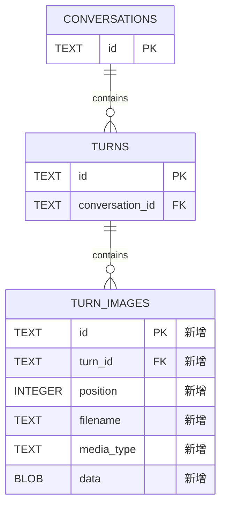

# 图片附件技术方案

状态为待评审。产品范围和交互见[图片附件需求](./2026-11-23-image-attachments-product-spec.md)。

## 当前实现

| 环节 | 当前行为 |
| --- | --- |
| 输入与发送 | Web 与 macOS 桌面端共用 `ConversationComposer`。普通发送调用 `POST /v1/agent/conversations/:id/runs:stream`，请求为 JSON，`input` 必须为非空文本。运行中的插话调用独立端点。 |
| 创建与恢复 | `ConversationRunService.startRun` 生成 Run ID。`beginRun` 在同一个 SQLite 事务里创建轮次、Run、开场用户消息，并设置会话的 `active_run_id`。事务提交后 SSE 响应返回 `X-Run-Id`，已有 ID 的客户端可以订阅回放或重新读取会话详情。 |
| 历史与模型 | 会话轮次保存 `user_message` 文本，转录中的用户消息保存 `content` 文本。上下文构建器基于转录估算用量、压缩历史，再由 OpenAI adapter 将用户消息填入 Responses API 的 `input`。 |

[输入框](../../web/src/components/ConversationComposer.tsx) · [启动路由](../../src/http/conversation-run-sse-route.ts) · [运行服务](../../src/application/conversation-run-service.ts) · [SQLite 会话存储](../../src/infrastructure/sqlite/sqlite-conversation-store.ts) · [模型转换](../../src/providers/openai.ts)

## 存在的问题

- 启动接口的 JSON 请求体上限为 64 KiB，转录和模型 adapter 均只承载文字。
- 响应头到达前断网时，客户端还没有 Run ID。此时服务端可能已经落库，重新发起一轮可能重复提交。
- 图文历史需要长期保留原图。模型调用和会话详情各自只需要选中的图片字节或展示元数据。

## 目标实现

用户选择一张 PNG 并输入「图中短码是什么？」。浏览器用当前会话的启动接口提交同一条图文消息。服务端验证图片并保存原图，SSE 返回这次 Run 的 ID，模型收到文字与图片。重新打开会话时，详情 JSON 返回图片元数据，界面按需请求图片原文。

以下是仅发图的最小请求。示例图片是有效的 1×1 PNG。响应头中的 `X-Run-Id` 等于请求中的 `runId`。

```json
{
  "input": "",
  "runId": "cd6ac31f-ec46-4d6e-90e6-cbf7349ce41a",
  "images": [{
    "name": "pixel.png",
    "data": "iVBORw0KGgoAAAANSUhEUgAAAAEAAAABCAIAAACQd1PeAAAADElEQVR4nGP4//8/AAX+Av4N70a4AAAAAElFTkSuQmCC"
  }]
}
```

### 选型

- 复用启动接口，发送时一次提交有界的 JSON 和 Base64，省去预上传、临时附件状态和超时清理。在现有 SQLite 事务中保存二进制，消息与附件同进同退，删除沿用外键级联。Codex 将文字和图片作为同一轮的结构化输入，并在模型请求边界使用图片项。Westie 采用相同的消息边界，原图字节由本地会话库持有。 [Codex 输入协议](https://github.com/openai/codex/blob/main/codex-rs/protocol/src/user_input.rs) · [Codex 请求映射](https://github.com/openai/codex/blob/main/codex-rs/protocol/src/models.rs)
- 首个支持组合为 `LLM_PROVIDER=openai` 和 `OPENAI_MODEL=gpt-5.2`，同时接受固定版本 `gpt-5.2-2025-12-11`。沿用 Responses API，在 adapter 内生成 `input_image` 和 Base64 data URL，使用 `detail: "high"`。其他模型及兼容 Provider 的图片能力默认关闭。 [GPT-5.2 模型](https://developers.openai.com/api/docs/models/gpt-5.2) · [OpenAI 图片输入](https://developers.openai.com/api/docs/guides/images-vision)

### 数据流

当前调用关系：

```text
Web / Electron 渲染页面 ── 文本 POST、SSE、详情 ── Node HTTP 服务
                                                    ├─ 读写 SQLite 文本历史
                                                    ├─ 文本请求 → 已配置的 Provider
                                                    └─ 执行工具 → 现有工具权限和沙箱边界
```

目标调用关系：

```text
Web / Electron 渲染页面 ── 图文 POST、图片 GET ───── Node HTTP 服务
                       ── SSE、详情（复用）────────┤
                                                    ├─ SQLite：增加原图及轮次关联
                                                    ├─ OpenAI Responses：增加图片输入项
                                                    └─ 执行工具 → 复用现有工具权限和沙箱边界
```

沿用现有进程与部署方式。Node 在接受消息前等待图片校验，异步解码不阻塞其他请求的事件循环。图片保存在会话数据库，读取由会话 HTTP 路由控制。工具和沙箱不获得额外路径或存储访问能力。

## 具体改动

### 请求、校验与能力

以 `/v1/agent/conversations/:id` 为接口路径前缀。

| 接口 | 变更 | 数据 |
| --- | --- | --- |
| `POST /runs:stream` | 扩展现有 JSON 和 SSE 接口 | 保留 `X-Run-Id`；新增图文请求字段见下表。 |
| `GET` 会话详情（前缀本身） | 扩展现有 JSON | 增加布尔值 `supportsImageInput`；有图片的轮次增加 `images: [{id, name, mediaType}]`，按选择顺序返回。 |
| `GET /images/:imageId` | 新增 | 以会话 ID 和图片 ID 查询归属，响应原始字节，`Content-Type` 使用校验后的 MIME，设置 `Content-Length`、`Cache-Control: no-store` 和 `X-Content-Type-Options: nosniff`。会话或归属不符返回 404。 |
| `GET /runs/:runId/events` | 复用 | 继续处理实时追踪、回放及 snapshot 续传。 |

| 请求字段 | 来源 | 必填与默认 |
| --- | --- | --- |
| `input` | 输入框文本，服务端 trim 后使用 | 必填。仅当有图时允许空字符串。 |
| `images` | 文件选择器中保留的图片，数组顺序即展示顺序 | 可省略。出现时数组至少一项。 |
| `images[].name` | 浏览器提交的文件名，只用于展示 | 有图时必填。以普通文字渲染。 |
| `images[].data` | 原始文件的标准 Base64 字符串 | 有图时必填。服务端从解码后的字节判断类型。 |
| `runId` | Web 为本次图文提交生成的 UUID v4。同一次提交的重试沿用该值。 | 有图时必填。纯文本请求沿用服务端生成 ID。 |
| `maxSteps` | 现有调用方选填 | 沿用现有默认和校验。 |

| 限制对象 | 单位 | 上限 | 超限处理 |
| --- | --- | --- | --- |
| 每条消息的图片数 | 张 | 4 | 前端跳过多余图片，服务端返回 422。 |
| 单张原始图片 | MiB | 5 | 前端跳过超限文件，服务端返回 422。 |
| 单张解码尺寸 | 像素 | 16,777,216 总像素 | 前端预览时检查，服务端拒绝并说明原因。 |
| 图片文件名 | 字符 | 255 | 返回 422 并指出对应文件。 |
| 启动请求的图文 JSON | MiB | 27 | 边读边计数，超过上限返回 413。4 张最大图片的 Base64 合计约 26.67 MiB。 |
| 图文请求的非图片 JSON | KiB | 64 | 移除图片数组和客户端 Run ID 后按序列化大小计算，超过上限返回 413。 |
| 纯文本及其他路由的 JSON | KiB | 64 | 沿用现有 413 处理。 |

`runs:stream` 单独使用扩展读取上限，其他路由继续用现有默认值。启动路由在扩大读体和解码前执行现有会话和 Origin 访问检查。对纯文本 body 仍用原始请求体字节数执行旧限制。Base64 按字符集、填充和预估解码大小先做校验；解码结果经 PNG/JPEG 文件签名过滤，再逐张用 `sharp` 限制像素并实际解码，保留原始字节。解码失败和格式不符都返回 422，响应提供失败图片的数组下标及原因。桌面后端依赖沿用现有生产依赖打包流程，在打包验收中验证原生模块可加载。 [sharp 解码选项](https://sharp.pixelplumbing.com/api-constructor/) · [sharp 安装](https://sharp.pixelplumbing.com/install/) · [桌面运行时装配](../../scripts/prepare-desktop.mjs)

由运行时根据实际 Provider 和模型得出 `supportsImageInput`，重试包装层透传。会话详情和启动服务读取同一值，服务端无能力时返回 422 `IMAGE_INPUT_UNSUPPORTED`。图片读取路由沿用会话可信 Origin 和现有 Run 访问条件，归档会话可读取图片。浏览器用同源请求展示图片，开发代理沿用现有 API 转发。

### 提交与恢复

1. Web 保存本次提交的原样快照及 `runId`，提交期间禁用重复发送。服务器在校验与解码完成后检查连接状态，随后在现有事务中创建轮次、Run、开场消息和全部附件。已接受的标志是事务提交，SSE 响应头在提交后返回。
2. 以 `runs.id` 主键实现幂等。在 `beginRun` 事务中先查该 ID，已归属于当前会话时返回 409 `RUN_ALREADY_ACCEPTED`，新请求继续检查会话忙碌与归档状态。路由在解码前也可查询已接受的 ID，减少重复解码；事务内检查仍保留。其他会话占用同一 ID 时拒绝请求且不返回其详情。同一 ID 代表同一次提交，前端用原样快照重试。
3. 收到 `X-Run-Id` 或 `RUN_ALREADY_ACCEPTED` 后清空对应草稿。SSE 中断或重复提交恢复时，复用 `/events` 续传。返回 410 时读取会话详情，使用数据库中的轮次与终态渲染。服务端重启后的中断运行沿用现有启动恢复。
4. 响应头前中断时，用客户端生成的 ID 查询 `/events`。若暂时查不到，保留原样快照并允许使用同一 ID 重试。404 只表示查询时尚无记录，旧请求与重试即使并发也只能提交一次。明确被拒绝的请求恢复可编辑的图文草稿。已接受后的模型失败、停止或客户端断线保留原图。
5. 发送中使用当前草稿缩略图作为本地展示。落库后通过会话详情替换为基于图片 ID 的展示，按 Run ID 合并轮次。刷新和切回会话读取持久化历史。切换会话清空未提交草稿，已发起的请求结果按原会话归属处理。创建的预览 object URL 在移除图片、替换或卸载时释放。

### 数据库迁移

当前 `turn_images` 表不存在，物理列为 0。目标表有 6 个物理列，完整 DDL 如下。现有 `turns` 有 8 列，保持 `id`、`conversation_id`、`position`、`user_message`、`opening_seq`、`status`、`created_at`、`updated_at`。现有 `transcript_messages` 有 5 列，保持 `conversation_id`、`seq`、`run_id`、`role`、`message_json`。去重使用现有 `runs.id` 主键。

```sql
CREATE TABLE turn_images (
  id TEXT NOT NULL PRIMARY KEY,
  turn_id TEXT NOT NULL REFERENCES turns(id) ON DELETE CASCADE,
  position INTEGER NOT NULL CHECK (position BETWEEN 0 AND 3),
  filename TEXT NOT NULL CHECK (length(filename) BETWEEN 1 AND 255),
  media_type TEXT NOT NULL CHECK (media_type IN ('image/jpeg', 'image/png')),
  data BLOB NOT NULL CHECK (length(data) BETWEEN 1 AND 5242880),
  UNIQUE (turn_id, position)
) STRICT;
```

| 新列 | 类型 | 语义 |
| --- | --- | --- |
| `id` | TEXT | 服务端生成的图片 UUID。 |
| `turn_id` | TEXT | 归属轮次。 |
| `position` | INTEGER | 从 0 开始的选择顺序。 |
| `filename` | TEXT | 用户文件的显示名。 |
| `media_type` | TEXT | 服务端识别的 MIME。 |
| `data` | BLOB | 完整原始字节。 |

主键为 `id`。外键 `turn_id → turns.id` 级联删除。CHECK 限定顺序范围、文件名长度、MIME 和原始大小。UNIQUE 限定一个轮次内每个顺序只能出现一次，其自动索引用于按轮次读取，无需额外索引。数据库依靠现有 `turns.conversation_id → conversations.id` 级联清理会话图片。



图中父表只展示关系涉及的列。迁移从 6 升至 7，现有库通过 `migrations.ts` 在事务内执行上述 DDL 并更新 `PRAGMA user_version`。新库直接建为 7。存量轮次无图片行，文本与转录原样读取。v6 代码按已有高版本保护拒绝打开 v7 库。 [迁移驱动](../../src/infrastructure/sqlite/migrations.ts) · [建库定义](../../src/infrastructure/sqlite/schema.ts)

有图的开场转录保存为 `{"role":"user","content":"","imageIds":["8a91e469-6bea-41fc-9801-864868e0200c"]}`。`imageIds` 是有序图片 UUID 数组，由仓储在事务中生成。SQLite 继续校验 `message_json` 是合法 JSON 对象且角色一致，应用 schema 校验 `imageIds` 和开场消息的写入条件。`turns.user_message` 继续保存普通文本，仅发图时保存空串。详情查询按会话批量读取各轮附件元数据，图片 GET 通过 `turn_images → turns` 检查归属。列表、会话 JSON、SSE、转录及诊断输出只携带文字或元数据；原图从独立图片响应和模型请求传输。

### 模型调用与上下文

- 只在开场用户消息上写 `imageIds`。上下文构建器保留投影中未被压缩或裁剪的图片引用，在最后的投影确定后按会话批量读取所需字节。`createProviderRequest` 将投影和可选的按 ID 索引的内存图片映射传给 adapter。图片找不到时显式结束该 Run 并报告读取失败。 [请求组装](../../src/agent-provider-turn.ts) · [上下文构建](../../src/application/context-builder.ts)
- OpenAI adapter 将有图消息转换为内容数组，有文字时追加 `input_text`，再依选择顺序追加 `input_image`；仅发图只包含图片项。纯文本仍用字符串。能力关闭时，普通纯文本 Run 仍可继续，旧历史中的图片在投影中替换为文本占位，界面仍可查看原图。
- 文本预算沿用现有算法。活跃投影中的每张图片按 7,373 输入 token 保守估算（GPT-5.2 的 6,144 patch 上限 × 1.2，向上取整）。触发压缩时沿用现有轮次保护，摘要只传文字历史和图片数量占位。每次模型请求最多保留 20 MiB 原图，预算阶段按元数据中的字节长度从最新轮次向前保留连续的完整图片组，超出时从最旧轮次裁去图片并留占位。本轮图片优先保留，本轮仍超过 token 预算时沿用现有上下文超限错误。裁剪仅作用于本次模型投影，图片历史不变。现有模型 usage 继续记录实际 token。 [OpenAI 图像计量](https://developers.openai.com/api/docs/guides/images-vision#calculating-costs)
- 模型请求体积估算另外计入图片的 Base64 字节数。请求错误输出提供状态和错误类别，避免写入图像编码或 SDK 请求体。

### 关键接入片段

以下两处是审阅片段，展示当前启动校验和转录映射的扩展位置。涉及的存储写入、恢复和投影步骤按上文接入。

`src/http/conversation-run-sse-route.ts` 中扩展图文请求。

```diff
 const runRequestSchema = z.strictObject({
-  input: z.string().trim().min(1),
+  input: z.string().trim(),
+  runId: z.uuidv4().optional(),
+  images: z.array(imageRequestSchema).min(1).max(4).optional(),
   maxSteps: z.number().int().positive().max(512).optional(),
-});
+}).refine(({ input, runId, images }) =>
+  images === undefined ? input.length > 0 && runId === undefined : runId !== undefined
+);
```

`src/infrastructure/sqlite/sqlite-conversation-store.ts` 中在开场序列化处保留有序引用，`imageIds` 来自同一事务插入的图片行。

```diff
           "$messageJson": serializeTranscriptMessage({
             role: "user",
             content: input,
+            ...(imageIds.length === 0 ? {} : { imageIds }),
           }),
```

## 保持不变

纯文本 Web、CLI、飞书、steering 和子 Agent 继续走原有文字入口。SSE 事件类型、停止运行和回放协议沿用现有行为。归档保留历史，删除沿用会话级联。工具执行与项目工作区权限不变。

## 验收

| 层级 | 待执行检查 |
| --- | --- |
| 迁移与事务 | 用含已有会话的 v6 副本做迁移、对照 v7 新库。核对旧会话与用量，验证 v6 代码拒绝打开 v7。模拟附件写入失败，确认轮次、Run、转录及附件全部回滚。删除会话后附件 GET 返回 404。 |
| 请求与恢复 | 覆盖纯图、图文、旧文本 JSON、64 KiB 旧限制、27 MiB 图文限制、伪装或损坏图片、像素和张数超限、能力关闭、跨会话读取和归档读取。模拟提交前丢包、提交后 SSE 响应头丢失、并发重试和服务器重启。每个 Run ID 对应最多一个轮次，确认前草稿可恢复。 |
| 模型与上下文 | Stub 捕获 Responses 请求，校验内容项、顺序、图片原字节和纯文本映射。实时调用 GPT-5.2 识别测试图随机短码并做纯文本追问。覆盖历史压缩、按体积裁剪、能力关闭后继续文本会话和实际 usage。 |
| Web 和桌面 | 在两端验证多选、移除、仅发图、运行中插话、提交失败、刷新与归档查看。打包 macOS 桌面版，验证自带后端可解码 JPEG 和 PNG。 |
